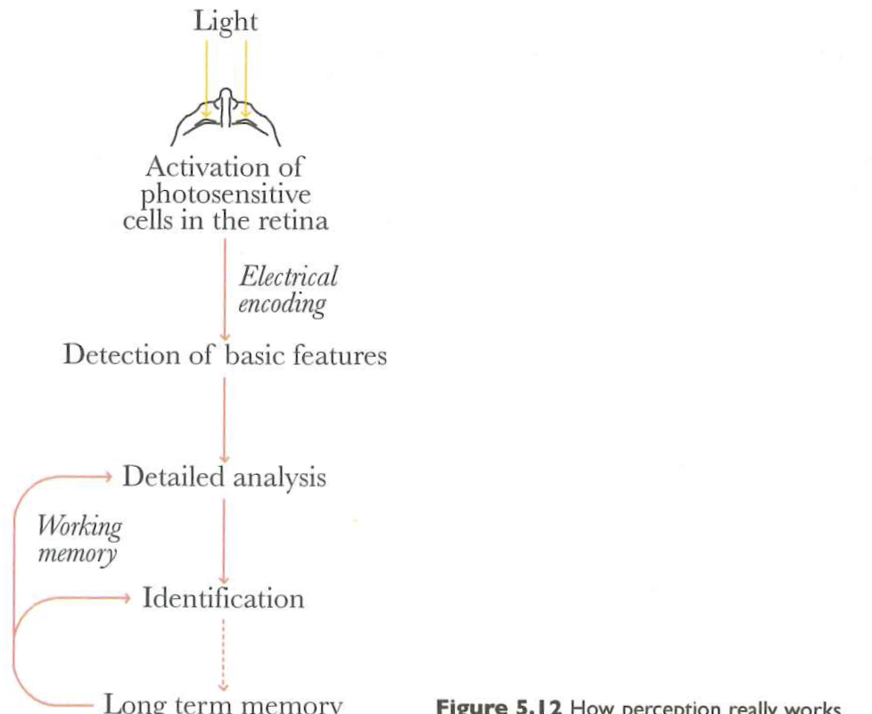
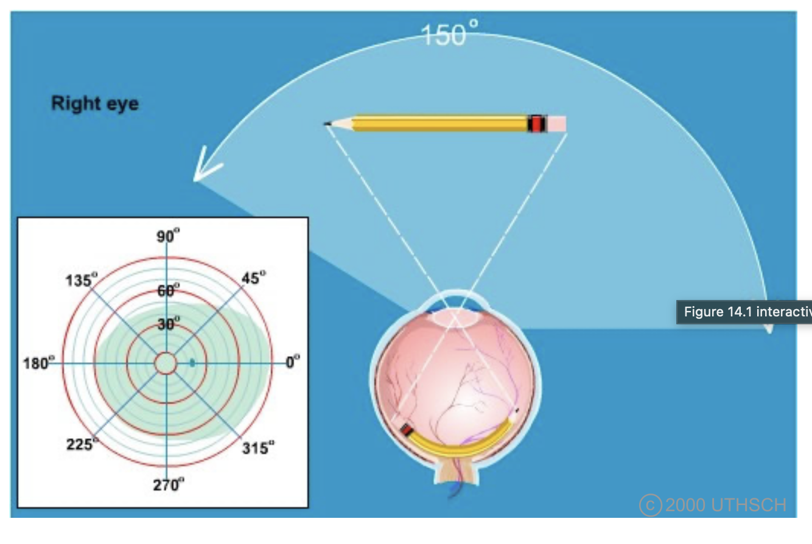
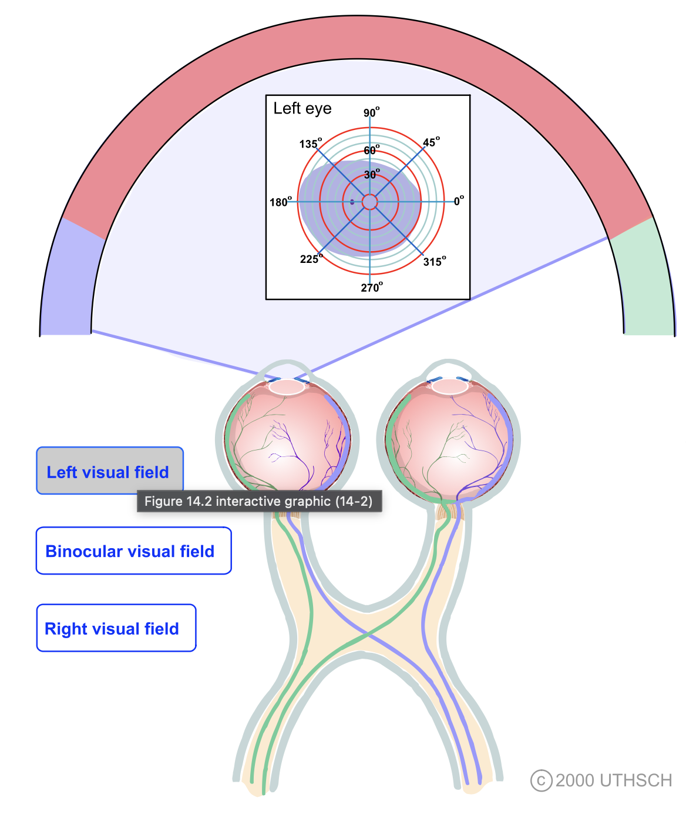
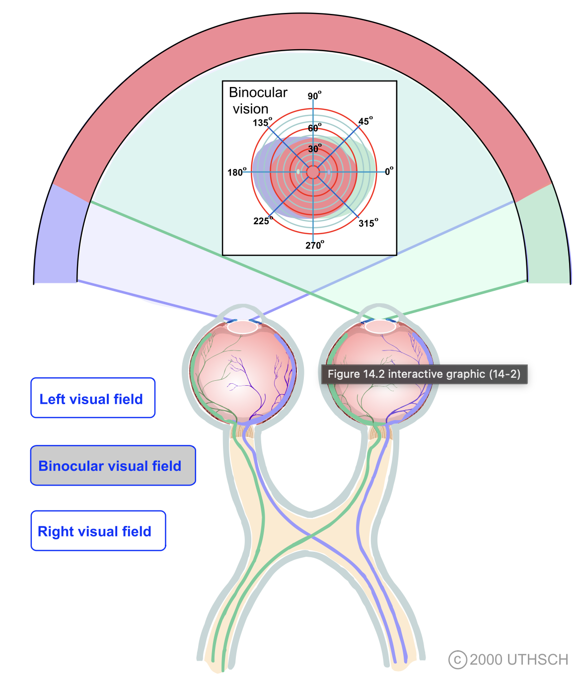
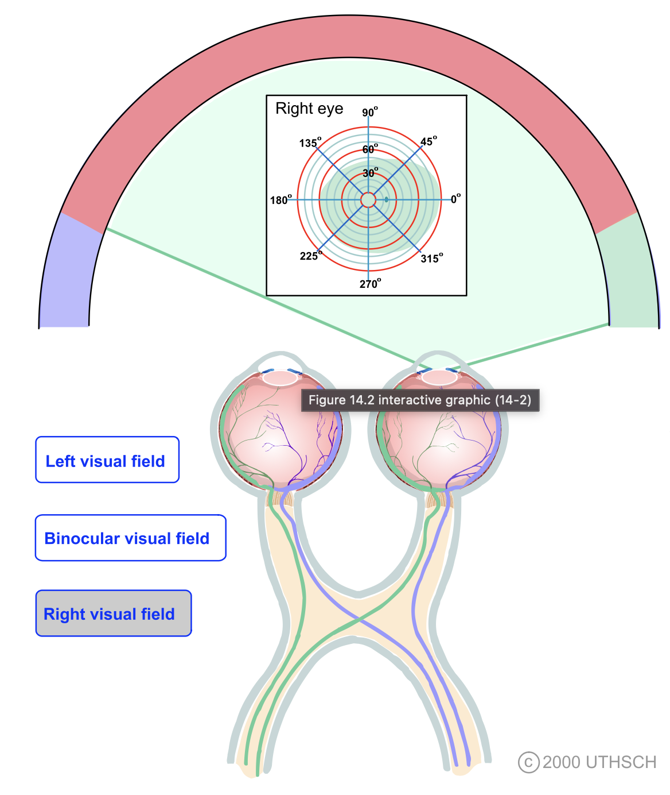

# Preliminaries

## Prelude

::: {#fig-i-can-see-clearly}

<iframe width="1280" height="450" src="https://www.youtube.com/embed/MrHxhQPOO2c?si=dB96BSnyWF0A-OUw" title="YouTube video player" frameborder="0" allow="accelerometer; autoplay; clipboard-write; encrypted-media; gyroscope; picture-in-picture; web-share" referrerpolicy="strict-origin-when-cross-origin" allowfullscreen></iframe>

@JimmyCliffVEVO2014-hs
:::

## Announcements

- *Quiz 3* this Friday, November 6, 2026.

## Today's topics

- Warm-up
- What is vision for?
- Information in light
- The eye

# Warm-up

---

### Across the lifespan, who sleeps the most?

- A. Young infants
- B. School-age children
- C. Older adults
- D. Teenagers

---

### Across the lifespan, who sleeps the most?

- **A. Young infants**
- ~~B. School-age children~~
- ~~C. Older adults~~
- ~~D. Teenagers~~

---

### The function of dreams has been well-established, true or false?

- A. True
- B. False

---

### The function of dreams has been well-established, true or false?

- ~~A. True~~
- **B. False**

---

### Caffeine acts as an ____ for the neurotransmitter ____.

- A. agonist; histamine
- B. antagonist; melatonin
- C. agonist; hypocretin/orexin
- D. antagonist; adenosine

---

### Caffeine acts as an ____ for the neurotransmitter ____.

- ~~A. agonist; histamine~~
- ~~B. antagonist; melatonin~~
- ~~C. agonist; hypocretin/orexin~~
- **D. antagonist; adenosine**

# What is vision for?

## Information at a distance

{#fig-web-deep-field width="70%"}

## Where is it/am I?

:::: {.columns}

::: {.column width=50%}
- Azimuth (left/right)
- Elevation (up/down)
- Distance (near/far)
- Orientation
:::

::: {.column width=50%}
![Wikipedia^[By TWCarlson - Azimut altitude.svg, CC BY-SA 3.0, https://commons.wikimedia.org/w/index.php?curid=17727911]](https://thumb.wikimedia.org/wikipedia/commons/thumb/f/f7/Azimuth-Altitude_schematic.svg/1920px-Azimuth-Altitude_schematic.svg.png?utm_source=en.wikipedia.org&utm_campaign=imageinfo&utm_content=thumbnail)
:::

::::

## What is it?

::: {.incremental}
- Edges $\rightarrow$
- Surfaces $\rightarrow$
- Objects or entities
:::

## When is it?

- Day/night
- Time of year

# Information in light

---

{#fig-cairo-5.12 width="65%"}

## Electromagnetic spectrum

{#fig-em-spectrum-wikipedia width="75%"}

## Surfaces reflect/absorb or emit

{#fig-surface-reflection width="60%"}

## Different surfaces == Different reflection/absorption

:::: {.columns}
::: {.column width=50%}
- Perceived color differences correspond to different patterns of light reflection.

:::
::: {.column width=50%}
{#fig-randeberg-2005}
:::
::::

## Artificial sources

::: {#fig-how-displays-work}

<iframe width="1280" height="450" src="https://www.youtube.com/embed/ipIPzRh6DQY?si=8mTWeTaXexMdnhSh" title="YouTube video player" frameborder="0" allow="accelerometer; autoplay; clipboard-write; encrypted-media; gyroscope; picture-in-picture; web-share" referrerpolicy="strict-origin-when-cross-origin" allowfullscreen></iframe>

@Tech2023-km
:::

## Spatial patterns on retina

:::: {.columns}
::: {.column width=50%}
- Depend on object geometry and orientation
- Same angle on retina $\rightarrow$ different angle in world
- Need more info to determine unambiguously many object properties 
:::
::: {.column width=50%}
{#fig-retinal-projection}

{#fig-same-projection-angle}
:::
::::

# Detecting information in light

## What information?

- Position
- Length
- Area
- Color
- Texture
- (Motion)

## The eye

{fig-align="center" #fig-the-eye}

## is like an auto-focus, auto-exposure camera...

:::: {.columns}
::: {.column width=50%}

:::
::: {.column width=50%}

:::
::::

## part of a self-stabilizing system...

::: {#fig-falcon-dance}

<iframe width="1280" height="450" src="https://www.youtube.com/embed/JGArTWOJtXs?si=j7wG2MmdYepTmTMU" title="YouTube video player" frameborder="0" allow="accelerometer; autoplay; clipboard-write; encrypted-media; gyroscope; picture-in-picture; web-share" referrerpolicy="strict-origin-when-cross-origin" allowfullscreen></iframe>

@Bucalo2015-qm
:::

## Eye + head + body system

::: {.callout-note}
- Eye + head + body movements *align and point* the eyes
- Eye + head + body movements *stabilize* the eyes
  - When the observer moves
  - When objects move
:::

## Parts of the eye

:::: {.columns}
::: {.column width=50%}
- *Cornea* - refraction (2/3 of total)
- *Pupil* - light intensity; diameter regulated by the *Iris*.
- *Lens* - modifiable refraction (remaining 1/3; variable focus)
:::
::: {.column width=50%}
{fig-align="center"}
:::
::::

## Parts of the eye

:::: {.columns}
::: {.column width=50%}
- *Retina* - light detection
- *Pigment epithelium* - regenerate photopigment
- *Muscles* - move eye, reshape lens, change pupil diameter
:::
::: {.column width=50%}
{fig-align="center"}
:::
::::

---

---

---

## Eye forms image on retina

:::: {.columns}
::: {.column width=50%}
- Image inverted (up/down)
- Image reversed (left/right)
- Point-to-point map (*retinotopic*)
:::
::: {.column width=50%}

:::
::::

## Eye forms image on retina

:::: {.columns}
::: {.column width=50%}
- Binocular and monocular zones
:::
::: {.column width=50%}
{width="85%"}
:::
::::

## Eye forms image on retina

:::: {.columns}
::: {.column width=50%}
- Binocular and monocular zones
:::
::: {.column width=50%}
{width="85%"}
:::
::::

## Eye forms image on retina

:::: {.columns}
::: {.column width=50%}
- Binocular and monocular zones
:::
::: {.column width=50%}
{width="85%"}
:::
::::

## The retina...

:::: {.columns}
::: {.column width=50%}
- samples spatial patterns of light intensity & wavelength
:::
::: {.column width=50%}
{fig-align="center" #fig-the-retina}
:::
::::

## 'Wavelength-tuned' photoreceptors

![Wikipedia^[By BenRG - Own work, Public Domain, https://commons.wikimedia.org/w/index.php?curid=7873848]](https://thumb.wikimedia.org/wikipedia/commons/thumb/0/04/Cone-fundamentals-with-srgb-spectrum.svg/3840px-Cone-fundamentals-with-srgb-spectrum.svg.png?utm_source=en.wikipedia.org&utm_campaign=imageinfo&utm_content=thumbnail){#fig-cone-photoreceptors width="60%"}

# Wrap-up

## Main points

- Vision is the sensory system that detects patterns at a distance based on wavelengths of light that are reflected off surfaces or emitted by sources
- The eye is similar to a high-resolution camera with photoreceptive cells (rods & cones) that capture light within specific wavelength bands
- Photoreceptors are distributed non-uniformly across the retina

## Main points

- The eye + eye muscles are an integrated system that work together to point the high resolution fovea at important targets

## Next time

- From retina to brain

# Resources


