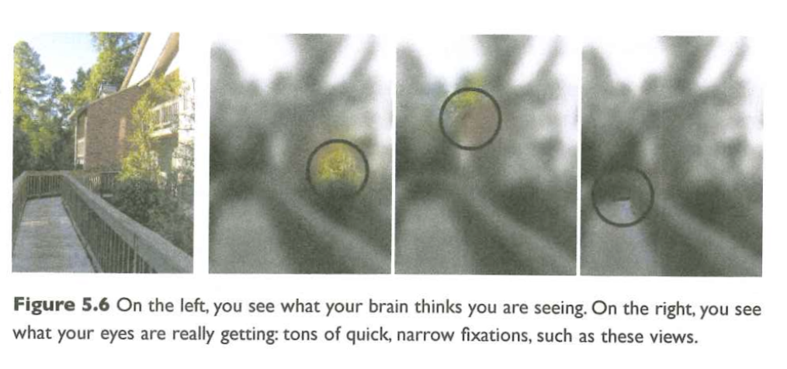
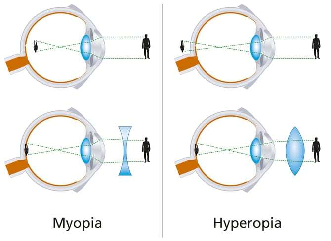
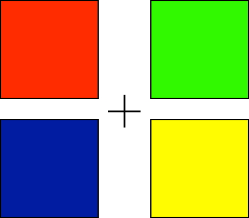
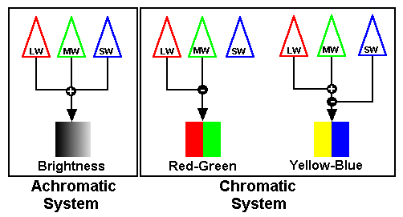

# Preliminaries

## Announcement

- Quiz 3 this Friday.

## Today's topics

- Warm-up
- The retina

# Warm-up

---

### The image of visual patterns projecting onto the retina is:

- A. Inside out and rotated.
- B. Upside down and left/right reversed.
- C. Unrecognizably distorted by the cornea and lens.
- D. Larger in one eye than the other.

---

### The image of visual patterns projecting onto the retina is:

- A. ~~Inside out and rotated.~~
- B. **Upside down and left/right reversed.**
- C. ~~Unrecognizably distorted by the cornea and lens.~~
- D. ~~Larger in one eye than the other.~~

---

### Visual information allows the perceiver to extract information about all of the following properties, EXCEPT:

- A. Object position (where is it?)
- B. Object density (mass/volume)
- C. Object type/identity (what is it?)
- D. Time (of day/year)

---

### Visual information allows the perceiver to extract information about all of the following properties, EXCEPT:

- A. Object position (where is it?)
- B. **Object density (mass/volume)**
- C. Object type/identity (what is it?)
- D. Time (of day/year)

# The retina

---

{#fig-rods-cones}

## How photoreceptors work

:::: {.columns}
::: {.column width=50%}
- Outer segment
    + Membrane disks
    + *Photopigments*
        - Sense light, trigger chemical cascade
:::
::: {.column width=50%}

:::
::::
    
## How photoreceptors work

:::: {.columns}
::: {.column width=50%}
- Inner segment
    + Synaptic terminal
- Light *hyperpolarizes* photoreceptor!
    + The *dark current*
- *Less* light $\rightarrow$ more NT (glutamate)!
:::
::: {.column width=50%}

:::
::::
    
## Retina

- Physiologically *backwards*
    + How?
- Anatomically *inside-out*
    + How?
    
## Retina

- Physiologically *backwards*
    + Dark current (more NT released in dark than light)
- Anatomically *inside-out*
    + Photoreceptors at back of eye

---

### Photoreceptors are arranged in mosaics

{#fig-cone-rod-mosaics}

---

### with different concentrations in different parts of the retina

{#fig-book-bionumbers}

## Photoreceptor distribution

- Retinal periphery
  - Mostly rods
- Retinal center/fovea 
  - Mostly cones
  - ~1-2 deg of visual angle
  
---

{#fig-visual-field-approx width="65%"}

## Consequences

- Must move eyes (or eyes/head or eyes/head/body) to position fovea on target
- Keep track of sequence of eye movements and positions over time
- Integrate sequence of samples over time

---

## Retinal information processing

:::: {.columns}

::: {.column width=50%}

- Separate channels for
  - Achromatic (black/gray/white) info
    - Mostly rods
  - Chromatic
    - Mostly cones
    - Short, medium, long wavelength types

:::
::: {.column width=50%}

- Pixels/photoreceptor analogy
  - ~120 M rods + ~ 5 M cones (125 M) 
  - vs. professional cameras with 100 M pixels

:::
::::

## Retinal information processing

- Point by point, topographic (map-like) 2D image of 3D world
- Non-uniform resolution (center >> periphery)
- yields focused image except...

---

### ...when eye misshapen for cornea+lens

{#fig-myopia-hyperopia width="65%"}

## Color perception

:::: {.columns}
::: {.column width=50%}
- Perceived color a function of activity in "R", "G", and "B" photoreceptors
:::
::: {.column width=50%}
{#fig-color-perception}
:::
::::

## Wavelengths are continuous, but are perceived colors?

## Color vision anomalies

:::: {.columns}
::: {.column width=50%}
- Absence of or anomalies in photoreceptors
:::
::: {.column width=50%}
{#fig-ishihara width="55%"}
:::
::::

## Types

:::: {.columns}
::: {.column width=40%}
- Protanopia (impaired R/long wavelength)
- Deuteranopia (impaired G/medium wavelength)
- Tritanopia (impaired B/short wavelength)
:::
::: {.column width=60%}
{#fig-color-vision-anomolies}
:::
::::

---

### Color is a *psychological* construct, not a physical property!

## What's a reddish-green look like?

{fig-align="center"}

## What's a reddish-green look like?

## Explanation

{#fig-color-opponency fig-align="center"}

## Opponent processing

- Black vs. white (achromatic)
- Long (red) vs. Medium (green) wavelength cones
- (Long + Medium) vs. Short (blue) cones
- Can't really see reddish-green or bluish-yellow

## Color opponency

:::: {.columns}
::: {.column width=50%}
- Sensitivity curves for medium and long wavelength cones overlap
- Color opponency "pushes" signals apart
:::
::: {.column width=50%}

:::
::::

# Wrap-up

## Next time

- Quiz 3; review answers to Exam 2

# Resources


