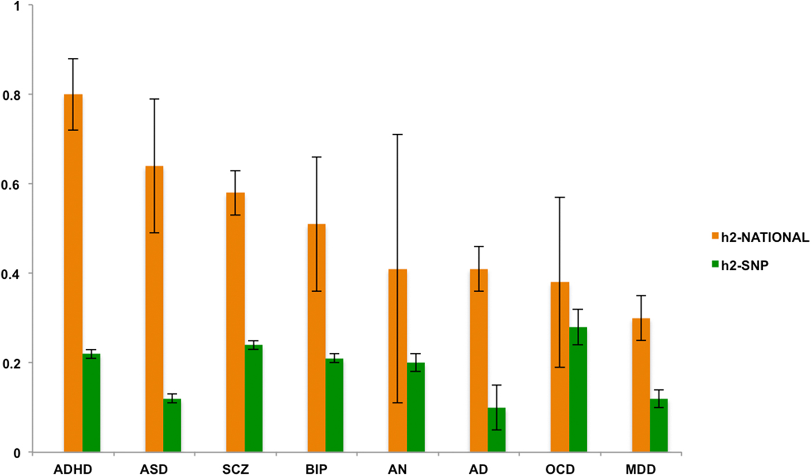
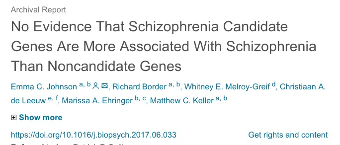
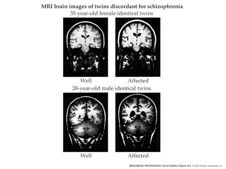
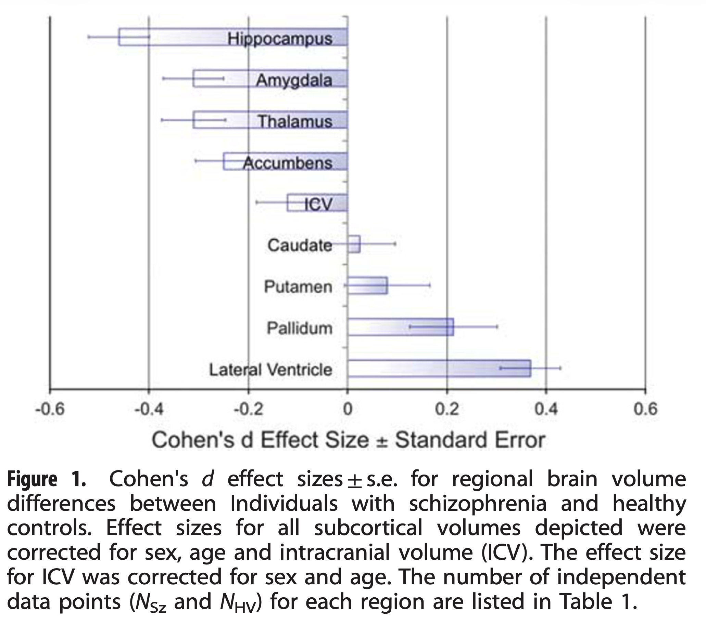
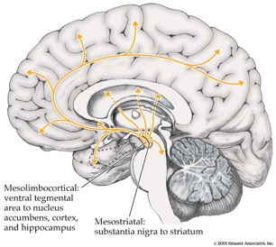
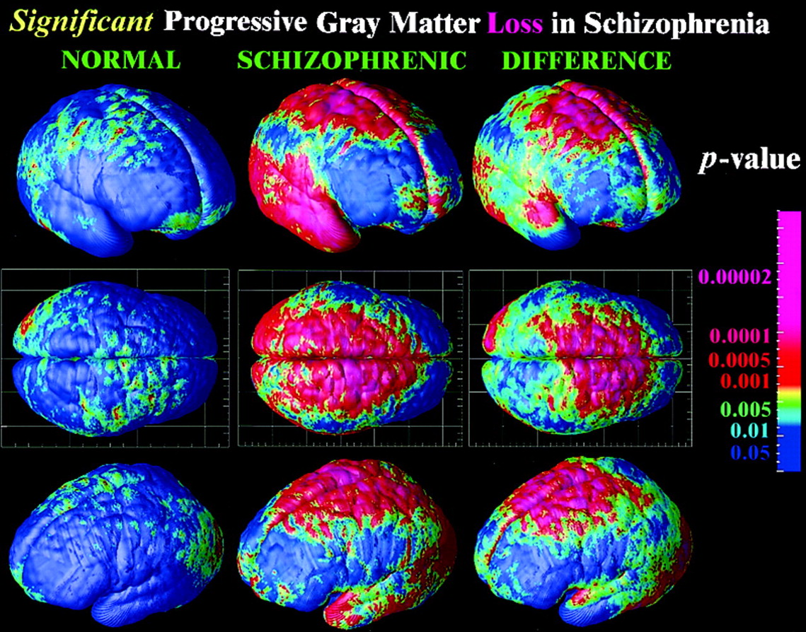

# Prelude

## Announcement

- Exam 2 on [Wednesday, October 21, 2026](../schedule.qmd#wed-oct-26)

## Today's topics

- Warm-up
- Schizophrenia

# Warm-up

---

### The fast-acting effect of ketamine on MDD undermines the monoamine hypothesis of depression because...

::: {.incremental}
- A. Drugs that upregulate monoamines take weeks to work.
- B. Ketamine affects glutamate-binding NMDA receptors.
- C. SSRIs are selective for norepinephrine.
- D. Both A. and B.
:::

---

### The fast-acting effect of ketamine on MDD undermines the monoamine hypothesis of depression because...

- A. Drugs that upregulate monoamines take weeks to work.
- B. Ketamine affects glutamate-binding NMDA receptors.
- ~~C. SSRIs are selective for norepinephrine.~~
- **D. Both A. and B.**

---

### Bipolar disorder is linked to disruption in ______ neurotransmitter system.

- A. the serotonin (5-HT)...
- B. the dopamine (DA)...
- C. the GABA...
- D. no specific or single...

---

### Bipolar disorder is linked to disruption in ______ neurotransmitter system.

- ~~A. the serotonin (5-HT)...~~
- ~~B. the dopamine (DA)...~~
- ~~C. the GABA...~~
- **D. no specific or single**

# Schizophrenia (SCZ)

---

::: {#fig-schiz-gerald}
<iframe width="1280" height="450" src="https://www.youtube.com/embed/gGnl8dqEoPQ?si=8lfhhI06Z7KZhlgj" title="YouTube video player" frameborder="0" allow="accelerometer; autoplay; clipboard-write; encrypted-media; gyroscope; picture-in-picture; web-share" referrerpolicy="strict-origin-when-cross-origin" allowfullscreen></iframe>

-- @Neuroslicer2007-ev
:::

## Background on SCZ

- Lifetime prevalence ~ 0.3-0.7%
    - Broader definitions suggest 2-3 or 3-5%
- ~1/3 chronic & severe
- Onset post-puberty, early adulthood

## Background on SCZ

- Males: Earlier onset & greater severity
- Pervasive disturbance in mood, thinking, movement, action, memory, perception
- Increased (early) mortality

---

:::: {.columns}
::: {.column width=50%}
### "Positive" symptoms

- “Additions” to behavior
- Disordered thought
- Delusions of grandeur, persecution
- Hallucinations (usually auditory)
- Bizarre behavior
:::
::: {.column width=50%}
### "Negative" symptoms

- “Reductions” in behavior
- Poverty of speech
- Flat affect
- Social withdrawal
- Anhedonia (loss of pleasure)
- Catatonia (reduced movement)
:::
::::

## Cognitive symptoms

- Memory
- Attention
- Planning, decision-making
- Social cognition
- Movement

## Affective symptoms

:::: {.columns}
::: {.column width=50%}
- Depressive, manic states
:::
::: {.column width=50%}

:::
::::

## Biological bases

- Genetic predisposition
- Brain abnormalities
- Neurochemical factors
- Developmental origins

## Genetic predisposition

- Heritability >50%

{#fig-pettersson-2019 width="65%"}

## Genetic risk

:::: {.columns}
::: {.column width=50%}
- But, no single gene...[@Johnson2017-bp]
:::
::: {.column width=50%}

:::
::::

## Brain structure

:::: {.columns}
::: {.column width=50%}
- Ventricles larger, esp in males
:::
::: {.column width=50%}

:::
::::

## 

![@Suddath1990-nn Figure 2^["MRI Coronal Views from Two Sets of Monozygotic Twins Discordant for Schizophrenia Showing Subtle Enlargement of the Lateral Ventricles in the Affected Twins (Panels B and D) as Compared with the Unaffected Twins (Panels A and C), Even When the Affected Twin Had Small Ventricles."]](../include/img/suddath-1990-fig-02.jpg){#fig-suddath-1990-fig-02 width="55%"}

## Ventricle size

:::: {.columns}
::: {.column width=50%}
- Increases across time
- Especially in the more impaired
:::
::: {.column width=50%}
{#fig-davis-1998-fig-02}
:::
::::

---

:::: {.columns}
::: {.column width=50%}

:::
::: {.column width=50%}

:::
::::

## Brain structure

:::: {.columns}
::: {.column width=50%}
- Hippocampus, amygdala, thalamus, nucleus accumbens (NAc; ventral striatum) smaller
- Related to ventricular enlargement?
- Early disturbance in brain development?
:::
::: {.column width=50%}
{#fig-van-erp-2015-fig-01}
:::
::::

## White matter disruption {.scrollable}

## White matter loss over age

![@Kochunov2016-cu Figure 2^["Mega-analytic analysis of the effects of diagnosis (DX) and DX by age interaction. The non-linear aging trends in FA values are regressed in each cohort separately, thus producing linear trends of patient–control differences in aging."]](../include/img/kochunov-2016-fig-02.jpg){#fig-kochunov-2016-fig-02 width="65%"}

## Disruptions heterogenous

>Compared to the healthy comparison group, the **schizophrenia group showed widespread reductions in FA and CT, involving virtually all white matter tracts** and cortical regions. Paradoxically, however, no more than 15–20% of patients deviated from the normative range for any single tract or region...Thus, while infra-normal deviations were common among patients, their **anatomical loci were highly inconsistent between individuals**. 

-- @Lv2021-hu

<!-- ## Disconnectivity in cortical networks -->

<!--  -->

<!-- - But connectivity findings inconsistent [@Fornito2015-go](https://dx.doi.org/10.1016/j.conb.2014.08.006) -->
<!-- - **Reduced structural** connectivity vs. -->
<!--     - Synaptic, dendritic, axonal connections b/w regions -->
<!--     - Usually measured via DTI or related diffusion-based MRI technique -->
<!-- - **Increased functional** connectivity -->
<!--     - BOLD, EEG, or MEG covariance -->
<!--     - Task-free 'resting' state or task-based -->

<!-- ![@Fornito2015-go. Figure 1. De-coupling of network structure and function in schizophrenia. (a) Shows an example of a brain-wide map of structural connectivity deficits in patients with schizophrenia, highlighting a relatively diffuse impairment that particularly affects fronto-posterior anatomical connectivity. In this whole-brain analysis, no increases of structural connectivity were found. Letters denote different regions (see below for key). (b) Illustrates frontal regions showing decreased and increased functional connectivity with seed regions in the dorsal (top) and ventral (bottom) caudate nucleus, respectively, in patients with schizophrenia (yellow, blue) and their unaffected, first-degree relatives (magenta, green). Thus, despite a fairly global impairment of structural connectivity (depicted in (a)), systems-specific increases in functional connectivity can be observed (b). (c,d) Brain-wide alterations of structural (c) and functional (d) connectivity in the same sample of patients with schizophrenia. Blue and green depict links where anatomical and functional connectivity, respectively, were reduced in patients; red depicts links where functional connectivity was increased in the patient group. (a) reproduced from [24•], (b) from [18•], and (c,d) from [23••] with permission. Regional abbreviations in (a) are as follow: A. Left Superior Frontal, B. Right Superior Frontal, C. Left Supplementary Motor Area, D. Left Superior Medial Frontal, E. Right Supplementary Motor Area, F. Right Superior Medial Frontal, G. Right Superior Parietal, H. Right Superior Occipital, I. Left Cuneus, J. Left Superior Occipital, K. Left Precuneus, L. Right Precuneus, M. Left Middle Temporal, N. Left Middle Occipital, O. Left Inferior Temporal, P. Left Fusiform, Q. Right Cuneus, R. Left Hippocampus, S. Left Middle Cingulum.](https://ars.els-cdn.com/content/image/1-s2.0-S0959438814001688-gr1.jpg) -->

<!-- - Global signal (cortical gray matter BOLD signal CGm) variations? -->

<!-- ![@Yang2014-oq. Fig 1. Power and variance of CGm signal in SCZ and BD. (A) Power of CGm signal in 90 SCZ patients (red) relative to 90 HCS (black) (see SI Appendix, Table S1 for demographics). (B) Mean power across all frequencies before and after GSR indicating an increase in SCZ [F(1, 178) = 7.42, P < 0.01], and attenuation by GSR [F(1, 178) = 5.37, P < 0.025]. (C) CGm variance also showed increases in SCZ [F(1, 178) = 7.25, P < 0.01] and GSR-induced reduction in SCZ [F(1, 178) = 5.25, P < 0.025]. (D–F) Independent SCZ sample (see SI Appendix, Table S2 for demographics), confirming increased CGm power [F(1, 143) = 9.2, P < 0.01] and variance [F(1, 143) = 9.25, P < 0.01] effects, but also the attenuating impact of GSR on power [F(1, 143) = 7.75, P < 0.01] and variance [F(1, 143) = 8.1, P < 0.01]. (G–I) Results for BD patients (n = 73) relative to matched HCS (see SI Appendix, Table S3 for demographics) did not reveal GSR effects observed in SCZ samples [F(1, 127) = 2.89, P = 0.092, n.s.] and no evidence for increase in CGm power or variance. All effects remained when examining all gray matter voxels (SI Appendix, Fig. S1). Error bars mark ± 1 SEM. ***P < 0.001 level of significance. n.s., not significant.](https://www.pnas.org/cms/10.1073/pnas.1405289111/asset/6ca17e78-6e95-4fb2-a2b7-5087738893c1/assets/graphic/pnas.1405289111fig01.jpeg) -->

<!-- ![@Yang2014-oq. Fig 2. Relationship between SCZ symptoms and CGm BOLD signal power. We extracted average CGm power for each patient with available symptom ratings (n = 153). (A) Significant positive relationship between CGm power and symptom ratings in SCZ (r = 0.18, P < 0.03), verified using Spearman’s ρ given somewhat nonnormally distributed data (ρ = 0.2, P < 0.015). (B and C) Results held across SCZ samples, increasing confidence in the effect (i.e., joint probability of independent effects P < 0.002, marked in blue boxes). All identified relationships held when examining Gm variance (SI Appendix, Fig. S4). Notably, all effects were no longer significant after GSR, suggesting GS carries clinically meaningful information. The shaded area marks the 95% confidence interval around the best-fit line.](https://www.pnas.org/cms/10.1073/pnas.1405289111/asset/f0650bcc-676c-46fb-8570-3daaf921bf79/assets/graphic/pnas.1405289111fig02.jpeg) -->

<!-- - Disconnectivity b/w 'hubs' -> higher functional connectivity overall -->

<!--  -->

<!-- ## Comparing neural measures -->

<!-- ![Figure 2 from @Porter2023-qt. Sensitivity and specificity scores were derived using data from the classifier in each manuscript. All manuscripts were able to reliably differentiate participants with psychosis from healthy controls independent of neuroimaging type aside from [169]. The size of points is scaled according to sample size and modality of analysis is shown in various colors.](https://media.springernature.com/full/springer-static/image/art%3A10.1038%2Fs41380-023-02195-9/MediaObjects/41380_2023_2195_Fig2_HTML.png?as=webp) -->

<!-- --- -->

<!--  -->

<!-- ![Figure 5 from @Porter2023-qt. Colors represent different imaging modalities; estimated summary receiver operating curves are shown overlaid for each of the imaging modalities with respective confidence interval regions surrounding mean sensitivity and specificity values. No significant differences were found for classification of internal datasets . When external datasets were used for classification, rs-FC studies (red) have a significant advantage in classification relative to T1 studies (blue).](https://media.springernature.com/full/springer-static/image/art%3A10.1038%2Fs41380-023-02195-9/MediaObjects/41380_2023_2195_Fig5_HTML.png?as=webp) -->

<!-- >Interestingly, at present most modalities perform similarly in the classification of psychosis, with slight advantages for rs-FC relative to structural modalities in some specific cases. Notably, results differed substantially across studies, with suggestions of biased effect sizes, particularly highlighting the need for more studies using external prediction and large sample sizes. @Porter2023-qt -->

## Neurochemical factors

- Dopamine (DA) hypothesis
- Glutamate (Glu) hypothesis

## Dopamine (DA) hypothesis

:::: {.columns}
::: {.column width=50%}
- Excessive DA: Manic or psychotic states
- Recall two midbrain DA pathways
  - Substantia nigra -> striatum
  - Ventral tegmental area -> limbic system & cerebral cortex
:::
::: {.column width=50%}
{fig-align="center"}
:::
::::

## Evidence for...

- DA ($D_2$ receptor) antagonists (e.g. chlorpromazine)
    + improve positive symptoms
- *Typical antipsychotics* are DA $D_2$ receptor antagonists
- DA agonists (amphetamine, cocaine, L-DOPA)
  + mimic or exacerbate symptoms
    
## Evidence against...

- New, *atypical antipsychotics* 
    + (e.g. Clozapine) **increase** DA in frontal cortex, affect 5-HT
- Mixed evidence for high DA metabolite levels in CSF
- Some DA neurons may release 5-HT, cannabinoids, glutamate [@Seutin2005-wx]

## Glutamate hypothesis

- *Psychomimetic* drugs 
  + Phencyclidine (PCP)
  + Ketamine
- Can induce schizophrenia-like states

## Ketamine

:::: {.columns}
::: {.column width=50%}
- dissociative (secondary) anesthetic
- side effects
  - hallucinations, blurred vision, delirium, floating sensations, vivid dreams
:::
::: {.column width=50%}
{#fig-sleigh-2014-fig-01}
:::
::::

## Ketamine

:::: {.columns}
::: {.column width=50%}
- Primarily a glutamate NMDA receptor (NMDA-R) antagonist[^1]
- Affects other systems [@Sleigh2014-xp]
- Potential fast-acting, short-duration treatment for MDD
:::
::: {.column width=50%}

:::
::::

[^1]: Blocks an open ion channel [@Sleigh2014-xp; @Zhang2021-nn].

## Glutamate hypothesis

- Schizophrenia $\rightarrow$ *underactivation* of NMDA receptors?
  - Note: NMDA-R role in learning, plasticity
- NMDA-R antagonists $\rightarrow$ neurodegeneration, excitotoxicity, & apoptosis (programmed cell death)

---

>The data show that the disorder **(SCZ) is characterized by lower levels of glutamate, GABA and dopamine in the frontal cortex**, and potentially other cortical regions; higher levels of glutamate in the basal ganglia and thalamus; and greater dopamine synthesis and release capacity in the basal ganglia relative to healthy individuals. Moreover, connections among some of these alterations indicate a key role for fronto-thalamo-striatal–midbrain circuits in the pathophysiology of the disorder. 

--- @Howes2023-vk

## Developmental origins

- Gray matter loss in adolescence
- Early life stress

## Developmental origins

:::: {.columns}
::: {.column width=50%}
- Rapid gray matter loss in adolescents in adolescents with early onset SCZ
:::
::: {.column width=50%}

:::
::::

## Early life stressors

- 2x greater risk in urban vs. rural environments [@Vassos2012-ja]
- Higher risk among migrant populations [@Cantor-Graae2005-ej]
- Exposure to infection *in utero* [@Brown2010-et]
- Birth complications [@Forte2024-hl]

## Early life stress

- @levine_transgenerational_2016
  - Children (N=51,233) of parents who born during Nazi era (1922-1945)
  - Emigrated before (indirect exposure) or after (direct exposure) Nazi era
  - Children exposed to direct stress *in utero* or postnatally
      + Did **not** differ in rates of schizophrenia, but
      + Had higher re-hospitalization rates
      
## Early life stress

- Danish cohort (*n*=1,141,447), @debost_investigating_2015
  - Exposure to early life stress 
    + *in utero* did **not** increase risk of schizophrenia, but
    + stress during 0-2 years increased risk
  - Increased risk associated with cortisol-related gene

## Novel approaches

- Virtual Reality Assisted therapy [@Bisso2020-nq; @Dellazizzo2021-tk]
- Deep Neural Network used to identify functional brain signatures in a genetic disorder ([DiGeorge syndrome](https://www.mayoclinic.org/diseases-conditions/digeorge-syndrome/symptoms-causes/syc-20353543); 22q11.2 deletion syndrome) linked to psychotic symptoms [@Supekar2024-rq]

# Wrap up

## Main points: SCZ

- DA hypothesis of SCZ $\rightarrow$ glutamate hypothesis

## Main points: SCZ

- Wide-ranging disturbance of mood, thought, action, perception
- Broad changes in brain structure^[area size; connectivity], function, chemistry, development
- (Simplistic) dopamine hypothesis giving way to signalling network (DA + Glu + GABA) models
- Genetic (polygenic = multiple genes) risk + environmental factors

---

![@Howes2023-vk Figure 4^["Summary of major neurochemical and other imaging differences observed in people with schizophrenia relative to healthy controls. In schizophrenia, dopamine synthesis and release capacity in the striatum (pink) are increased but dopamine release in the frontal cortex (blue) is decreased. Lower levels of glutamate are present in the medial frontal cortex (within the blue area), glutamate and glutamine (Glx) levels in the basal ganglia (pink) are higher and γ-aminobutyric acid (GABA) levels in the mid-cingulate cortex (within the blue area) are lower. Expression of synaptic markers in the frontal and anterior cingulate cortices (within the blue area) is lower and grey matter volume is reduced in the temporal cortex (green) and frontal cortex (blue) in schizophrenia compared with healthy controls."]](https://media.springernature.com/full/springer-static/image/art%3A10.1038%2Fs41582-023-00904-0/MediaObjects/41582_2023_904_Fig4_HTML.png?as=webp){#fig-howes-2023-fig-04 width="65%"}

---

![@Howes2023-vk Figure 2^["Projections to the striatum show distinct topographies depending on their origin. Limbic regions (yellow) project to the ventral striatum, the association cortex (blue) projects to the rostro-dorsal striatum and the sensorimotor cortex (red) projects to the caudo-dorsal striatum. Projections illustrated by black arrows."]](https://media.springernature.com/full/springer-static/image/art%3A10.1038%2Fs41582-023-00904-0/MediaObjects/41582_2023_904_Fig2_HTML.png?as=webp){#fig-howes-2023-fig-02 width="60%"}

## Next time

- Emotion

# Resources

## About

This talk was produced using [Quarto](https://quarto.org), using the [RStudio](https://posit.co/products/open-source/rstudio/)
Integrated Development Environment (IDE), version 2026.8.1.195.

The source files are in R and R Markdown, then rendered to HTML using the
[revealJS](https://revealjs.com) framework.
The HTML slides are hosted in a [GitHub repo](https://github.com/psu-psychology/psych-260-2026-fall) and served by GitHub pages:
<https://psu-psychology.github.io/psych-260-2026-fall/>

## References
