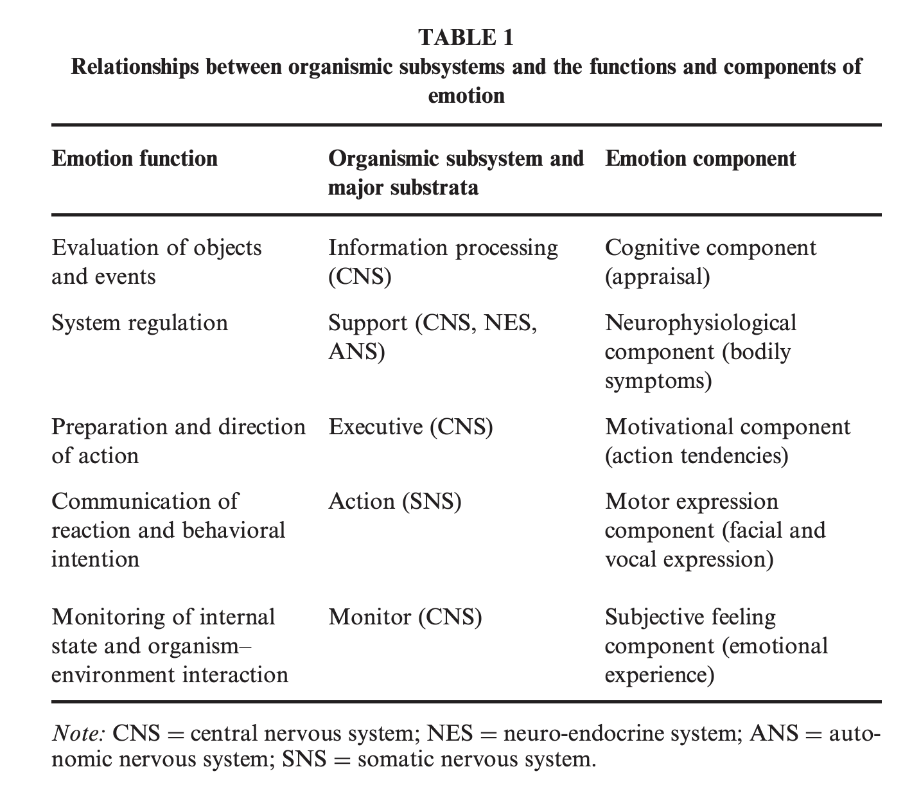
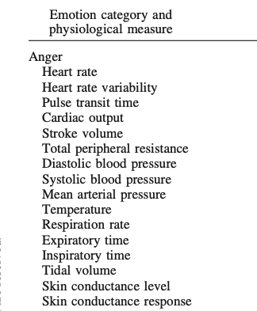
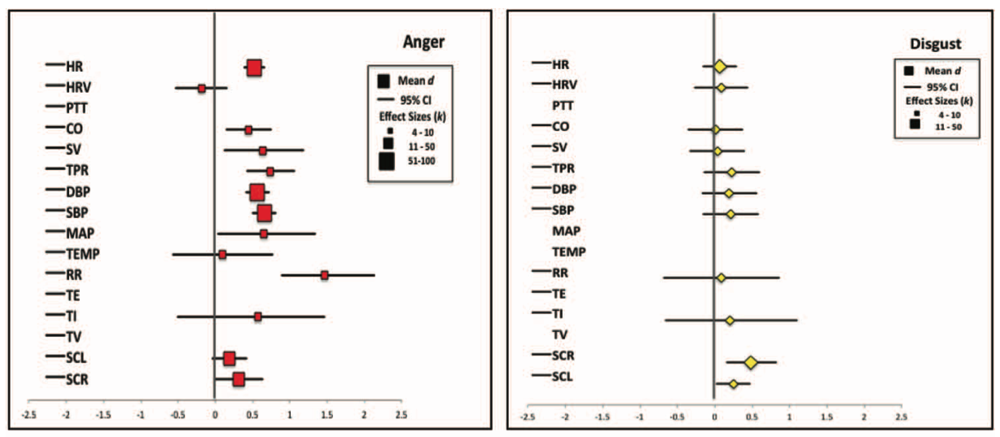
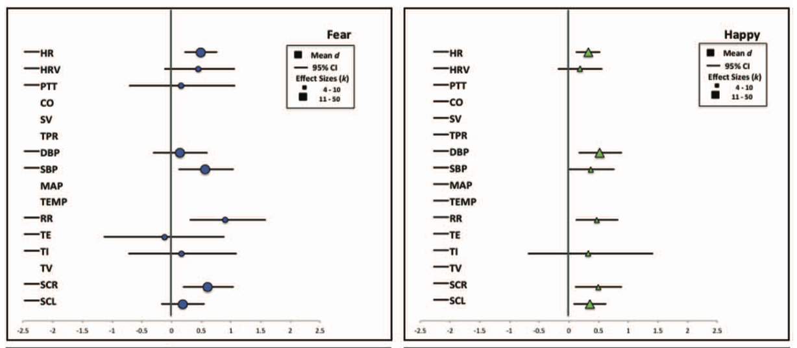
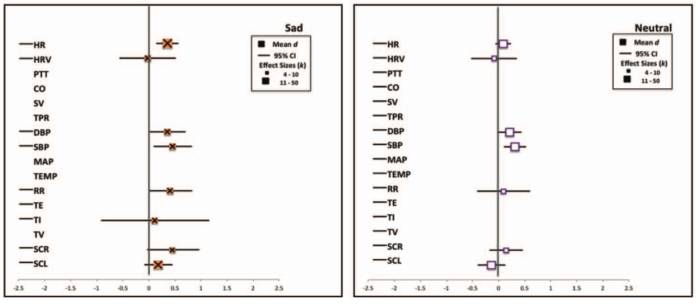
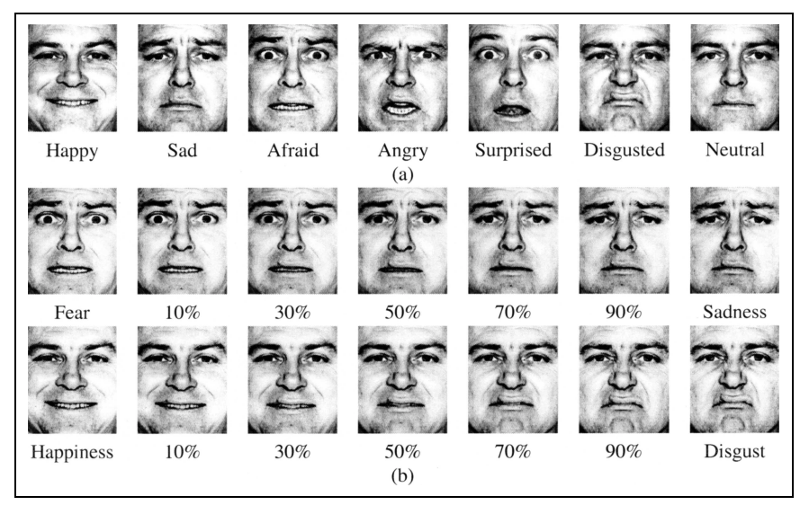

# Prelude

---

<!-- Happiness from "You're a Good Man Charlie Brown" -->



-- @Number1AnimationFan2007-gu

---

<!-- Inside Out Trailer -->



-- @Pixar2014-md

## Announcements

- Exam 2 next Wednesday, October 21, 2026

## Today's topics

- Warm up
- The biology of emotion
- Pleasure & reward

# Warm up

---

### Which of the following statements about bipolar disorder (BP) is *incorrect*?

::: {.incremental}
- A. BP is linked to disruption in a monoamine neurotransmitter system.
- B. BP has high heritability.
- C. BP is characterized by cycling affective states.
- D. Mood stabilizers like lithium are common drug therapies for BP.
:::

---

### Which of the following statements about bipolar disorder is *incorrect*?

- **A. BP is linked to disruption in a monoamine neurotransmitter system.**
- ~~B. BP has high heritability.~~
- ~~C. BP is characterized by cycling affective states.~~
- ~~D. Mood stabilizers like lithium are common drug therapies for BP.~~

---

### The dopamine hypothesis of schizophrenia suggests that effective drug therapies should ______ levels of this neurotransmitter.

::: {.incremental}
- A. increase
- B. cause seasonal variation in
- C. ignore
- D. decrease
:::

---

### The dopamine hypothesis of schizophrenia suggests that effective drug therapies should ______ levels of this neurotransmitter.

- ~~A. increase~~
- ~~B. cause seasonal variation in~~
- ~~C. ignore~~
- **D. decrease**

---

### Reuptake inhibitors like SSRIs and SNRIs act on what stage of synaptic transmission?

::: {.incremental}
- A. Exocytosis
- B. Neurotransmitter inactivation
- C. Ca++ entry via voltage-gated channels
- D. Generation of EPSPs or IPSPs
:::

---

### Reuptake inhibitors like SSRIs and SNRIs act on what stage of synaptic transmission?

- ~~A. Exocytosis~~
- **B. Neurotransmitter inactivation**
- ~~C. Ca++ entry via voltage-gated ion channels~~
- ~~D. Generation of excitatory or inhibitory post-synaptic potentials (PSPs)~~

# The biology of emotion

## Big questions

- What is emotion?
- What causes emotion?
- What functions do emotions serve?
- Where do emotions arise?

## What is emotion?

::: {.fragment}

:::: {.columns}
::: {.column width=75%}
>The concept of ‘‘emotion’’ presents a particularly thorny problem.
Even though the term is used very frequently, to the point of being
extremely fashionable these days, the question ‘‘What is an emotion?’’ rarely generates the same answer from different individuals,
scientists or laymen alike.

--- @Scherer2005-pw
:::
::: {.column width=25%}
{fig-align="right"}
:::
::::


:::

## What is emotion?

:::: {.columns}
::: {.column width=40%}
- Scherer's [-@Scherer2005-pw; @Leventhal1987-ip] component process model
:::
::: {.column width=60%}

:::
::::

## Components of emotion

- Cognitive appraisal
- Bodily (physiological) symptoms
- Motivation (action tendencies)
- Action 
- Subjective feelings

## What causes emotion?

>Do we run from a bear because we are afraid or are we afraid because we run? William James posed this question more than a century ago, yet the notion that afferent visceral signals are essential for the unique experiences of distinct emotions remains a key unresolved question at the heart of emotional neuroscience.

-- @Harrison2010-nx

## What causes emotion?

```{mermaid}
flowchart LR
  B[Bear] ---> M[Me]
  M ---> F[Fear]
  F ---> P[Physio]
  F ---> R[Run]
```

## Competing views on causes

- James-Lange theory [@Wikipedia-contributors2025-xn]
- Cannon-Bard theory [@Wikipedia-contributors2025-wp]
- Two factor (Singer/Schacter) theory [@Wikipedia-contributors2025-er]

## [James-Lange](https://en.wikipedia.org/wiki/James%E2%80%93Lange_theory) theory

- Physiological response -> subjective feelings
    
```{mermaid}
flowchart LR
  B[Bear] ---> M[Me]
  M ---> P[Physio]
  P ---> F[Fear]
  M ---> R[Run]
```

## [Cannon-Bard](https://en.wikipedia.org/wiki/Cannon%E2%80%93Bard_theory)

:::: {.columns}
::: {.column width=50%}
- Severing CNS (spinal cord & vagus, Xth n) from rest of body leaves emotional expression unchanged
- Physiological states slow, don't differentiate among emotions
:::
::: {.column width=50%}
```{mermaid}
flowchart LR
  B[Bear] ---> M[Me]
  M ---> P[Physio]
  M ---> F[Fear]
  M ---> R[Run]
```
:::
::::

## [Cannon-Bard](https://en.wikipedia.org/wiki/Cannon%E2%80%93Bard_theory) theory

:::: {.columns}
::: {.column width=50%}
- Physiology and feelings distinct
- Hypothalamus (physiological response); dorsal thalamus (feelings)
:::
::: {.column width=50%}
```{mermaid}
flowchart LR
  B[Bear] ---> M[Me]
  M ---> P[Physio]
  M ---> F[Fear]
  M ---> R[Run]
```
:::
::::

## [Two factor](https://en.wikipedia.org/wiki/Two-factor_theory_of_emotion) theory

:::: {.columns}
::: {.column width=50%}
- Also known as Singer-Schacter theory
- Physiological arousal + cognitive appraisal -> Emotion states
:::
::: {.column width=50%}
```{mermaid}
flowchart LR
  B[Bear] ---> M[Me]
  M ---> P[Physio]
  M ---> A[Appraisal]
  A ---> F[Fear]
  P ---> F
  P ---> A
  M ---> R[Run]
```
:::
::::

## Physiological states

:::: {.columns}
::: {.column width=50%}
>The classical view of emotion hypothesizes that certain emotion categories have a specific autonomic nervous system (ANS) “fingerprint” that is distinct from other categories... 

-- @Siegel2018-ab
:::
::: {.column width=50%}
::: {.fragment}
```{mermaid}
flowchart LR
  F[fear] ---> H(heart rate)
  F ---> B(blood pressure)
  P[happiness] ---> H
  P ---> B
  A[anger] ---> H
  A ---> B
```
:::
::: 
::::

## Physiological states

:::: {.columns}
::: {.column width=50%}
- What ANS measures are part of this "fingerprint?"
- Do they distinguish among emotion categories?
:::
::: {.column width=50%}
{fig-align="right" width="75%"}
:::
::::

## Physiological states



---



---



## Physiological states

>...**there is no 1-to-1 mapping between an emotion category and a specific autonomic nervous system response pattern**. In addition, we observed substantial variability in autonomic nervous system changes during instances of the same emotion category that was not accounted for by experimental moderators (such as the way the emotion was induced). 

-- @Siegel2018-ab

## Physiological states

>These findings suggest that **autonomic nervous system changes during emotion are less like a bodily fingerprint and more like a population of variable, context sensitive instances**. 

-- @Siegel2018-ab

## Emotion in action

{fig-align="center"}

## Emotion in action



:::: {.columns}

::: {.column width=50%}
What emotion?

:::

::: {.column width=50%}
{width="60%"}
:::
::::

## Emotion in action



:::: {.columns}

::: {.column width=50%}
How about now?

:::

::: {.column width=50%}
{width="60%"}
:::
::::

---

<iframe src="https://www.biomotionlab.ca/Demos/bmlwalker/" width="1200" height="600"></iframe>

## Feeling emotion {.scrollable}

{#fig-nummenaa-2014-fig-1 width="75%"}

---

{#fig-nummenaa-2014-fig-2 width="75%"}

## What functions do emotions serve?

::: {.fragment}
:::: {.columns}
::: {.column width=60%}
- Charles Darwin, father of modern evolutionary theory
- Similarities between animals in emotional expressions
- Suggest similarities in function
:::
::: {.column width=40%}
{#fig-darwin width="60%"}
:::
::::
:::

## What functions do emotions serve?

:::: {.columns}
::: {.column width=50%}
- Vary in *valence*
    + Positive/negative
- Vary in *intensity* (arousal)
:::
::: {.column width=50%}
{#wikipedia-plutchik width="75%"}
:::
::::

## What functions do emotions serve?

:::: {.columns}
::: {.column width=50%}
::: {.incremental}
- Vary in *action tendency*
    + Approach/avoid
- Biological goals
  - Ingestion (hunting/foraging)
  - Defense (fight/freeze/flee)
:::
:::
::: {.column width=50%}
{width="75%"}
:::
::::


## What functions do emotions serve?

:::: {.columns}

::: {.column width=50%}
- Biological goals
  - Reproduction
  - Affiliation

:::

::: {.column width=50%}
{width="75%"}
:::
::::

## *Where* do emotions arise?

:::: {.columns}
::: {.column width=50%}
- If emotions are *localized*, where?
:::
::: {.column width=50%}
{#fig-lindquist-2012-fig-1}
:::
::::

## *Where* do emotions arise?

:::: {.columns}
::: {.column width=50%}
- If emotions are localized, is activity emotion-specific?
:::
::: {.column width=50%}
{#fig-lindquist-2012-fig-6}
:::
::::

## *Where* do emotions arise?

>A psychological **constructionist account** of emotion assumes that **emotions are psychological events that emerge out of more basic psychological operations that are not specific to emotion**.

--- @Lindquist2012-jr

## *Where* do emotions arise?

>...**mental categories such as anger, sadness, fear, et cetera, are not respected by the brain**...

--- @Lindquist2012-jr

## *Where* do emotions arise?

> ...**emotions emerge when people make meaning out of sensory input from the body and from the world** using knowledge of prior experiences. Emotions are “situated conceptualizations” (cf. Barsalou 2003) because the emerging meaning is tailored to the immediate environment and prepares the person to respond to sensory input in a way that is tailored to the situation.

--- @Lindquist2012-jr

## Interim summary: Emotions

- Consist of 
  - multiple components
  - cognition + action + action tendencies
- Have 
  - distinguishable patterns of subjective feelings, external actions

## Interim summary: Emotions

- Do *not* have 
  - distinct ANS response patterns
  - distinct brain activation patterns
- Can't be neatly or easily *localized* in the CNS

## Next time

- Emotion II

# Resources

## About

This talk was produced using [Quarto](https://quarto.org), using the [RStudio](https://posit.co/products/open-source/rstudio/)
Integrated Development Environment (IDE), version 2026.8.1.195.

The source files are in R and R Markdown, then rendered to HTML using the
[revealJS](https://revealjs.com) framework.
The HTML slides are hosted in a [GitHub repo](https://github.com/psu-psychology/psych-260-2026-fall) and served by GitHub pages:
<https://psu-psychology.github.io/psych-260-2026-fall/>

## References
