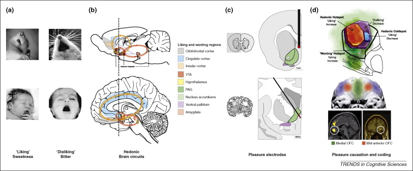
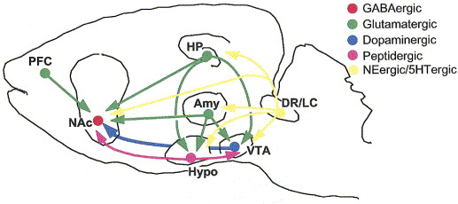
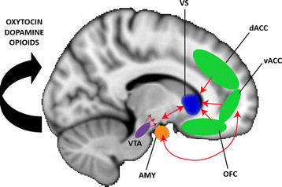
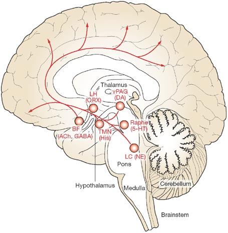
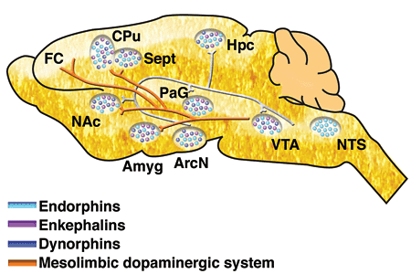
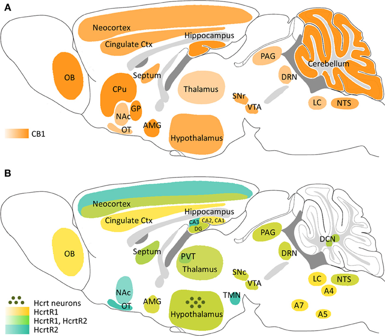

# Prelude

---

<!-- Happiness from "You're a Good Man Charlie Brown" -->



-- @Number1AnimationFan2007-gu

## Announcements

- Exam 2 next Wednesday, October 21, 2026

## Today's topics

- Warm up
- Last time...
- Pleasure & reward

# Warm up

---

### Plutchik argued that emotions can be mapped to a space with the following dimensions:

- a. Fight & flight
- b. Valence & arousal
- c. Positive & negative
- d. Sympathetic & parasympathetic

---

### Plutchik argued that emotions can be mapped to a space with the following dimensions:

- ~~a. Fight & flight~~
- **b. Valence & arousal**
- ~~c. Positive & negative~~
- ~~d. Sympathetic & parasympathetic~~

---

### What does evidence imply about the relationship between physiological measures and emotional states?

- a. Sympathetic nervous system activity distinguishes between  emotions
- b. Parasympathetic nervous system activity distinguishes between  emotions
- c. There is no 1:1 mapping between emotion categories and ANS activity
- d. Emotions don't activate the ANS

---

### What does evidence imply about the relationship between physiological measures and emotional states?

- ~~a. Sympathetic nervous system activity distinguishes between  emotions~~
- ~~b. Parasympathetic nervous system activity distinguishes between  emotions~~
- **c. There is no 1:1 mapping between emotion categories and ANS activity**
- ~~d. Emotions don't activate the ANS~~

---

## A "locationist" account of emotions assumes...

- a. Specific brain areas activate or control specific emotions
- b. A distributed network of brain areas activates to emotions
- c. Some emotions are only experienced in specific places
- d. There is a physical map in the brain of emotions like Plutchik's

---

## A "locationist" account of emotions assumes...

- **a. Specific brain areas activate or control specific emotions**
- ~~b. A distributed network of brain areas activates to emotions~~
- ~~c. Some emotions are only experienced in specific places~~
- ~~d. There is a physical map in the brain of emotions like Plutchik's~~

# Last time...

## Emotion in action



:::: {.columns}

::: {.column width=50%}
What emotion?

:::

::: {.column width=50%}
{width="55%"}
:::
::::

## Emotion in action



:::: {.columns}

::: {.column width=50%}
How about now?

:::

::: {.column width=50%}
{width="55%"}
:::
::::

# Pleasure & reward

## Big questions

- Components?
- What functions do pleasure & reward serve?
- Where/how do they arise?

## Components

:::: {.columns}
::: {.column width=50%}
- [Aristotle](http://plato.stanford.edu/entries/aristotle-ethics/)
- Eudaimonia
    + Life satisfaction
- Hedonia
    + Pleasure
:::
::: {.column width=50%}
::: {.fragment}
:max_bytes(150000):strip_icc():format(webp)/GettyImages-143382618-56a798255f9b58b7d0ebfac8.jpg){#fig-boy-eating-chocolate}
:::
:::
::::
    
## Functions served

- Approach vs. avoidant behaviors
- *Rewards* 
  - External events that reinforce (make more prevalent/probable) some behavior
- Basis of [operant conditioning](https://en.wikipedia.org/wiki/Operant_conditioning)

---

::: {#fig-brain-pleasure-addiction}
<iframe width="560" height="315" src="https://www.youtube.com/embed/de_b7k9kQp0?si=t33yoSB_iDTTDCWK" title="YouTube video player" frameborder="0" allow="accelerometer; autoplay; clipboard-write; encrypted-media; gyroscope; picture-in-picture; web-share" referrerpolicy="strict-origin-when-cross-origin" allowfullscreen></iframe>

@Ashikkerib2007-su
:::

## Where & how do these arise?

- Milner and Olds [@milner_discovery_1989](http://doi.org/10.1016/S0149-7634(89)80013-2)
  - discovered 'rewarding' power of electrical self-stimulation
- Heath [-@heath1963electrical] studied effects in human patients.

## Implications

- Specific circuits signal pleasure
- Form of memory
  - Action in (recent) past led to positive outcomes
- Similarities across animal species
  - Behavior & brain
  
## Implications

{#fig-kringelbach-fig-02}

## Circuit components

:::: {.columns}
::: {.column width=50%}
- Ventral tegmental area (VTA) in midbrain
- Nucleus accumbens (nAcc), ventral striatum
- Dorsal Raphe Nucleus/Locus Coeruleus (DR/LC)
:::
::: {.column width=50%}
{#fig-nestler-06-fig-01}
:::
::::

## Circuit components

:::: {.columns}
::: {.column width=50%}
- Hypothalamus (Hyp)
- Amygdala (Amy)
- Hippocampus (HP)
- Prefrontal cortex (PFC)
:::
::: {.column width=50%}
{#fig-kohls-2012-fig-02}
:::
::::

## Neurotransmitters

:::: {.columns}
::: {.column width=50%}
- Dopamine
- Serotonin, Norepinephrine
- ACh
:::
::: {.column width=50%}
{#fig-cock-2008-fig-04}
:::
::::

## Dopamine memes

:max_bytes(150000):strip_icc():format(webp)/can-you-get-addicted-to-dopamine-5207433-ADD-Color-bcfbd83f2cc148aba1b2c0b130166ff8.jpg){fig-align="center" #fig-dopamine-memes}

## What does DA *actually* signal?

:::: {.columns}
::: {.column width=50%}
- Differences between expected and actual rewards
- Reward prediction error
:::
::: {.column width=50%}
{#fig-hu-2016-fig-01}
:::
::::

## Inputs

:::: {.columns}
::: {.column width=50%}
- DA network
  - Ventral tegmental area (VTA) and Substantia Nigra (SN)
  - Midbrain tegmentum
- From across the brain
:::
::: {.column width=50%}
{width="60%" #watabe-uchida-2017-fig-04}
:::
::::

## Reward & aversion networks interconnect

{#fig-hu-2016-fig-03 width="65%"}

## Other neurotransmitters

:::: {.columns}
::: {.column width=60%}
- Endogenous morphines or *endorphins*
  - Opioids generated & released by the CNS
  - Sources include ventral tegmental area, nucleus accumbens, amygdala, etc.
- *Exogenous* opioids (morphine, heroin, oxycontin) powerful pain relievers
:::
::: {.column width=40%}
{fig-align="right" #fig-endorphins-niaa}
:::
::::

## Other neurotransmitters

:::: {.columns}
::: {.column width=50%}
- Cannabinoids == psychoactive compounds found in cannibis
- Endogenous cannabinoids (Endocannabinoids)
  - Bind to receptors
  - CB1 in CNS; CB2 in PNS, immune system
:::
::: {.column width=50%}
{#fig-flores-2013-fig-01}
:::
::::

## Exogenous substances

- Activate or modulate endogenous neurotransmitter systems in some cases
- Influence subjective feelings of pain, pleasure
- Vary in relative health risk

## Comparative risk

>A comparative risk assessment of drugs including alcohol and tobacco using the margin of exposure (MOE) approach was conducted. The MOE is defined as ratio between toxicological threshold (benchmark dose) and estimated human intake. Median lethal dose values from animal experiments were used to derive the benchmark dose. The human intake was calculated for individual scenarios and population-based scenarios...

-- @Lachenmeier2015-mm

## Comparative risk

>...For individual exposure the four substances alcohol, nicotine, cocaine, and heroin fall into the “high risk” category with MOE < 10, the rest of the compounds except THC fall into the “risk” category with MOE < 100.

-- @Lachenmeier2015-mm

---

![@Lachenmeier2015-mm Figure 1^["Margin of exposure for daily drug use estimated using probabilistic analysis (left red bar: average; error bar: standard deviation; right gray bar: tolerant user; circle symbol (for alcohol): value based on human data)."]](../include/img/41598_2015_Article_BFsrep08126_Fig1_HTML.jpg.webp){#fig-lachenmeier-2015 width="85%"}

## Comparative risk

>The toxicological MOE approach validates epidemiological and social science-based drug ranking approaches especially in regard to the positions of alcohol and tobacco (high risk) and cannabis (low risk).

-- @Lachenmeier2015-mm

# Wrap-up

## Main points

- Types of pleasure activate overlapping areas
- Pleasure/happiness engage distributed brain network
    - VTA and ventral striatum/nucleus accumbens (NAcc) especially important
    
## Main points

- Pleasure/happiness signaling involves multiple NTs
  - DA especially important in signalling *unexpected outcomes*
- “Reward” pathways activated by multiple inputs
- Some *exogenous* substances associated with feelings of pleasure or relief from pain bind to *endogenous* receptor systems

# Resources

## About

This talk was produced using [Quarto](https://quarto.org), using the [RStudio](https://posit.co/products/open-source/rstudio/)
Integrated Development Environment (IDE), version 2026.10.0.233.

The source files are in R and R Markdown, then rendered to HTML using the
[revealJS](https://revealjs.com) framework.
The HTML slides are hosted in a [GitHub repo](https://github.com/psu-psychology/psych-260-2026-fall) and served by GitHub pages:
<https://psu-psychology.github.io/psych-260-2026-fall/>

## References
