# Prelude

---

::: {#fig-dont-you-worry-about-a-thing}
<iframe width="1280" height="450" src="https://www.youtube.com/embed/mMTkujnftIs?si=4yfcj8ChRCFUbj9P" title="YouTube video player" frameborder="0" allow="accelerometer; autoplay; clipboard-write; encrypted-media; gyroscope; picture-in-picture; web-share" referrerpolicy="strict-origin-when-cross-origin" allowfullscreen></iframe>


@Musikladen2020-kq
:::

---

::: {#fig-i-get-by-cocker}
<iframe width="1280" height="450" src="https://www.youtube.com/embed/McB9sJqHFx4?si=1cyDe_xrPTHFB5TO" title="YouTube video player" frameborder="0" allow="accelerometer; autoplay; clipboard-write; encrypted-media; gyroscope; picture-in-picture; web-share" referrerpolicy="strict-origin-when-cross-origin" allowfullscreen></iframe>


@Cocker-Topic2018-kr
:::

---



-- @Musikladen2020-kq

---



-- @Cocker-Topic2018-kr

## In the news

:::: {.columns}
::: {.column width=50%}
- Locus Coeruleus (LC) neurons release norepinephrine (NE) via two separate pathways
:::
::: {.column width=50%}
{#fig-lc-ne-study-allen-inst}
:::
::::

## Today's topics

- Fear & stress
  - with a touch of empathy

# Fear and stress

## Animal models

- Do non-human animals experience emotion?
- What functions might these serve?
- Risks vs. reward of cross-species comparisons?

## Threat ("fear") conditioning 

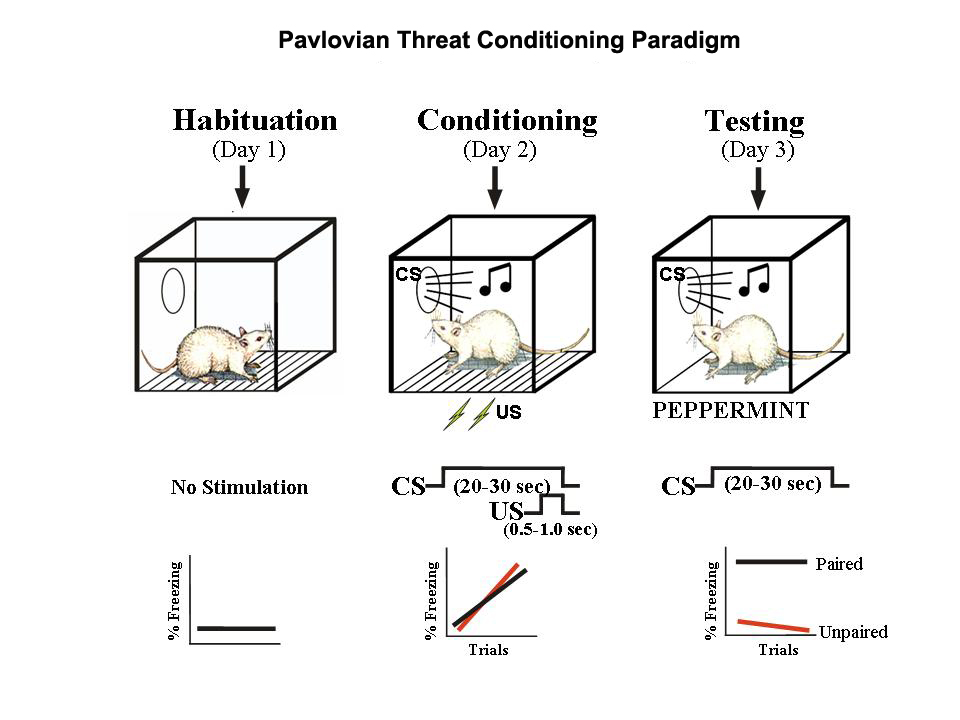{#fig-ledoux-fear-conditioning width="55%"}

## Rat vs. human

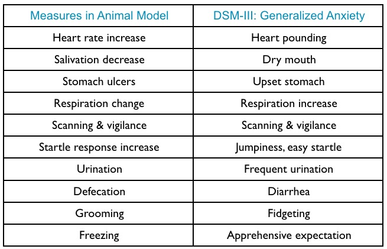{#fig-davis-1992}

## Threat conditioning

```{mermaid}
flowchart LR
  S[sound] ---> A(auditory)
  F[shock] ---> T(somatosensory)
  A ---> L(learning)
  T ---> L
  L ---> D(freezing)
  L ---> H(blood pressure)
  L ---> C(hormones)
```

::: {.fragment}
- Why *these* responses to threat?
- What are the pathways from stimuli to responses?
- How is predicting future events adaptive?
:::

## Amygdala

:::: {.columns}
::: {.column width=50%}
- From Greek 'almond'
- medial temporal lobe (bilateral)
:::
::: {.column width=50%}
{#fig-amydala}
:::
::::

## Amygdala inputs

:::: {.columns}
::: {.column width=50%}
+ Thalamus 
  - "direct" or "fast"
+ Cerebral cortex
  - "indirect" or "slow"
:::
::: {.column width=50%}
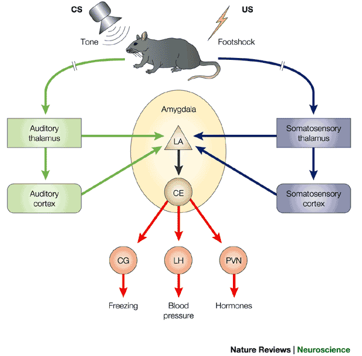{#fig-medina-fig-2}
:::
::::

## Amygdala outputs

:::: {.columns}
::: {.column width=50%}
+ CG (central gray matter) of tegmentum (ventral midbrain): behavior
+ LH (lateral hyp): ANS
+ PVN (paraventricular n. of hypothalamus): hormones
:::
::: {.column width=50%}

:::
::::

## Amygdala role

:::: {.columns}
::: {.column width=50%}
- Lesions of amygdala impair threat conditioning
- Interpretation: Fast-acting, involuntary responses
:::
::: {.column width=50%}

:::
::::

## Amygdala meme

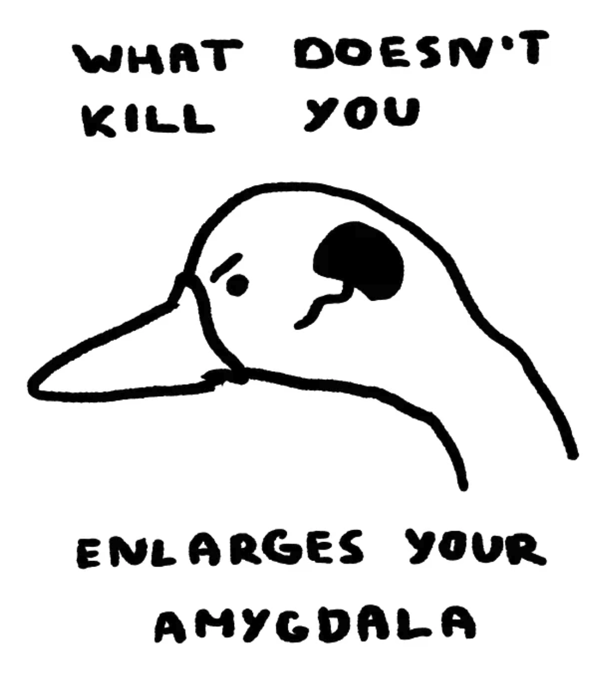{#fig-amygdala-meme width="35%"}

## Cerebral cortex role

:::: {.columns}
::: {.column width=50%}
- Cerebral cortex lesions cause generalized responses
  - Not specific to cue features
  - Response discrimination?
:::
::: {.column width=50%}

:::
::::

## Cerebral cortex role

:::: {.columns}
::: {.column width=50%}
- Interpretation
  - Fast, crude responses vs. slower, detailed ones
  + That’s a stick, not a snake!
:::
::: {.column width=50%}

:::
::::

## Cerebral cortex role

:::: {.columns}
::: {.column width=50%}
- Amygdala widely connected
- Emotion ->
  - subjective feelings + physiology + behaviors
  - see [2026-10-14](wk-08-2026-10-14-emotion-I.qmd) slides
:::
::: {.column width=50%}

:::
::::

---

{#fig-lindquist-2012-fig-6 width="65%"}

## Amygdala as processing hub

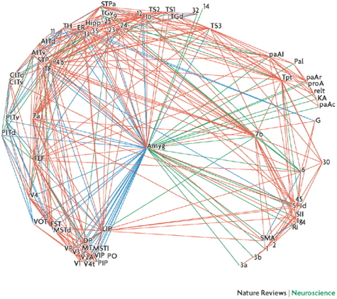{#fig-pessoa-08}

## Emotions serve survival goals

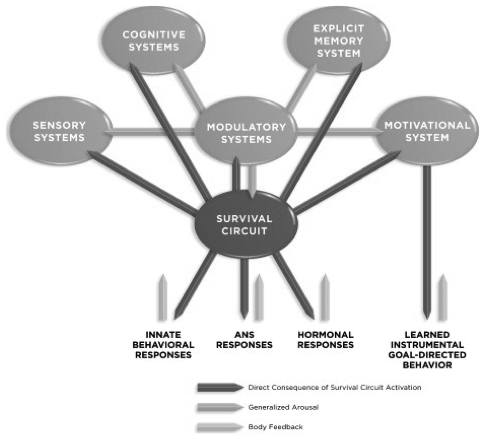{#fig-ledoux-rethinking}

## Emotions are 

:::: {.columns}
::: {.column width=50%}
- global states
- physiological responses + behaviors
:::
::: {.column width=50%}
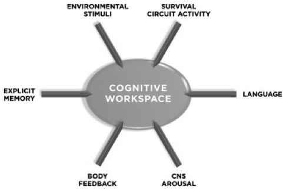
:::
::::

## From fear to stress...


## Stressors linked with biological imperatives

:::: {.columns}
::: {.column width=50%}
::: {.incremental}
- Sustenance
    + Hunger, thirst
- Well-being/defense
    + Threat
:::
:::
::: {.column width=50%}
::: {.fragment}
- Reproduction
    + Rejection
- Affiliation
    + Loneliness
:::
:::
::::

::: {.fragment}
- Social relationships critical to human biology
- Many human stressors have social underpinnings
:::

## Stress and the brain

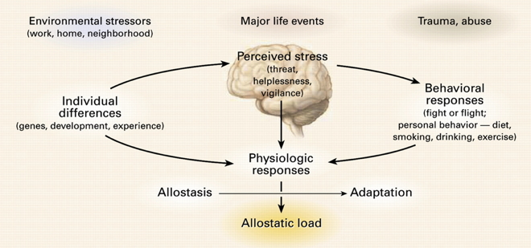{#fig-mcewen-fig-01}

## Homeostasis

- Maintenance of stable internal environment
  - e,g., Regulation of physiological variables (e.g., blood $O_2$) via negative feedback [@Cannon1929-ij]
- Stable internal environments or *adaptive* ones?
  
## Allostasis

:::: {.columns}
::: {.column width=50%}
::: {.incremental}
- @Sterling1988-rl
- Adaptation to *changing* external conditions
- Regulation an active process
- Regulation anticipatory, varies by circumstance
- Regulation targets vary [@Ramsay2014-la]
:::
:::
::: {.column width=50%}
{width="50%"}
:::
::::

## Stress and the brain

:::: {.columns}
::: {.column width=50%}
::: {.incremental}
- **Acute** stress
    + Short duration
    + Fast action required
      - e.g., fight, flee, freeze
    + HPA (Cortisol), SAM (NE/Epi) axes
:::
:::
::: {.column width=50%}
::: {.fragment}
- vs. **Chronic** stress
    + Long duration, persistent
    - Prolonged coping required
- What happens to HPA, SAM systems?  
:::
:::
::::

## Glucocorticoid (CORT) release

:::: {.columns}
::: {.column width=60%}
::: {.incremental}
- Adrenal cortex releases cortisol
  - Increases blood glucose levels
  - Suppresses immune system
  - Reduces inflammation
  - Aids in metabolism
+ Receptors in brain and body
:::
:::
::: {.column width=40%}
![@Wikipedia-contributors2025-sy^[By ShelleyAdams - This file was derived from: HPA Axis Diagram (Brian M Sweis 2012).png, CC BY-SA 3.0, https://commons.wikimedia.org/w/index.php?curid=53298307]](https://thumb.wikimedia.org/wikipedia/commons/thumb/e/ee/HPA_Axis_Diagram_%28Brian_M_Sweis_2012%29.svg/1920px-HPA_Axis_Diagram_%28Brian_M_Sweis_2012%29.svg.png?utm_source=en.wikipedia.org&utm_campaign=imageinfo&utm_content=thumbnail)
:::
::::

## CORT

:::: {.columns}
::: {.column width=50%}
- Circadian rhythm to release
- Peak ~30 min of morning awakening in humans
:::
::: {.column width=50%}
![Molecular brain^[http://www.molecularbrain.com/content/figures/1756-6606-3-2-1-l.jpg]](../include/img/cortisol-molecular-brain.jpg){#fig-molecular-brain}
:::
::::

## Glucocorticoid cascade hypothesis

:::: {.columns}
::: {.column width=50%}
- CORT receptors in hippocampus, amygdala, hypothalamus
    - Hippocampus regulates HPA axis via hypothalamus
:::
::: {.column width=50%}
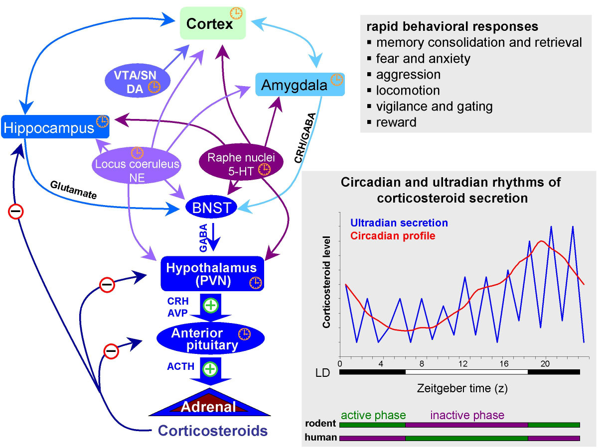
:::
::::

## Glucocorticoid cascade hypothesis

:::: {.columns}
::: {.column width=50%}
- Prolonged CORT $\downarrow$ hippocampus response
    - $\downarrow$ volume, connectivity in hippocampus
:::
::: {.column width=50%}
![Molecular brain^[http://www.molecularbrain.com/content/figures/1756-6606-3-2-1-l.jpg]](../include/img/cortisol-molecular-brain.jpg)
:::
::::

## Glucocorticoid cascade hypothesis

:::: {.columns}
::: {.column width=50%}
- Hippocampus critical for long-term memory formation
- Acute stress can $\uparrow$ memory
- Chronic stress $\downarrow$ long-term memory [@Schwabe2025-pz]
:::
::: {.column width=50%}
![Molecular brain^[http://www.molecularbrain.com/content/figures/1756-6606-3-2-1-l.jpg]](../include/img/cortisol-molecular-brain.jpg)
:::
::::
    
## Glucocorticoids & DA

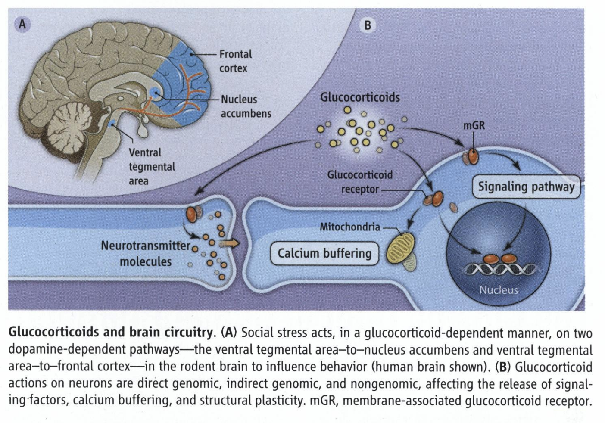{#fig-mcewen-2013-fig-01 width="65%"}

## Glucocorticoid cascade hypothesis

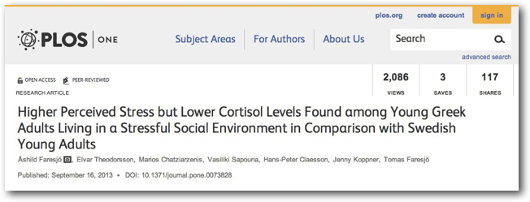

::: {.fragment}
- CORT -> stress link not straightforward 
:::

## Your stress ain't like mine

:::: {.columns}
::: {.column width=50%}
- Zebras (probably) don't worry about predation by lions

::: {.incremental}
- Phasic (short-term) vs. chronic (long-term)
- *Physical* stress (hunger, thirst, injury, disease) vs. *psychological/social* stress
:::
:::
::: {.column width=50%}
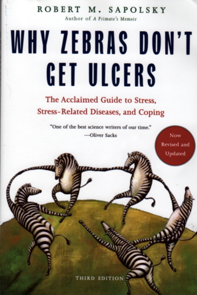
:::
::::

## Social distress & empathy

- Some non-human animals demonstrate sensitivity to conspecifics' distress
- Pain thresholds lower (sensitivity greater) when a mouse's cage mate is also in pain [@Smith2016-ts]
  - But no CORT $\uparrow$
- Rats will cooperate to release distressed cage mate, foregoing food rewards
  
-- @Sapolsky2016-hs

## Empathy in non-human animals

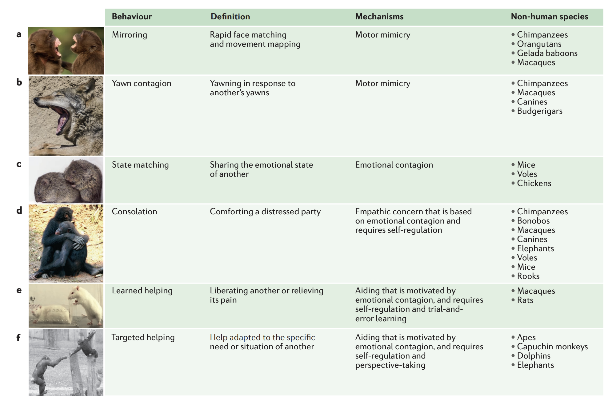{#fig-de-wall-2017 width="65%"}

---

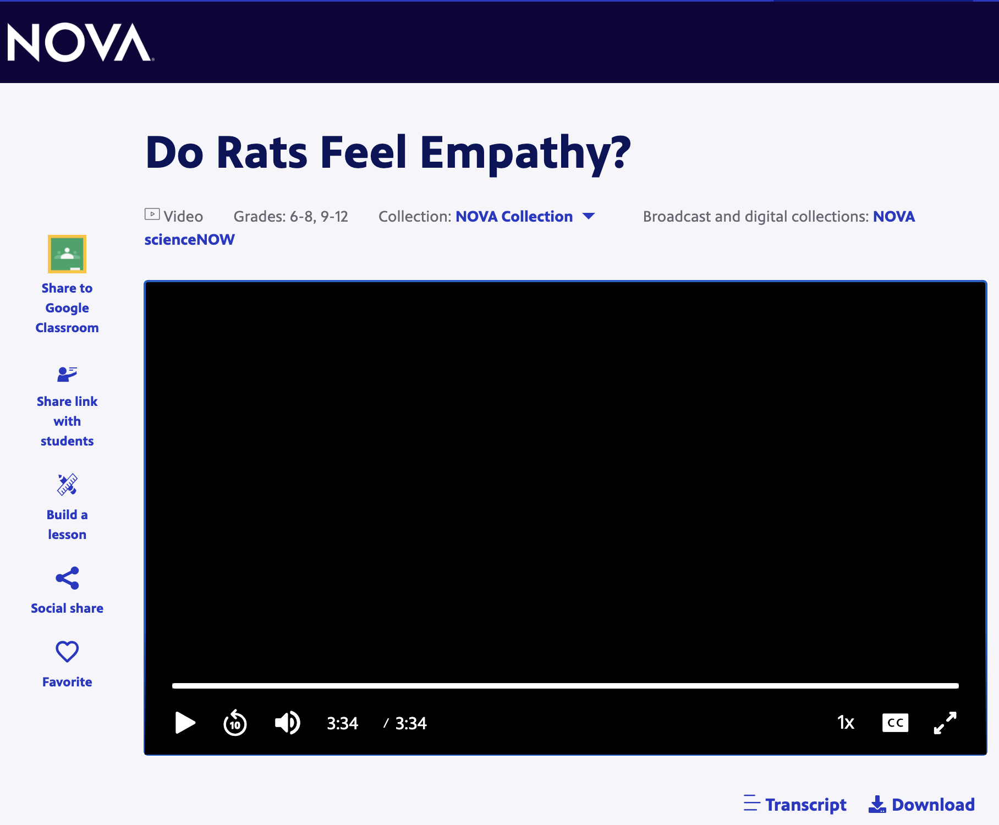{width="50%"}

- <https://wpsu.pbslearningmedia.org/resource/nvsn6.sci.bio.rats/do-rats-feel-empathy/>

# Wrap up

## Main points

- Fear responses include behavior, physiology, internal states
- Parallels between human and non-human animal responses
- Like happiness and pleasure, fear engages network of brain systems
- Amygdala key node in this network, but connects widely

## Main points

- Stressors arise from multiple sources
- Acute (short-term) vs. chronic (long-term) distinction crucial
- Corticosteroid receptors found across the CNS
- Glucorticoid cascade hypothesis
- Some animals respond to others' distress

## Next time

- Sleep

# Resources

## About

This talk was produced using [Quarto](https://quarto.org), using the [RStudio](https://posit.co/products/open-source/rstudio/)
Integrated Development Environment (IDE), version 2026.10.0.233.

The source files are in R and R Markdown, then rendered to HTML using the
[revealJS](https://revealjs.com) framework.
The HTML slides are hosted in a [GitHub repo](https://github.com/psu-psychology/psych-260-2026-fall) and served by GitHub pages:
<https://psu-psychology.github.io/psych-260-2026-fall/>

## References
