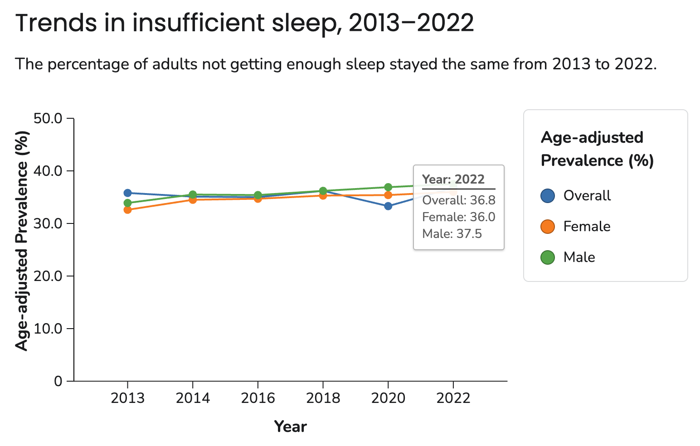
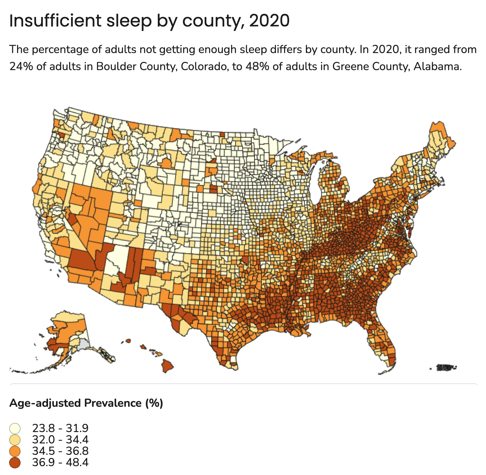
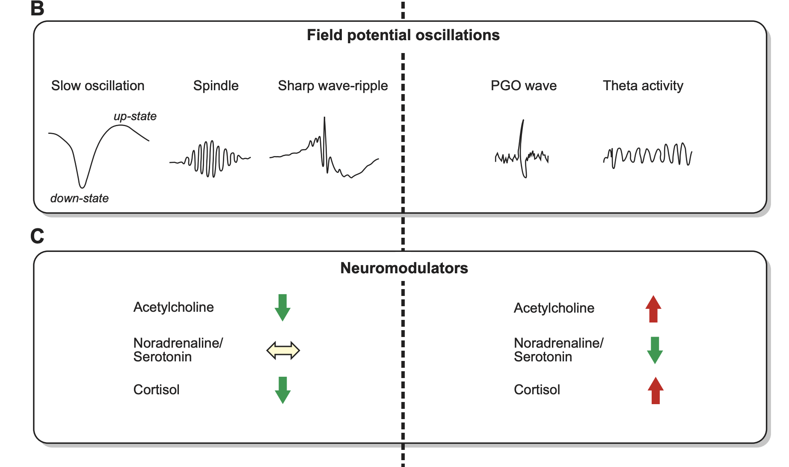
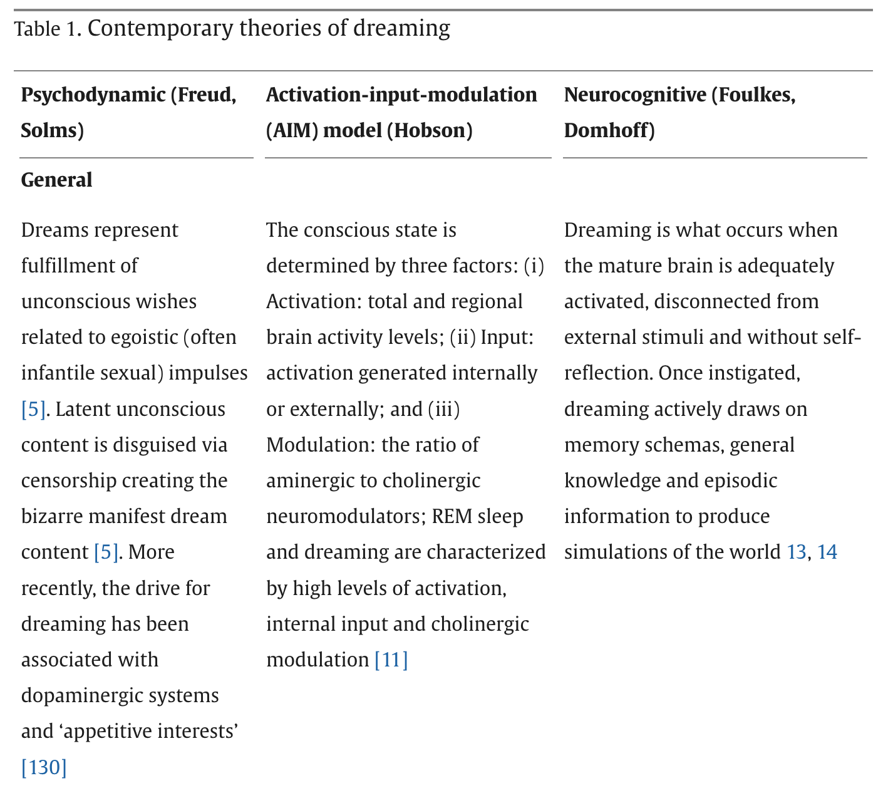
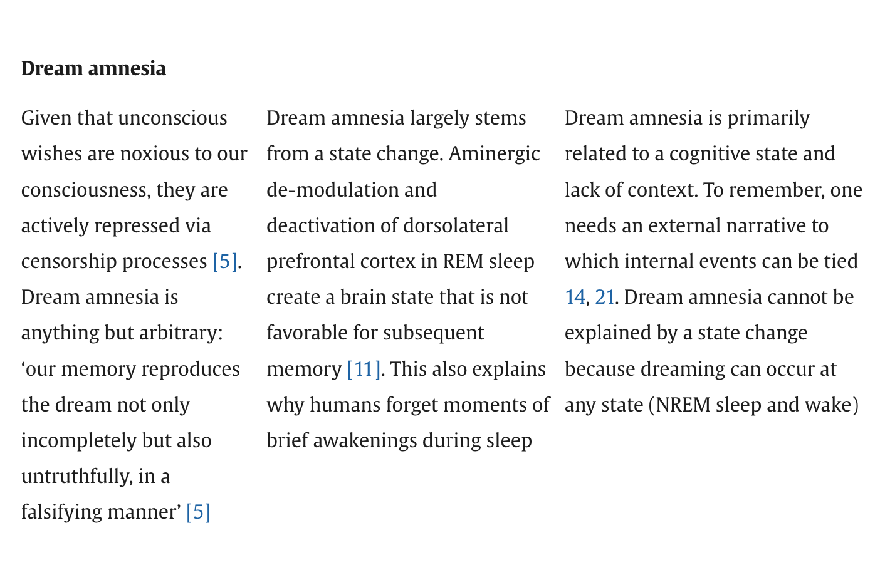
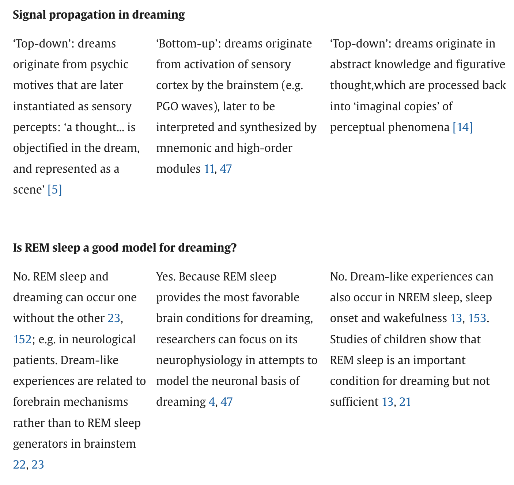
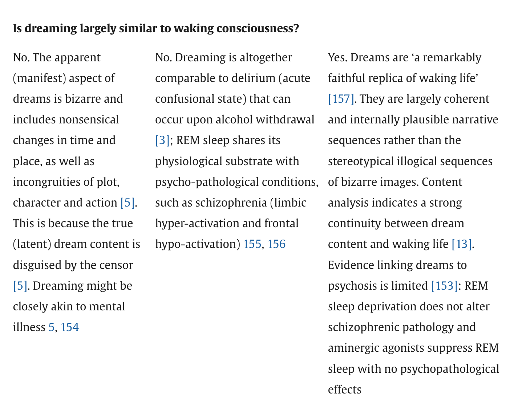
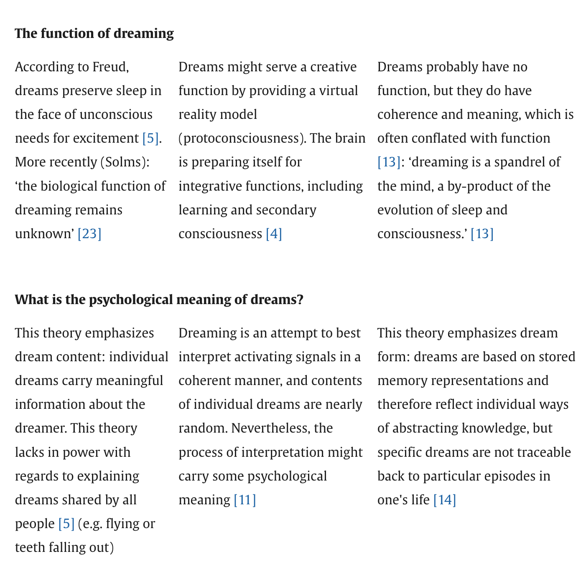

# Overview

## Prelude

::: {#fig-dreamweaver}
<iframe width="1200" height="450" src="https://www.youtube.com/embed/xZKuzwPOefs?si=hNEyFVfwrelgGOJC" title="YouTube video player" frameborder="0" allow="accelerometer; autoplay; clipboard-write; encrypted-media; gyroscope; picture-in-picture; web-share" referrerpolicy="strict-origin-when-cross-origin" allowfullscreen></iframe>

@Films2014-dm
:::

## Announcements

- *Quiz 3* next Friday, November 6, 2026.

## Today's topics

- Warm-up
- Wrap-up on fear/stress/empathy
- Sleep facts

# Warm-up

---

### A key *output target* for signals from the amygdala is

- A. The enteric nervous system
- B. The endocrine system
- C. The hypothalamus
- D. The thalamus

---

### A key output target for signals from the amygdala is

- ~~A. The enteric nervous system~~
- ~~B. The endocrine system~~
- **C. The hypothalamus**
- ~~D. The thalamus~~

---


---

### Which of the following are *not* nodes in the *forebrain portion* of the emotion network?

- A. Anterior Cingulate Cortex (ACC)
- B. Hippocampus
- C. Periaqueductal Grey
- D. Orbitofrontal cortex

---

### Which of the following are *not* nodes in the *forebrain portion* of the emotion network?

- ~~A. Anterior Cingulate Cortex (ACC)~~
- ~~B. Hippocampus~~
- **C. Periaqueductal Grey** (PAG)
- ~~D. Orbitofrontal cortex~~ (OFC)

---

{width="60%"}

---

### Neurons in the _____ release _____ when there is a mismatch between predicted and actual reward.

- A. Ventral Tegmental Area (VTA); dopamine (DA)
- B. Locus Coeruleus; norepinephrine (NE)
- C. Substantia Nigra (SN); dopamine
- D. Raphe Nuclei; Serotonin (5-HT)

---

### Neurons in the _____ release _____ when there is a mismatch between predicted and actual reward.

- **A. Ventral Tegmental Area (VA); dopamine (DA)**
- B. Locus Coeruleus; norepinephrine (NE)
- C. Substantia Nigra; dopamine
- D. Raphe Nuclei; Serotonin (5-HT)

---

![Allen Brain Institute: @UnknownUnknown-mk^["Neuromodulators (NMs) are neurotransmitters released by a small number of neurons (less than 0.001% of the neurons in our brain) with broad projections to most of the nervous system. They bind primarily to G-protein-coupled receptors on neurons and glia to activate intracellular signaling cascades and modulate the properties of membranes and synapses. The physiological processes triggered by NM release are often slow compared to fast synaptic transmission (hundreds of milliseconds or longer vs. less than ten milliseconds). These cells are largely conserved across vertebrates and have diverse functions in behavior, including modulating sleep-wake cycles, internal homeostasis, learning, arousal, and movement. Early theories that focused on specific behavioral conditions yielded to a more comprehensive view that NMs modulate all behavior, from gastric rhythms in invertebrates to mammalian cognition. We are studying five major NMs: four biogenic amines—norepinephrine (NE), serotonin (5-HT), dopamine (DA), and histamine (HA)—and acetylcholine (ACh). They are primarily released by neurons in the locus coeruleus (NE), raphe nuclei (5-HT), ventral tegmental area and substantia nigra pars compacta (DA), tuberomammillary nucleus (HA), and several cholinergic areas across the brain, including the nucleus basalis (ACh). Many disorders, including depression, schizophrenia, drug addiction, and Parkinson's disease, appear to involve dysfunction of NM signaling."]](https://cdn.prod.website-files.com/691fabdb8ba70248dd5b7fa8/691fabdb8ba70248dd5b8225_66fdeb61ad6f661a7dd7d654_66fc2762eed1ba43e23ab82d_66fc251ce5ca05a46dec6a90_nmCartoon.png)

# Wrap-up on emotion

## Fear, stress, empathy

- Link to [2026-10-23 slides](wk-09-2026-10-23-emotion-III.qmd#glucocorticoids-da)

# Sleep facts

## Recommendations by age {.scrollable}

{#fig-cdc-sleep-recs}

## In graphic form

```{r}
library(ggplot2)
library(dplyr)
cdc_sleep <- readr::read_csv("../include/csv/cdc-sleep-recs.csv", show_col_types = FALSE)

cdc_sleep |>
  mutate(hrs = (hrs_min + hrs_max)/2,
         age = (age_min + age_max)/2) |>
  ggplot() +
  geom_errorbar(aes(x = age, ymin = hrs_min, ymax = hrs_max), width = 0.2, color = "gray40") +
  # orizontal error bars (X-axis)
  geom_errorbarh(aes(y = hrs, xmin = age_min, xmax = age_max), height = 0.2, color = "gray40") +
  geom_smooth(aes(x = age, y = hrs), se = FALSE) +
  theme_minimal() +
  ylim(0,17)
```

---

{#fig-cdc-trends width="75%"}

---

{#fig-cdc-sleep-by-county width="50%"}

## Health impacts

![@Shah2025-ol Figure 2^["Figure 2. Potential mechanisms influenced by sleep deprivation (CVD, Cardiovascular Disease; CHD, Coronary Heart Disease; HTH, Hypertension)."]](../include/img/shah-2025-fig-02.jpg)

## Evaluating self-report measures of sleep quality

>...objective measures of sleep quality, such as polysomnography, are not readily available to most clinicians in their daily routine, and are expensive, time-consuming, and impractical for epidemiological and research studies

-- @Fabbri2021-aj

---

>As the most frequently used subjective measurement of sleep quality, the PSQI^[Pittsburgh Sleep Quality Index @Buysse1989-hj] reported good internal reliability and validity; however, different factorial structures were found in a variety of samples, casting doubt on the usefulness of total score in detecting poor and good sleepers.

-- @Fabbri2021-aj

# Brain states during sleep

## Polysomnography

:::: {.columns}
::: {.column width=50%}
- Electroencephalography (EEG)
- Electrocardiography (ECG)
- Electrooculography (EOG)
- Electromyography (EMG)
- Pulse oxymetry & respiratory airflow
:::
::: {.column width=50%}
![@Wikipedia-contributors2025-fi^["By NascarEd - Own work, CC BY-SA 3.0, https://commons.wikimedia.org/w/index.php?curid=24506939"]](https://upload.wikimedia.org/wikipedia/commons/4/4d/Sleep_Stage_REM.png){#fig-polysomnography}
:::
::::

## EEG

:::: {.columns}
::: {.column width=50%}
- Post-synaptic electrical activity
- Mostly from cerebral cortex
:::
::: {.column width=50%}
![@Wikipedia-contributors2026-vk^[CC BY-SA 2.0, https://commons.wikimedia.org/w/index.php?curid=845554]](https://upload.wikimedia.org/wikipedia/commons/2/26/Spike-waves.png){#fig-wikipedia-spike-waves}
:::
::::

## What does EEG measure?

:::: {.columns}
::: {.column width=50%}
- Voltage *differences* between *source* and *reference* electrode
- Combined activity of huge # of neurons

:::
::: {.column width=50%}
{#fig-eeg-montages}
:::
::::

## What does EEG measure?

:::: {.columns}
::: {.column width=50%}
- Current/voltage gradients between *apical* (near surface) dendrites and *basal* (deeper) dendrites and cell body/soma
:::
::: {.column width=50%}
{#fig-eeg-source}
:::
::::

## EEG frequency bands

:::: {.columns}
::: {.column width=50%}
- Fourier Analysis of time-varying EEG yields
- High amplitudes in specific frequency bands
:::
::: {.column width=50%}
{#fig-eeg-freq-bands}
:::
::::

<!-- ## Aside about EEG spectra -->

<!-- :::: {.columns} -->
<!-- ::: {.column width=50%} -->
<!-- - EEG contains periodic and aperiodic components [@Donoghue2020-dh] -->
<!-- - Comparisons of relative EEG power across frequency bands should consider aperiodic component -->
<!-- ::: -->
<!-- ::: {.column width=50%} -->
<!-- ![@Donoghue2020-dh Figure 2^["Overview of band ratio measures and spectral parameters. A, An example power spectrum in which shaded regions reflect the θ band (4–8 Hz) and β band (20–30 Hz), respectively. Band ratio measures, such as the θ/β ratio, are calculated by dividing the average power between these two bands. B, An example of a parameterized power spectrum, in which aperiodic activity is separated from measured periodic components. This is an example spectrum from EEG data, in which peaks in θ, α, and β power are present. C, Examples of simulated power spectra with and without component oscillations of the θ/β ratio. Black lines indicate the simulated data, with red line reflecting the model fit, the dashed blue line indicating the aperiodic component of the model fit, and the green lines indicating the location of canonical θ and β oscillations. Band ratio measures, although intended to measure periodic activity, will reflect power at the predetermined frequencies regardless of whether there is evidence of periodic activity at those frequencies."]](https://www.eneuro.org/content/eneuro/7/6/ENEURO.0192-20.2020/F2.large.jpg?width=800&height=600&carousel=1) -->
<!-- ::: -->
<!-- :::: -->

## Sleep cycles

:::: {.columns}
::: {.column width=50%}
- Non-Rapid Eye Movement (NREM)
  - N1 (light sleep)
  - N2
  - N3 (slow-wave, deep sleep)
:::
::: {.column width=50%}
![@Wikipedia-contributors2025-as^["By RazerM at English Wikipedia, CC BY-SA 3.0, https://commons.wikimedia.org/w/index.php?curid=17745252"]](https://upload.wikimedia.org/wikipedia/commons/thumb/3/3e/Sleep_Hypnogram.svg/3840px-Sleep_Hypnogram.svg.png){#fig-sleep-cycles}
:::
::::

## Sleep cycles

:::: {.columns}
::: {.column width=50%}
- Rapid Eye Movements (REM)
  - More vivid dreaming
  - Muscle atonia (REM atonia)
- 4-6 cycles/night
  - Often shorter as night progresses
  - Less NREM, more REM
:::
::: {.column width=50%}
![@Wikipedia-contributors2025-as^["By RazerM at English Wikipedia, CC BY-SA 3.0, https://commons.wikimedia.org/w/index.php?curid=17745252"]](https://upload.wikimedia.org/wikipedia/commons/thumb/3/3e/Sleep_Hypnogram.svg/3840px-Sleep_Hypnogram.svg.png)
:::
::::

## EEG patterns

:::: {.columns}
::: {.column width=50%}
- NREM
  - Lower frequency, higher amplitude
- REM
  - Higher frequency, lower amplitude
  - More awake-like
:::
::: {.column width=50%}
![@Wikipedia-contributors2025-as^["By Andrii Cherninskyi - Own work, CC BY-SA 4.0, https://commons.wikimedia.org/w/index.php?curid=44033654"]](https://upload.wikimedia.org/wikipedia/commons/5/58/Normal_EEG_of_mouse.png){#fig-normal-mouse-eeg}
:::
::::

---

![@Wikipedia-contributors2025-as^["By MrSandman at English Wikipedia - Transferred from en.wikipedia to Commons., Public Domain, https://commons.wikimedia.org/w/index.php?curid=453205"]](https://upload.wikimedia.org/wikipedia/commons/5/5e/Sleep_EEG_REM.png){#fig-sleep-rem}

---

![@Rasch2013-yn Figure 1^["FIGURE 1. Typical human sleep profile and sleep-related signals. A: sleep is characterized by the cyclic occurrence of rapid-eye-movement (REM) sleep and non-REM sleep. Non-REM sleep includes slow-wave sleep (SWS) corresponding to N3, and lighter sleep stages N1 and N2 (591). According to an earlier classification system by Rechtschaffen and Kales (974), SWS was divided into stage 3 and stage 4 sleep. The first part of the night (early sleep) is dominated by SWS, whereas REM sleep prevails during the second half (late sleep). B: the most prominent electrical field potential oscillations during SWS are the neocortical slow oscillations (0.8 Hz), thalamocortical spindles (waxing and waning activity between 10 –15 Hz), and the hippocampal sharp wave-ripples (SW-R), i.e., fast depolarizing waves that are generated in CA3 and are superimposed by high-frequency (100 –300 Hz) ripple oscillation. REM sleep, in animals, is characterized by ponto-geniculooccipital (PGO) waves, which are associated with intense bursts of synchronized activity propagating from the pontine brain stem mainly to the lateral geniculate nucleus and visual cortex, and by hippocampal theta (4–8 Hz) activity. In humans, PGO and theta activity are less readily identified. C: sleep is accompanied by a dramatic change in activity levels of different neurotransmitters and neuromodulators. Compared with waking, cholinergic activity reaches a minimum during SWS, whereas levels during REM sleep are similar or even higher than those during waking. A similar pattern is observed for the stress hormone cortisol. Aminergic activity is high during waking, intermediate during SWS, and minimal during REM sleep. [Modified from Diekelmann and Born (293).]"]](../include/img/rasch-fig01-a.png){#fig-rash-fig-01a}

---

{#fig-rash-fig-01a}

## Mechanisms of REM atonia

:::: {.columns}
::: {.column width=50%}
- Spinal motor neurons hyperpolarize
- But not those controlling eye muscles!
- CN III, IV, VI control eye movements
:::
::: {.column width=50%}
![@Roguski2020-ee Figure 1^["Key brain regions and neurotransmitters involved in regulation and maintenance of the REM sleep stage under healthy normative or pathological RBD conditions. In RBD, dysfunction within the SubC → VMM → Spinal Motor Neuron pathway results in a lack of REM atonia (depicted with dotted line). BF, basal forebrain; LC, locus coeruleus; LDT/PPT, laterodorsal tegmentum/pedunculopontine tegmentum; LH, lateral hypothalamus; Subc/PC, subcoeruleus/pre-locus coeruleus; TMN, tuberomammillary nucleus; vlPAG, ventrolateral periaqueductal gray; VLPO/MnPO, ventrolateral preoptic nucleus/median preoptic nucleus; VMM, ventromedial medulla. Figure created using BioRender.com."]](https://www.frontiersin.org/api/ipx/f=webp/https://www.frontiersin.org/files/Articles/526705/xml-images/fneur-11-00610-g0001.webp){#fig-ragulski-fig-1}
:::
::::

---


# Psychological states

## Perchance to dream

- Variations in consciousness during NREM and REM sleep
- Reduced voluntary control, self-awareness
- Enhanced emotionality
- Altered mnemonic processes [@Nir2010-xd]

---

:::: {.columns}
::: {.column width=50%}
![@Freud2001-fe^["Photographic portrait of Sigmund Freud, signed by the sitter ("Prof. Sigmund Freud"). By Max Halberstadt - https://www.christies.com/lotfinder/lot_details.aspx?intObjectID=6116407, Public Domain, https://commons.wikimedia.org/w/index.php?curid=64082854"]](https://upload.wikimedia.org/wikipedia/commons/thumb/3/36/Sigmund_Freud%2C_by_Max_Halberstadt_%28cropped%29.jpg/1280px-Sigmund_Freud%2C_by_Max_Halberstadt_%28cropped%29.jpg){width="60%"}
:::
::: {.column width=50%}
>Deeper research will one day trace the path further and discover an organic
basis for the mental event.

-- @Freud1900-ne
:::
::::

## {.scrollable}



## {.scrollable}



<!-- ## {.scrollable} -->

<!--  -->

## {.scrollable}



## {.scrollable}



# Wrap-up

## Main points

- Humans spend 1/2 to 1/3 of their day asleep
- Sleep requirements decline across age
- Sleep deprivation has health consequences
  - more than 1/3 of adults do not get recommended amounts

## Main points

- Survey measures of sleep quality have limitations
- Physiological measures (e.g., EEG) have distinct signatures
- Non-REM vs. REM (rapid eye movement) sleep phases
- Function of dreams not well understood

## Next time

- Mechanisms of sleep

# Resources

## About

This talk was produced using [Quarto](https://quarto.org), using the [RStudio](https://posit.co/products/open-source/rstudio/)
Integrated Development Environment (IDE), version 2026.10.0.233.

The source files are in R and R Markdown, then rendered to HTML using the
[revealJS](https://revealjs.com) framework.
The HTML slides are hosted in a [GitHub repo](https://github.com/psu-psychology/psych-260-2026-fall) and served by GitHub pages:
<https://psu-psychology.github.io/psych-260-2026-fall/>

## References