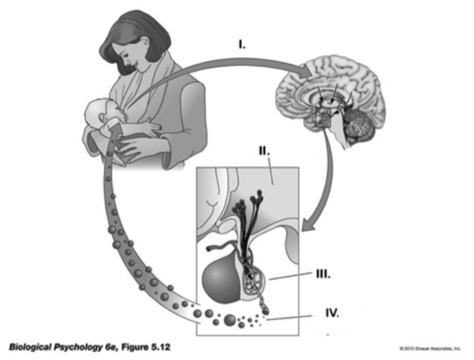

# Preliminaries

## Today's topics

- Quiz 2
- Exam 2 answers

# Quiz 2

# Exam 2 answers

---

### 1. True or False. The primate cerebellum is larger in volume than the cerebral cortex but contains fewer nerve cells than the cerebral cortex. 

- a. True
- b. False

---

### 1. True or False. The primate cerebellum is larger in volume than the cerebral cortex but contains fewer nerve cells than the cerebral cortex. 

- a. True
- b. **False**

---

### 2. Influx of ____ ions into the presynaptic terminal triggers the release of neurotransmitters by means of ____. 

- a. Na+; ion transportation.
- b. Cl-; inhibitory postsynaptic potential enhancement. 
- c. Ca++; exocytosis.
- d. K+; Na+/K+ pump activity.

---

### 2. Influx of ____ ions into the presynaptic terminal triggers the release of neurotransmitters by means of ____. 

- a. Na+; ion transportation.
- b. Cl-; inhibitory postsynaptic potential enhancement. 
- c. **Ca++; exocytosis.**
- d. K+; Na+/K+ pump activity.

---

### 3. This branch of the autonomic nervous system is activated in parallel with the HPA axis during responses to threat or challenge.

- a. sympathetic branch.
- b. parasympathetic branch 
- c. vagal branch.
- d. adrenergic branch.

---

### 3. This branch of the autonomic nervous system is activated in parallel with the HPA axis during responses to threat or challenge.

- a. **sympathetic branch.**
- b. parasympathetic branch 
- c. vagal branch.
- d. adrenergic branch.

---

### Match the hormone to its function.

---

### 4. Oxytocin

- a. Stress response; increases blood in glucose; anti-inflammatory effect. 
- b. Uterine contraction; milk release; bonding. 
- c. Regulates seasonal changes; sexual maturation. 
- d. Blood vessel constriction; antidiuretic hormone.

---

### 4. Oxytocin

- a. Stress response; increases blood in glucose; anti-inflammatory effect. 
- b. **Uterine contraction; milk release; bonding.**
- c. Regulates seasonal changes; sexual maturation. 
- d. Blood vessel constriction; antidiuretic hormone.

---

### 5. Cortisol 

- a. Stress response; increases in blood glucose; anti-inflammatory effect. 
- b. Uterine contraction; milk release; bonding.
- c. Regulates seasonal changes; sexual maturation. 
- d. Blood vessel constriction; antidiuretic hormone. 

---

### 5. Cortisol 

- a. **Stress response; increases in blood glucose; anti-inflammatory effect.** 
- b. Uterine contraction; milk release; bonding.
- c. Regulates seasonal changes; sexual maturation. 
- d. Blood vessel constriction; antidiuretic hormone. 

---

### 6. Melatonin

- a. Stress response; increases in blood glucose; anti-inflammatory effect.
- b. Uterine contraction; milk release; bonding.
- c. Regulates seasonal changes, circadian rhythm. 
- d. Blood vessel constriction; antidiuretic hormone.

---

### 6. Melatonin

- a. Stress response; increases in blood glucose; anti-inflammatory effect.
- b. Uterine contraction; milk release; bonding.
- c. **Regulates seasonal changes, circadian rhythm.**
- d. Blood vessel constriction; antidiuretic hormone. 

---

### 7. Within an animal group, e.g., mammals, large species tend to have _______ brains.

- a. larger
- b. smaller
- c. less metabolically active
- d. more quickly developing

---

### 7. Within an animal group, e.g., mammals, large species tend to have _______ brains.

- a. **larger**
- b. smaller
- c. less metabolically active
- d. more quickly developing

---

### 8. ____ is a kind of ____ brain imaging method used to study axon fiber (white matter) tracts.

- a. Structural MRI; structural.
- b. Positron Emission Tomography (PET); functional.
- c. Magnetoencephalography; functional.
- d. Diffusion tensor imaging (DTI); structural.

---

### 8. ____ is a kind of ____ brain imaging method used to study axon fiber (white matter) tracts.

- a. Structural MRI; structural.
- b. Positron Emission Tomography (PET); functional.
- c. Magnetoencephalography; functional.
- d. **Diffusion tensor imaging (DTI); structural.**

---

### 9. All the following are common treatments for bipolar disorder EXCEPT: 

- a. Lithium.
- b. Anticonvulsants. 
- c. Antipsychotics.
- d. Dopamine agonists.

---

### 9. All the following are common treatments for bipolar disorder EXCEPT: 

- a. Lithium.
- b. Anticonvulsants. 
- c. Antipsychotics.
- d. **Dopamine agonists.**

---

### 10. Brain imaging evidence suggests that emotions activate a distributed network of brain areas, not specific locations in the brain.

- a. True.
- b. False.

---

### 10. Brain imaging evidence suggests that emotions activate a distributed network of brain areas, not specific locations in the brain.

- a. **True.**
- b. False.

---

### 11. Selective serotonin reuptake inhibitors (SSRIs) like Prozac act to ____ neurotransmitter concentrations. 

- a. reduce
- b. eliminate
- c. increase 
- d. recycle 

---

### 11. Selective serotonin reuptake inhibitors (SSRIs) like Prozac act to ____ neurotransmitter concentrations. 

- a. reduce
- b. eliminate
- c. **increase**
- d. recycle 

---

### Please put in their proper order the steps that lead to synaptic communication between neurons. Begin with the presynaptic cell.

---

### 12. Step 1 

- a. Voltage-gated Ca++ channels open. 
- b. Action potential propagates down the axon to the axon terminal. 
- c. Ca++ entry initiates exocytosis of neurotransmitter. 
- d. Ligand-gated receptors bind neurotransmitter and activate channels in the postsynaptic cell. 
- e. Neurotransmitter diffuses across the synaptic cleft. 

---

### 12. Step 1 

- a. Voltage-gated Ca++ channels open. 
- b. **Action potential propagates down the axon to the axon terminal.**
- c. Ca++ entry initiates exocytosis of neurotransmitter. 
- d. Ligand-gated receptors bind neurotransmitter and activate channels in the postsynaptic cell. 
- e. Neurotransmitter diffuses across the synaptic cleft. 

---

### 13. Step 2 

- a. Voltage-gated Ca++ channels open. 
- b. Action potential propagates down the axon to the axon terminal. 
- c. Ca++ entry initiates exocytosis of neurotransmitter. 
- d. Ligand-gated receptors bind neurotransmitter and activate channels in the postsynaptic cell. 
- e. Neurotransmitter diffuses across the synaptic cleft. 

---

### 13. Step 2 

- a. **Voltage-gated Ca++ channels open.**
- b. Action potential propagates down the axon to the axon terminal. 
- c. Ca++ entry initiates exocytosis of neurotransmitter. 
- d. Ligand-gated receptors bind neurotransmitter and activate channels in the postsynaptic cell. 
- e. Neurotransmitter diffuses across the synaptic cleft. 

---

### 14. Step 3 

- a. Voltage-gated Ca++ channels open. 
- b. Action potential propagates down the axon to the axon terminal. 
- c. Ca++ entry initiates exocytosis of neurotransmitter. 
- d. Ligand-gated receptors bind neurotransmitter and activate channels in the postsynaptic cell. 
- e. Neurotransmitter diffuses across the synaptic cleft. 

---

### 14. Step 3 

- a. Voltage-gated Ca++ channels open. 
- b. Action potential propagates down the axon to the axon terminal. 
- c. **Ca++ entry initiates exocytosis of neurotransmitter.**
- d. Ligand-gated receptors bind neurotransmitter and activate channels in the postsynaptic cell. 
- e. Neurotransmitter diffuses across the synaptic cleft. 

---

### 15.  Step 4 

- a. Voltage-gated Ca++ channels open. 
- b. Action potential propagates down the axon to the axon terminal. 
- c. Ca++ entry initiates exocytosis of neurotransmitter. 
- d. Ligand-gated receptors bind neurotransmitter and activate channels in the postsynaptic cell. 
- e. Neurotransmitter diffuses across the synaptic cleft. 

---

### 15.  Step 4 

- a. Voltage-gated Ca++ channels open. 
- b. Action potential propagates down the axon to the axon terminal. 
- c. Ca++ entry initiates exocytosis of neurotransmitter. 
- d. Ligand-gated receptors bind neurotransmitter and activate channels in the postsynaptic cell. 
- e. **Neurotransmitter diffuses across the synaptic cleft.** 

---

### 16. Step 5 

- a. Voltage-gated Ca++ channels open. 
- b. Action potential propagates down the axon to the axon terminal. 
- c. Ca++ entry initiates exocytosis of neurotransmitter. 
- d. Ligand-gated receptors bind neurotransmitter and activate channels in the postsynaptic cell. 
- e. Neurotransmitter diffuses across the synaptic cleft. 

---

### 16. Step 5 

- a. Voltage-gated Ca++ channels open. 
- b. Action potential propagates down the axon to the axon terminal. 
- c. Ca++ entry initiates exocytosis of neurotransmitter. 
- d. **Ligand-gated receptors bind neurotransmitter and activate channels in the postsynaptic cell.** 
- e. Neurotransmitter diffuses across the synaptic cleft. 

---

### 17. The meso-limbo-cortical projection from the ____ in the midbrain releases the neurotransmitter ____. It is part of the brain’s ‘reward’ circuit.

- a. ventral tegmental area; dopamine 
- b. raphe nucleus; NE
- c. superior colliculus; glutamate
- d. thalamus; GABA

---

### 17. The meso-limbo-cortical projection from the ____ in the midbrain releases the neurotransmitter ____. It is part of the brain’s ‘reward’ circuit.

- a. **ventral tegmental area; dopamine**
- b. raphe nucleus; NE
- c. superior colliculus; glutamate
- d. thalamus; GABA

---

### 18. The central sulcus divides the ____. 

- a. left hemisphere from the right
- b. frontal lobe from the parietal lobe
- c. frontal lobe from the occipital lobe
- d. corpus callosum from the anterior commissure

---

### 18. The central sulcus divides the ____. 

- a. left hemisphere from the right
- b. **frontal lobe from the parietal lobe**
- c. frontal lobe from the occipital lobe
- d. corpus callosum from the anterior commissure

---

### 19. This glial cell type produces myelin in the peripheral nervous system. 

- a. Pyramidal cells. 
- b. Schwann cells. 
- c. Oligodendrocytes
- d. Microglia. 

---

### 19. This glial cell type produces myelin in the peripheral nervous system. 

- a. Pyramidal cells. 
- b. **Schwann cells.** 
- c. Oligodendrocytes
- d. Microglia. 

---

### 20. ____ receptors contain their own ion channel; ____ do not.

- a. Ionotropic; metabotropic
- b. Metabotropic; ionotropic
- c. GABA; glutamate
- d. Dopamine; serotonin

---

### 20. ____ receptors contain their own ion channel; ____ do not.

- a. **Ionotropic; metabotropic**
- b. Metabotropic; ionotropic
- c. GABA; glutamate
- d. Dopamine; serotonin

---

### 21. ____ is the primary excitatory neurotransmitter in the CNS; ____ is the primary neurotransmitter of CNS output.

- a. GABA; glutamate. 
- b. Glutamate; GABA.
- c. Glutamate; acetylcholine. 
- d. Acetylcholine; glutamate. 

---

### 21. ____ is the primary excitatory neurotransmitter in the CNS; ____ is the primary neurotransmitter of CNS output.

- a. GABA; glutamate. 
- b. Glutamate; GABA.
- c. **Glutamate; acetylcholine.** 
- d. Acetylcholine; glutamate.

---

### 22. Schizophrenia is characterized by which of the following brain abnormalities?

- a. Increased size of ventricles.
- b. Reduced hippocampal volume. 
- c. White matter disruptions. 
- d. All of the above.

---

### 22. Schizophrenia is characterized by which of the following brain abnormalities?

- a. Increased size of ventricles.
- b. Reduced hippocampal volume. 
- c. White matter disruptions. 
- d. **All of the above.**

---

### 23. Opening a channel permeable to Na+ in a neuron at its resting potential would have a/an ____ effect.

- a. Excitatory 
- b. Inhibitory
- c. Modulatory
- d. Ca++ activating

---

### 23. Opening a channel permeable to Na+ in a neuron at its resting potential would have a/an ____ effect.

- a. **Excitatory** 
- b. Inhibitory
- c. Modulatory
- d. Ca++ activating

---

### Match the endocrine structure with the function.

---

### 24. Hypothalamus

- a. Regulates digestive processes via dopamine release.
- b. Responds to adrenocorticotropic hormone (ACTH) by releasing cortisol.
- c. Releases NE and epinephrine.
- d. Controls hormone secretions into and by the pituitary.

---

### 24. Hypothalamus

- a. Regulates digestive processes via dopamine release.
- b. Responds to adrenocorticotropic hormone (ACTH) by releasing cortisol.
- c. Releases NE and epinephrine.
- d. **Controls hormone secretions into and by the pituitary.**

---

### 25. Pineal gland 

- a. Regulates circadian rhythms via melatonin release.
- b. Responds to adrenocorticotropic hormone (ACTH) by releasing cortisol.
- c. Releases NE and epinephrine.
- d. Controls hormone secretions into and by the pituitary.

---

### 25. Pineal gland 

- a. **Regulates circadian rhythms via melatonin release.**
- b. Responds to adrenocorticotropic hormone (ACTH) by releasing cortisol.
- c. Releases NE and epinephrine.
- d. Controls hormone secretions into and by the pituitary.

---

### 26. Glucocorticoid hormones (e.g., cortisol) serve all the following functions EXCEPT:

- a. Stimulating uterine and vaginal contractions during childbirth
- b. Increasing glucose levels
- c. Inhibiting inflammation
- d. Suppressing immune responses

---

### 26. Glucocorticoid hormones (e.g., cortisol) serve all the following functions EXCEPT:

- a. **Stimulating uterine and vaginal contractions during childbirth**
- b. Increasing glucose levels
- c. Inhibiting inflammation
- d. Suppressing immune responses

---

### 27. Animals with complex nervous systems emerged ____. 

- a. about 4.5 billion years ago. 
- b. about 13.7 billion years ago. 
- c. 500-600 million years ago. 
- d. within the last 10,000 years. 

---

### 27. Animals with complex nervous systems emerged ____. 

- a. about 4.5 billion years ago. 
- b. about 13.7 billion years ago. 
- c. **500-600 million years ago.** 
- d. within the last 10,000 years. 

---

### 28. A type of synapse called gap junctions support ____ between cells.

- a. direct electrical coupling 
- b. chemical communication 
- c. slow communication
- d. hormonal signaling

---

### 28. A type of synapse called gap junctions support ____ between cells.

- a. **direct electrical coupling** 
- b. chemical communication 
- c. slow communication
- d. hormonal signaling 

---

### 29. The release of glutamate onto an ionotropic receptor on a neuron’s dendrite produces an ____. 

- a. inhibitory postsynaptic potential (IPSP)
- b. electrochemical postsynaptic potential (EPSP)
- c. inwardly-driven postsynaptic potential (IPSP) 
- d. excitatory postsynaptic potential (EPSP) 

---

### 29. The release of glutamate onto an ionotropic receptor on a neuron’s dendrite produces an ____. 

- a. inhibitory postsynaptic potential (IPSP)
- b. electrochemical postsynaptic potential (EPSP)
- c. inwardly-driven postsynaptic potential (IPSP) 
- d. **excitatory postsynaptic potential (EPSP)**

---

### 30. Both Parkinson’s Disease and schizophrenia have been linked to disturbances in ____ neurotransmitter systems. 

- a. dopamine
- b. GABA 
- c. acetylcholine 
- d. serotonin

---

### 30. Both Parkinson’s Disease and schizophrenia have been linked to disturbances in ____ neurotransmitter systems. 

- a. **dopamine**
- b. GABA 
- c. acetylcholine 
- d. serotonin

---

### 31. True or False. There are many details about how evolution occurred that are not yet well established.

- a. True. 
- b. False.

---

### 31. True or False. There are many details about how evolution occurred that are not yet well established.

- a. **True.**
- b. False.

---

### 32. The human ____ has about 16 billion neurons, ____ than any other animal, including animals with larger brains.

- a. cerebellum; fewer 
- b. cerebral cortex; fewer 
- c. cerebral cortex; more 
- d. cerebellum; more 

---

### 32. The human ____ has about 16 billion neurons, ____ than any other animal, including animals with larger brains.

- a. cerebellum; fewer 
- b. cerebral cortex; fewer 
- c. **cerebral cortex; more** 
- d. cerebellum; more

---

### 33. All of the following are characteristics of the vertebrate central nervous system EXCEPT:

- a. radial symmetry.
- b. segmentation. 
- c. encephalization. 
- d. identifiable forebrain, midbrain, and hindbrain components. 

---

### 33. All of the following are characteristics of the vertebrate central nervous system EXCEPT:

- a. **radial symmetry.**
- b. segmentation. 
- c. encephalization. 
- d. identifiable forebrain, midbrain, and hindbrain components. 

---

### 34. Brain mass _____ body mass in vertebrates. 

- a. increases with
- b. decreases with
- c. has no relationship to
- d. can't be measured like

---

### 34. Brain mass _____ body mass in vertebrates. 

- a. **increases with**
- b. decreases with
- c. has no relationship to
- d. can't be measured like 

---

### Match the Roman numeral in the figures below, to the process and structures in the hormonal action cycle the figure depicts.

---

:::: {.columns}
::: {.column width=50%}
### 35. I 

- a. Posterior pituitary receives impulses from hypothalamus. 
- b. Sensory nerve impulses project to the brain. 
- c. Release of oxytocin into blood stream. 
- d. Hypothalamus responds to sensory input. 
:::
::: {.column width=50%}

:::
::::

---

:::: {.columns}
::: {.column width=50%}
### 35. I 

- a. Posterior pituitary receives impulses from hypothalamus. 
- b. **Sensory nerve impulses project to the brain.**
- c. Release of oxytocin into blood stream. 
- d. Hypothalamus responds to sensory input. 
:::
::: {.column width=50%}

:::
::::

---

:::: {.columns}
::: {.column width=50%}
### 36. II

- a. Posterior pituitary receives impulses from hypothalamus.
- b. Sensory nerve impulses project to the brain.
- c. Release of oxytocin into blood stream. 
- d. Hypothalamus responds to sensory input. 
:::
::: {.column width=50%}

:::
::::

---

:::: {.columns}
::: {.column width=50%}
### 36. II

- a. Posterior pituitary receives impulses from hypothalamus.
- b. Sensory nerve impulses project to the brain.
- c. Release of oxytocin into blood stream. 
- d. **Hypothalamus responds to sensory input.** 
:::
::: {.column width=50%}

:::
::::

---

:::: {.columns}
::: {.column width=50%}
### 37. III

- a. Posterior pituitary receives impulses from hypothalamus. 
- b. Sensory nerve impulses project to the brain.
- c. Release of oxytocin into blood stream. 
- d. Hypothalamus responds to sensory input. 
:::
::: {.column width=50%}

:::
::::

---

:::: {.columns}
::: {.column width=50%}
### 37. III

- a. **Posterior pituitary receives impulses from hypothalamus.** 
- b. Sensory nerve impulses project to the brain.
- c. Release of oxytocin into blood stream. 
- d. Hypothalamus responds to sensory input. 
:::
::: {.column width=50%}

:::
::::

---

:::: {.columns}
::: {.column width=50%}
### 38. IV

- a. Posterior pituitary receives impulses from hypothalamus.
- b. Sensory nerve impulses project to the brain. 
- c. Release of oxytocin into blood stream. 
- d. Hypothalamus responds to sensory input.
:::
::: {.column width=50%}

:::
::::

---

:::: {.columns}
::: {.column width=50%}
### 38. IV

- a. Posterior pituitary receives impulses from hypothalamus.
- b. Sensory nerve impulses project to the brain. 
- c. **Release of oxytocin into blood stream.**
- d. Hypothalamus responds to sensory input.
:::
::: {.column width=50%}

:::
::::

---

### 39. Which of the following statements are inconsistent with the theory of evolution.

- a. Organisms existed in the distant past that no longer exist today.
- b. Organisms differ in the extent to which they survive and reproduce successfully.
- c. The history of life on Earth is too short for new species to have evolved.
- d. Offspring inherit many traits from their parents. 

---

### 39. Which of the following statements are inconsistent with the theory of evolution.

- a. Organisms existed in the distant past that no longer exist today.
- b. Organisms differ in the extent to which they survive and reproduce successfully.
- c. **The history of life on Earth is too short for new species to have evolved.**
- d. Offspring inherit many traits from their parents. 

---

### 40. All of these animals except ____, have relatively large brains for their body sizes and correspondingly high cognitive capacities.

- a. chimpanzees. 
- b. mice. 
- c. humans. 
- d. corvids (crows and ravens). 

---

### 40. All of these animals except ____, have relatively large brains for their body sizes and correspondingly high cognitive capacities.

- a. chimpanzees. 
- b. **mice.** 
- c. humans. 
- d. corvids (crows and ravens). 

---

### 41. The hippocampus is located deep within which lobe of the cerebral cortex? 

- a. Temporal. 
- b. Frontal. 
- c. Parietal. 
- d. Occipital. 

---

### 41. The hippocampus is located deep within which lobe of the cerebral cortex? 

- a. **Temporal.**
- b. Frontal. 
- c. Parietal. 
- d. Occipital. 

---

### 42. Histamine is one of the ____ group of neurotransmitters. It is released by the ____. 

- a. monoamine; hippocampus 
- b. monoamine; hypothalamus 
- c. amino acid; midbrain 
- d. peptide; amygdala

---

### 42. Histamine is one of the ____ group of neurotransmitters. It is released by the ____. 

- a. monoamine; hippocampus 
- b. **monoamine; hypothalamus** 
- c. amino acid; midbrain 
- d. peptide; amygdala 

---

### 43. The 10th cranial (Xth) or vagus nerve connects to the ____ branch of the autonomic nervous system. Its neurons tend to slow heart rate and activate digestion when stimulated. 

- a. parasympathetic 
- b. sympathetic
- c. enteric
- d. somatic 

---

### 43. The 10th cranial (Xth) or vagus nerve connects to the ____ branch of the autonomic nervous system. Its neurons tend to slow heart rate and activate digestion when stimulated. 

- a. **parasympathetic**
- b. sympathetic
- c. enteric
- d. somatic 

---

### 44. Recent large-scale meta-analyses have ____ .

- a. Reinforced the association between serotonin dysfunction and depression.
- b. Called into question similarities between bipolar disorder and schizophrenia.
- c. Reinforced the link between dopamine dysfunction and bipolar disorder. 
- d. Called into question the relationship between serotonin dysfunction and depression.

---

### 44. Recent large-scale meta-analyses have ____ .

- a. Reinforced the association between serotonin dysfunction and depression.
- b. Called into question similarities between bipolar disorder and schizophrenia.
- c. Reinforced the link between dopamine dysfunction and bipolar disorder. 
- d. **Called into question the relationship between serotonin dysfunction and depression.**

---

### 45. The neural tube forms at about ____ post-conception in human embryos. This is commonly considered the starting point for the development of the nervous system.

- a. 37 weeks
- b. 6 months
- c. 3-4 weeks
- d. 2 years

---

### 45. The neural tube forms at about ____ post-conception in human embryos. This is commonly considered the starting point for the development of the nervous system.

- a. 37 weeks
- b. 6 months
- c. **3-4 weeks**
- d. 2 years

# Wrap-up

## Next time

- Vision III

# Resources

# Resources

