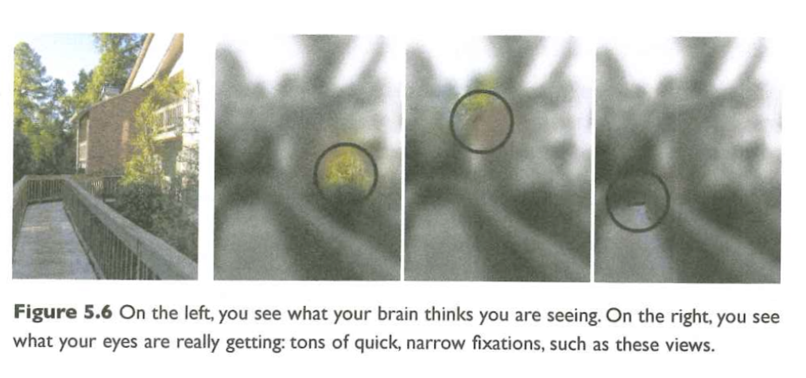
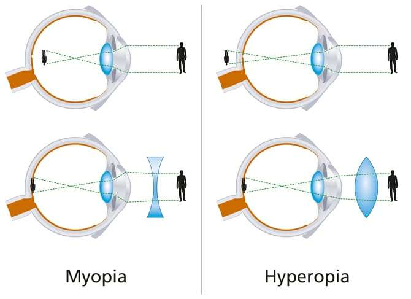

# Preliminaries

## Announcement

- Quiz 3 this Friday.

## Today's topics

- Warm-up
- Capturing information in light
- From retina to brain

# Warm-up

---

### The image of visual patterns projecting onto the retina is:

- A. Inside out and rotated.
- B. Upside down and left/right reversed.
- C. Unrecognizably distorted by the cornea and lens.
- D. Larger in one eye than the other.

---

### The image of visual patterns projecting onto the retina is:

- A. ~~Inside out and rotated.~~
- B. **Upside down and left/right reversed.**
- C. ~~Unrecognizably distorted by the cornea and lens.~~
- D. ~~Larger in one eye than the other.~~

---

### Visual information allows the perceiver to extract information about all of the following properties, EXCEPT:

- A. Object position (where is it?)
- B. Object density (mass/volume)
- C. Object type/identity (what is it?)
- D. Time (of day/year)

---

### Visual information allows the perceiver to extract information about all of the following properties, EXCEPT:

- A. Object position (where is it?)
- B. **Object density (mass/volume)**
- C. Object type/identity (what is it?)
- D. Time (of day/year)

# Capturing information in light

---

{#fig-rods-cones}

## How photoreceptors work

:::: {.columns}
::: {.column width=50%}
- Outer segment
    + Membrane disks
    + *Photopigments*
        - Sense light, trigger chemical cascade
:::
::: {.column width=50%}

:::
::::
    
## How photoreceptors work

:::: {.columns}
::: {.column width=50%}
- Inner segment
    + Synaptic terminal
- Light *hyperpolarizes* photoreceptor!
    + The *dark current*
- *Less* light $\rightarrow$ more NT (glutamate)!
:::
::: {.column width=50%}

:::
::::
    
## Retina

- Physiologically *backwards*
    + How?
- Anatomically *inside-out*
    + How?
    
## Retina

- Physiologically *backwards*
    + Dark current (more NT released in dark than light)
- Anatomically *inside-out*
    + Photoreceptors at back of eye

---

### Photoreceptors are arranged in mosaics

{#fig-cone-rod-mosaics}

---

### with different concentrations in different parts of the retina

{#fig-book-bionumbers}

## Photoreceptor distribution

- Retinal periphery
  - Mostly rods
- Retinal center/fovea 
  - Mostly cones
  - ~1-2 deg
  
## Visual field angular sizes


## Consequences

- Must move eyes (or eyes/head or eyes/head/body) to position fovea on target
- Keep track of sequence of eye movements and positions over time
- Integrate sequence of samples over time

---



## Retinal information processing

- Separate channels for
  - Achromatic (black/gray/white)
  - Chromatic
    - Mostly cones
    - Short, medium, long wavelength types
- 
- ~120 M rods + ~ 5 M cones (125 M) vs. professional cameras with 100 M pixels

## Retinal information processing

- Point by point, topographic (map-like) 2D image of 3D world
- Non-uniform resolution (center >> periphery)
- yields focused image except...

---

### ...when eye misshapen for cornea+lens

{#fig-myopia-hyperopia width="65%"}

## Color perception

:::: {.columns}
::: {.column width=50%}
- Perceived color a function of activity in "R", "G", and "B" photoreceptors
:::
::: {.column width=50%}
{#fig-color-perception}
:::
::::

## Wavelengths are continuous, but are perceived colors?


## Color vision anomalies

:::: {.columns}
::: {.column width=50%}
- Absence of or anomalies in photoreceptors
:::
::: {.column width=50%}
{#fig-ishihara width="55%"}
:::
::::

## Types

:::: {.columns}
::: {.column width=40%}
- Protanopia (impaired R/long wavelength)
- Deuteranopia (impaired G/medium wavelength)
- Tritanopia (impaired B/short wavelength)
:::
::: {.column width=60%}
{#fig-color-vision-anomolies}
:::
::::

# From retina to brain

<div class="centered">

</div>

## From eye to brain

- Retinal ganglion cells
  - 1st cells with long axons
  - 1st to generate action potentials
- 2nd/II cranial (optic) nerve
    + Optic chiasm

## From eye to brain

- Hypothalamus
    + Suprachiasmatic nucleus
        - Regulates circadian (day/night) rhythm via pineal gland

---

```{r, fig.cap="https://en.wikipedia.org/wiki/Retinohypothalamic_tract", echo=FALSE, out.width="700px", fig.align='center'}
knitr::include_graphics("https://upload.wikimedia.org/wikipedia/commons/5/55/Circadian_rhythm_labeled.jpg")
```

## From eye to brain
        
- Superior colliculus & brainstem

## *Lateral Geniculate Nucleus (LGN)* of thalamus 

- ~90% of axons from retina

<div class="centered">

</div>

## LGN

- 6 layers + intralaminar zone
    + Parvocellular (small cells): chromatic 
    + Magnocellular (big cells): achromatic
    + Koniocellular (chromatic - short wavelength?)
- Retinotopic map of opposite visual field

## From LGN to V1

<div class="centered">

</div>

## From LGN to V1

- Via optic radiations
- *[Primary visual cortex (V1)](http://www.scholarpedia.org/article/Area_V1)* in occipital lobe

<!-- ## Human V1 {.smaller} -->

<!-- <div class="centered"> -->
<!--  -->

<!-- <http://www.scholarpedia.org/w/images/3/3a/03-Human-V1.png> -->
<!-- </div> -->

<!-- ## Measuring retinotopy in V1 {.smaller} -->

<!-- <div class="centered"> -->
<!--  -->

<!-- [[@dougherty_visual_2003]](http://dx.doi.org/10.1167/3.10.1) -->
<!-- </div> -->

<!-- --- -->

<!-- <iframe width="560" height="315" src="https://www.youtube.com/embed/f2JMbo4BZqY" title="YouTube video player" frameborder="0" allow="accelerometer; autoplay; clipboard-write; encrypted-media; gyroscope; picture-in-picture" allowfullscreen></iframe> -->

<!-- --- -->

<!-- <iframe width="560" height="315" src="https://www.youtube.com/embed/rsykP-9-moA" title="YouTube video player" frameborder="0" allow="accelerometer; autoplay; clipboard-write; encrypted-media; gyroscope; picture-in-picture" allowfullscreen></iframe> -->

<!-- ## Retinotopy in V1 -->

<!-- - Fovea overrepresented -->
<!--     + Analogous to somatosensation -->
<!--     + High acuity in fovea vs. lower outside it -->
<!-- - Upper visual field/lower (ventral) V1 and *vice versa* -->

<!-- ## Recording from V1 -->

<!-- <iframe width="560" height="315" src="https://www.youtube.com/embed/IOHayh06LJ4" title="YouTube video player" frameborder="0" allow="accelerometer; autoplay; clipboard-write; encrypted-media; gyroscope; picture-in-picture" allowfullscreen></iframe> -->

<!-- --- -->

<!-- <iframe width="560" height="315" src="https://www.youtube.com/embed/8VdFf3egwfg" title="YouTube video player" frameborder="0" allow="accelerometer; autoplay; clipboard-write; encrypted-media; gyroscope; picture-in-picture" allowfullscreen></iframe> -->

<!-- ## V1 has laminar, columnar organization -->

<!-- <div class="centered"> -->
<!--  -->
<!-- </div> -->

<!-- ## V1 has laminar, columnar organization -->

<!-- - 6 laminae (layers) -->
<!--     + Input: Layer 4 -->
<!--     + Output: Layers 2-3 (to cortex), 5 (to brainstem), 6 (to LGN) -->

<!-- ## V1 has laminar, columnar organization -->

<!-- - Columns -->
<!--     + Orientation/angle -->
<!--     + Spatial frequency -->

<!-- ## Orientation/angle tuning {.smaller} -->

<!-- <div class="centered"> -->
<!--  -->

<!-- <https://foundationsofvision.stanford.edu/wp-content/uploads/2012/02/dir.selective.png> -->
<!-- </div> -->

<!-- ## From center-surround receptive fields to line detection {.smaller} -->

<!-- <div class="centered" height=450px> -->
<!--  -->
<!-- </div> -->

<!-- ## Spatial frequency tuning {.smaller} -->

<!-- <div class="centered"> -->
<!-- Low == gist    ||     high == details -->
<!--  -->

<!-- [[@panichello_predictive_2013]](http://dx.doi.org/10.3389/fpsyg.2012.00620) -->
<!-- </div> -->

<!-- ## V1 has laminar, columnar organization -->

<!-- - Columns -->
<!--     + Color/wavelength -->
<!--     + Eye of origin, *ocular dominance* -->

<!-- ## Ocular dominance columns -->

<!-- <div class="centered"> -->
<!--  -->
<!-- </div> -->

<!-- ## Ocular dominance signals retinal disparity -->

<!-- <iframe width="560" height="315" src="https://www.youtube.com/embed/KjAQdc29vF8" frameborder="0" allowfullscreen></iframe> -->

<!-- <http://www.scholarpedia.org/w/images/9/99/11-Hubel-Wiesel-model.png> -->
<!-- </div> -->

<!-- ## Beyond V1 -->

<!-- <div class="centered" height=450px> -->
<!--  -->
<!-- </div> -->

<!-- ## Beyond V1 -->

<!-- - Larger, more complex receptive fields -->
<!-- - *Dorsal stream* (where/how) -->
<!--     + Toward parietal lobe -->
<!-- - *Ventral stream* (what) -->

<!-- ## "Rich" perception from "impoverished" info -->

<!-- <https://www.biomotionlab.ca/html5-bml-walker/> -->

<!-- ## What is vision for? -->

<!-- - What is it? (form perception) -->
<!-- - Where is it? (space perception) -->
<!-- - How do I get from here to there (action control) -->
<!-- - What time (or time of year) is it? -->

<!-- ## Computer vision inspired by biological vision -->

<!-- ```{r, out.width="800px"} -->
<!-- knitr::include_graphics("https://i2.wp.com/thedatascientist.com/wp-content/uploads/2018/03/Deep-Neural-Network-What-is-Deep-Learning-Edureka.png?fit=1926%2C987&ssl=1") -->
<!-- ``` -->

<!-- --- -->

<!-- <https://github.com/CMU-Perceptual-Computing-Lab/openpose> -->

<!-- --- -->

<!-- <iframe width="560" height="315" src="https://www.youtube.com/embed/MPU2HistivI" title="YouTube video player" frameborder="0" allow="accelerometer; autoplay; clipboard-write; encrypted-media; gyroscope; picture-in-picture" allowfullscreen></iframe> -->

## References {.smaller}
