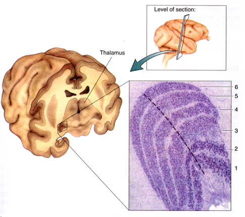
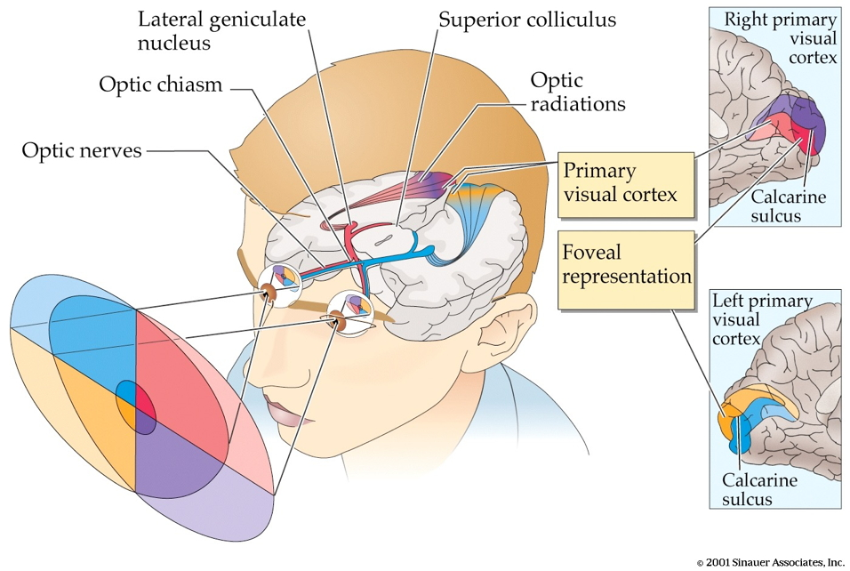
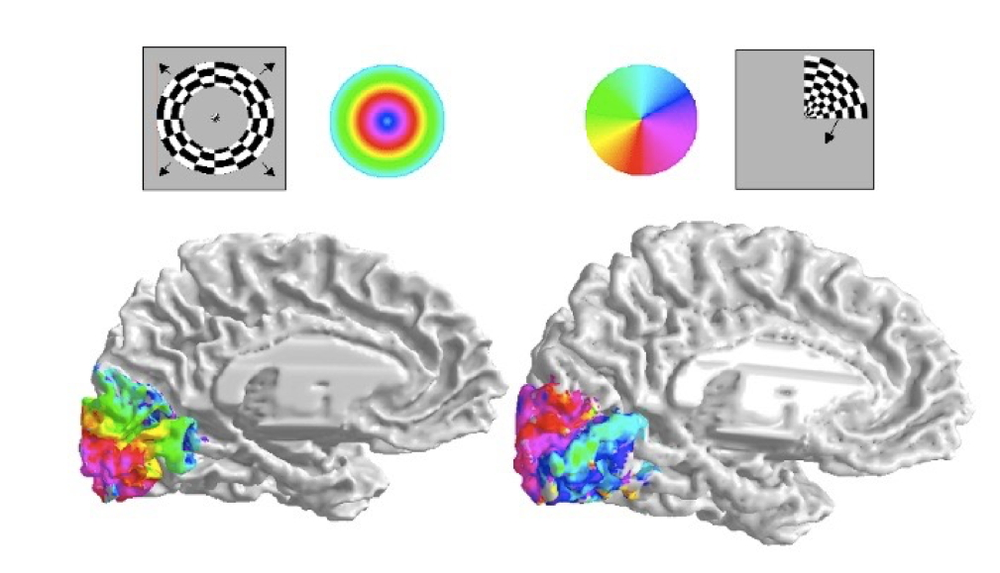
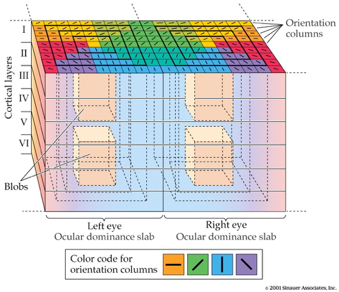
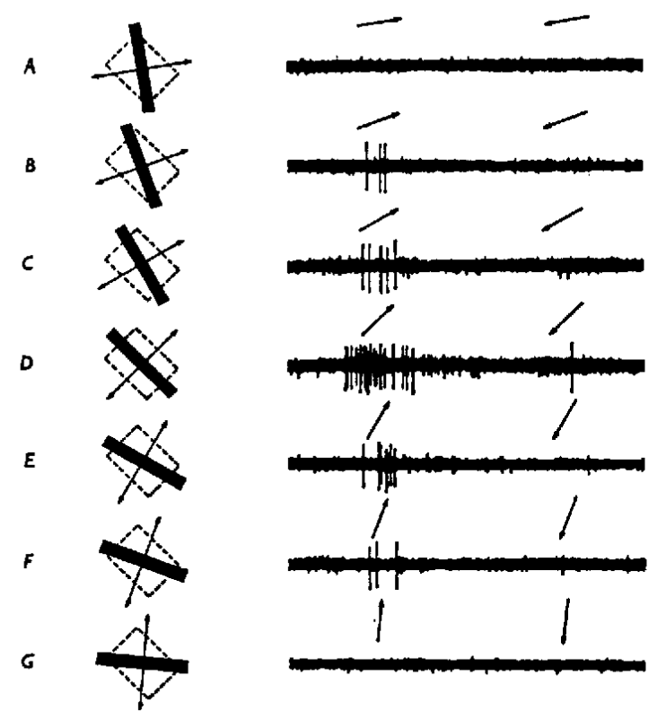
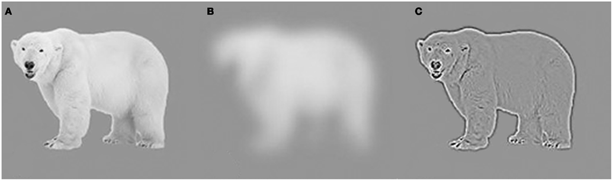
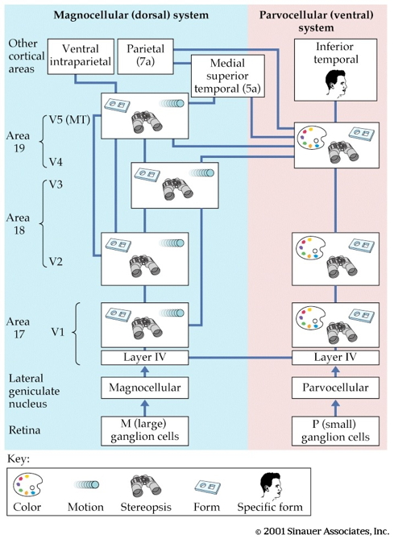
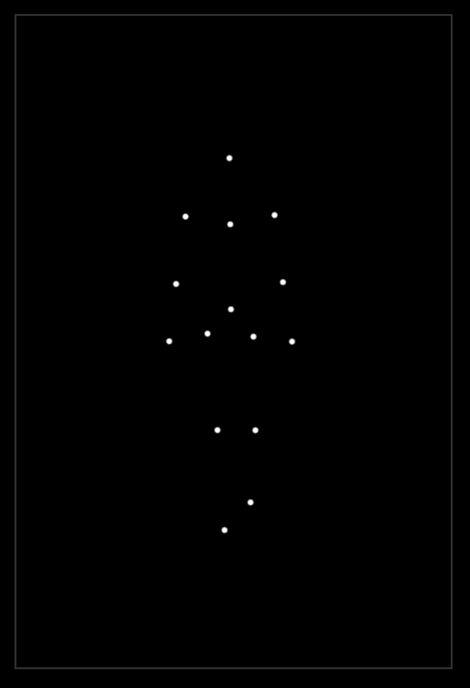

# Preliminaries

## Announcement

- Quiz 4, next Friday, November 4, 2026

## PSYCH 452 • Learning and Memory

- Dr. Nancy Dennis (nad12\@psu.edu)
- MWF 10:10-11:00, Chambers 208
- PSYCH 256 is a prerequisite, but Dr. Dennis can override for PSYCH 260 students

## PSYCH 452 • Learning and Memory

>The class focuses on explaining how memory works - including memory success and memory failures (such as forgetting and false memory). We also learn about the brain basis of memory in understanding success and failures across the lifespan. It will conclude with an examination of individual differences in memory including memory in childhood and advanced aging, Alzheimer’s disease and amnesia. 

## Today's topics

- Warm-up
- Beyond photoreceptors
- From retina to brain

# Warm-up

---

### What part of the retina contains the lowest concentration of rod photoreceptors?

:::: {.columns}
::: {.column width=50%}
- A. Periphery
- B. Fovea
- C. Nasal hemifield
- D. Optic disk
:::
::: {.column width=50%}
:::
::::

---

:::: {.columns}
::: {.column width=50%}
- ~~A. Periphery~~
- **B. Fovea**
- ~~C. Nasal hemifield~~
- ~~D. Optic disk~~
:::
::: {.column width=50%}

:::
::::

---

### Why does Gilmore say that photoreceptors are physiologically *backward*?

- A. Light hyperpolarizes photoreceptors
- B. Light depolarizes photoreceptors
- C. Na+ ions flow out of photoreceptors
- D. Cl- ion flow out of photoreceptors

---

### Why does Gilmore say that photoreceptors are physiologically *backward*?

- **A. Light hyperpolarizes photoreceptors**
- ~~B. Light depolarizes photoreceptors~~
- ~~C. Na+ ions flow out of photoreceptors~~
- ~~D. Cl- ion flow out of photoreceptors~~

## Beyond photoreceptors

:::: {.columns}
::: {.column width=50%}
- Photoreceptors $\rightarrow$
- Bipolar cells $\rightarrow$
- Retinal ganglion cells
:::
::: {.column width=50%}
{fig-align="center" #fig-the-retina}
:::
::::

## From eye to brain

- Retinal ganglion cells
  - 1st cells with long axons (to LGN, hypothalamus, brainstem)
  - 1st to generate action potentials
  - Information functionally segregated
  
## ["Receptive fields"](https://en.wikipedia.org/wiki/Receptive_field)

+ Area on retina that changes neuron's firing when stimulated in a specific way

---

{#fig-receptive-field width="65%"}

## Receptive field (RF) properties

- Shape/diameter
- Information that it responds to best
- RFs and feature detectors

## Center-Surround RFs

:::: {.columns}
::: {.column width=50%}
::: {.incremental}
- Functional property of bipolar & retinal ganglion cells
- Circular-shaped region on retina
- "On" and "off" zones
:::
:::
::: {.column width=50%}
![Wikipedia^["By original uploaded to en by user:delldot, modified by Xoneca - Own work, Public Domain, https://commons.wikimedia.org/w/index.php?curid=5714283"]](https://upload.wikimedia.org/wikipedia/commons/1/16/Receptive_field.png?utm_source=en.wikipedia.org&utm_campaign=imageinfo&utm_content=thumbnail_unscaled){#fig-wikipedia-rfs width="45%"}
:::
::::

## Center-Surround RFs

:::: {.columns}
::: {.column width=50%}
::: {.incremental}
- Maximal response:
  - light in "on" zone +
  - dark in "off" zone
- Weakest response when light/dark in *both*
- Detect contrast (light/dark difference)

:::
:::
::: {.column width=50%}
![Wikipedia^["By original uploaded to en by user:delldot, modified by Xoneca - Own work, Public Domain, https://commons.wikimedia.org/w/index.php?curid=5714283"]](https://upload.wikimedia.org/wikipedia/commons/1/16/Receptive_field.png?utm_source=en.wikipedia.org&utm_campaign=imageinfo&utm_content=thumbnail_unscaled){width="45%"}
:::
::::

## Thinking about RFs

- What shape are the RFs of photoreceptors?
- Why don't photoreceptors have center-surround RFs?
- The diameter of RFs varies in size? Why do you suppose?
- Where in the retina do you think RF diameters are *smallest*?
  
---

![Wikipedia^["By Otosakanum2 - Own work, CC BY-SA 4.0, https://commons.wikimedia.org/w/index.php?curid=174602486"]](https://thumb.wikimedia.org/wikipedia/commons/thumb/2/24/Cross_section_of_retinal_layers.png/1920px-Cross_section_of_retinal_layers.png?utm_source=en.wikipedia.org&utm_campaign=imageinfo&utm_content=thumbnail){#fig-retinal-layers width="45%"}

## From eye to brain

- Retinal ganglion cells
  - 1st cells with long axons
  - 1st to generate action potentials
- 2nd/II cranial (optic) nerve
    + Optic chiasm

## From eye to brain

:::: {.columns}
::: {.column width=50%}
- Hypothalamus
    + Suprachiasmatic nucleus
        - Regulates circadian (day/night) rhythm via pineal gland
:::
::: {.column width=50%}

:::
::::

## From eye to brain
        
- Superior colliculus & brainstem
  - CN III, IV, VI (control eye movements)

## *Lateral Geniculate Nucleus (LGN)* of thalamus 

:::: {.columns}
::: {.column width=50%}
- ~90% of axons from retina
:::
::: {.column width=50%}

:::
::::

## LGN

:::: {.columns}
::: {.column width=50%}
- 6 layers + intralaminar zone
    + Parvocellular (small cells): chromatic 
    + Magnocellular (big cells): achromatic
    + Koniocellular (chromatic - short wavelength?)
:::
::: {.column width=50%}

:::
::::

## LGN

:::: {.columns}
::: {.column width=50%}
- Input from both eyes
- Retinotopic map of *opposite* visual field
:::
::: {.column width=50%}

:::
::::

## From LGN to Primary Visual Cortex

{width="65%" fig-align="center"}

## From LGN to Primary Visual Cortex

:::: {.columns}
::: {.column width=50%}
- Via optic radiations
- *[Primary visual cortex (V1)](http://www.scholarpedia.org/article/Area_V1)* in occipital lobe
:::
::: {.column width=50%}
![Wikipedia^[By Yeh, F. C., Panesar, S., Fernandes, D., Meola, A., Yoshino, M., Fernandez-Miranda, J. C., ... & Verstynen, T. (2018). Population-averaged atlas of the macroscale human structural connectome and its network topology. NeuroImage, 178, 57-68. - http://brain.labsolver.org/, CC BY-SA 4.0, https://commons.wikimedia.org/w/index.php?curid=78298729]](https://upload.wikimedia.org/wikipedia/commons/9/9c/Optic_Radiation.jpg)
:::
::::

## LGN to V1

:::: {.columns}
::: {.column width=50%}
- Via optic radiations
- *[Primary visual cortex (V1)](http://www.scholarpedia.org/article/Area_V1)* in occipital lobe
:::
::: {.column width=50%}
![Wikipedia^[By Ratznium at en.wikipedia, CC BY 2.5, https://commons.wikimedia.org/w/index.php?curid=3199004]](https://upload.wikimedia.org/wikipedia/commons/d/d0/ERP_-_optic_cabling.jpg)
:::
::::

## Human V1

![Scholarpedia^[http://www.scholarpedia.org/w/images/3/3a/03-Human-V1.png]](http://www.scholarpedia.org/w/images/3/3a/03-Human-V1.png){width="120%"}

## Measuring retinotopy in V1

{#fig-dougherty-2003 width="75%"}

---

<iframe width="560" height="315" src="https://www.youtube.com/embed/f2JMbo4BZqY" title="YouTube video player" frameborder="0" allow="accelerometer; autoplay; clipboard-write; encrypted-media; gyroscope; picture-in-picture" allowfullscreen></iframe>

---

<iframe width="560" height="315" src="https://www.youtube.com/embed/rsykP-9-moA" title="YouTube video player" frameborder="0" allow="accelerometer; autoplay; clipboard-write; encrypted-media; gyroscope; picture-in-picture" allowfullscreen></iframe>

## Retinotopy in V1

- Fovea overrepresented
    + Analogous to somatosensation
    + High acuity in fovea vs. lower outside it
- Upper visual field/lower (ventral) V1 and *vice versa*

## Recording from V1

<iframe width="560" height="315" src="https://www.youtube.com/embed/IOHayh06LJ4" title="YouTube video player" frameborder="0" allow="accelerometer; autoplay; clipboard-write; encrypted-media; gyroscope; picture-in-picture" allowfullscreen></iframe>

---

<iframe width="560" height="315" src="https://www.youtube.com/embed/8VdFf3egwfg" title="YouTube video player" frameborder="0" allow="accelerometer; autoplay; clipboard-write; encrypted-media; gyroscope; picture-in-picture" allowfullscreen></iframe>

## V1 has laminar, columnar organization

{fig-align="center"}

## V1 has laminar, columnar organization

:::: {.columns}
::: {.column width=50%}

- 6 laminae (layers)
    + Input: Layer 4
    + Output: Layers 2-3 (to cortex), 5 (to brainstem), 6 (to LGN)
    
:::
::: {.column width=50%}

- Columns
    + Orientation/angle
    + Spatial frequency
    
:::
::::

## Orientation/angle tuning

{width="35%"}

## From center-surround receptive fields to line detection

## Spatial frequency tuning

Low == gist    ||     high == details

## Ocular dominance slabs/columns

:::: {.columns}
::: {.column width=50%}
- Input from one eye "dominates" input from the other
:::
::: {.column width=50%}

:::
::::

## Ocular dominance signals retinal disparity

<iframe width="560" height="315" src="https://www.youtube.com/embed/KjAQdc29vF8" frameborder="0" allowfullscreen></iframe>

<http://www.scholarpedia.org/w/images/9/99/11-Hubel-Wiesel-model.png>

## Beyond V1

{width="35%" fig-align="center"}

## Beyond V1

- Larger, more complex receptive fields
- *Dorsal stream* (where/how)
    + Toward parietal lobe
- *Ventral stream* (what)

## "Rich" perception from "impoverished" info

{fig-align="center" width="25%"}

## What is vision for?

- What is it? (form perception)
- Where is it? (space perception)
- How do I get from here to there (action control)
- What time (or time of year) is it?

## Computer vision inspired by biological vision

---

---

<iframe width="560" height="315" src="https://www.youtube.com/embed/MPU2HistivI" title="YouTube video player" frameborder="0" allow="accelerometer; autoplay; clipboard-write; encrypted-media; gyroscope; picture-in-picture" allowfullscreen></iframe>

# Wrap-up

## Main points

- 90% of axons from retinal ganglion cells go to the LGN
- Visual pathways functionally segregated
  - Eye of origin
  - Chromatic/achromatic
  - Part of retina

## Main points

- Visual pathways maintain retinotopic map
- LGN layered
- LGN projects to V1 via optic radiations

## Main points

- V1 has laminar, columnar structure
  - Layers: Input vs. output
  - Columns: eye
  - Orientation, motion direction, color
- Most V1 cells do not have circular center-surround RFs

## Next time

- Audition

# Resources


