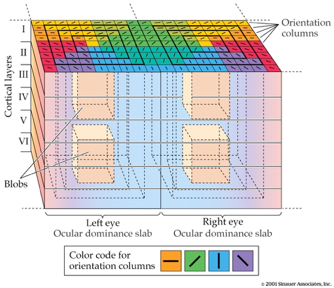
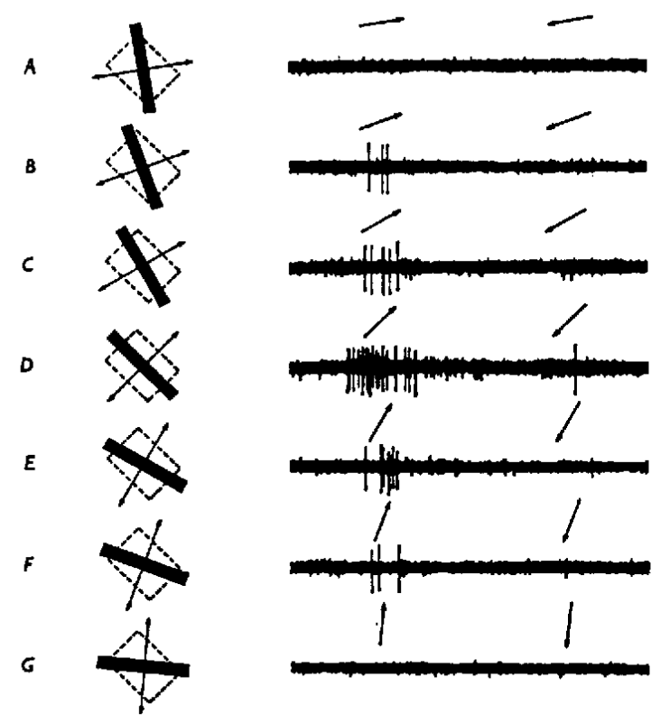
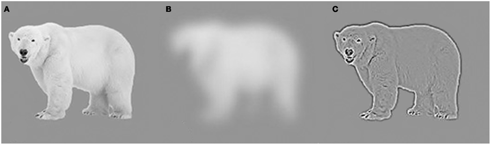
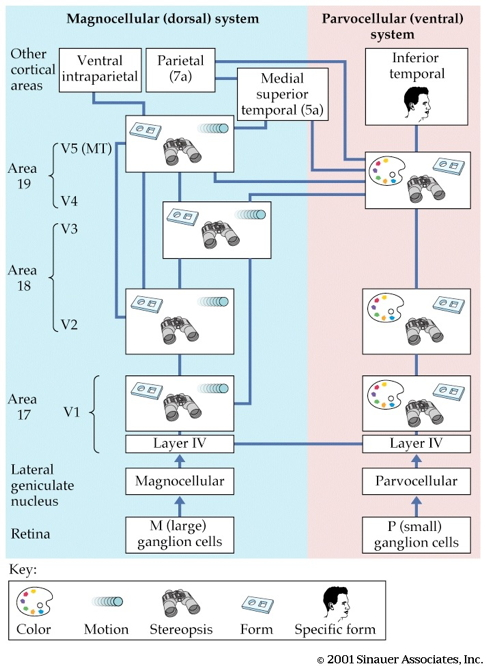
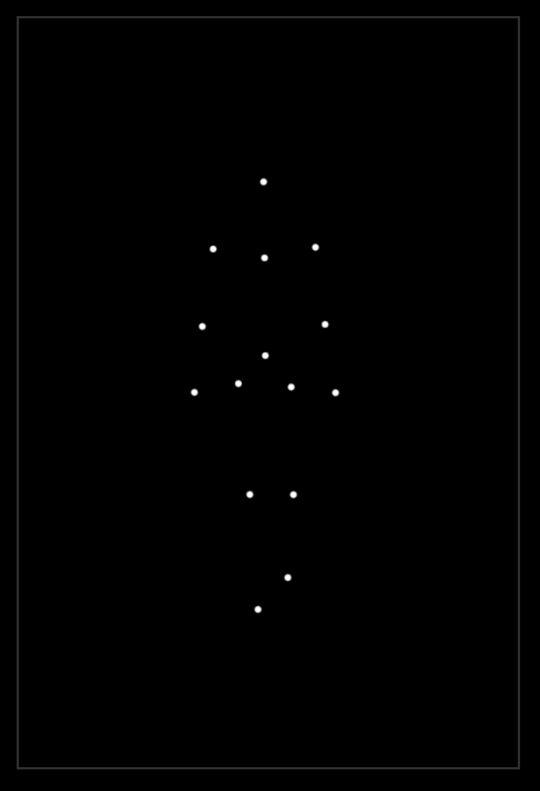
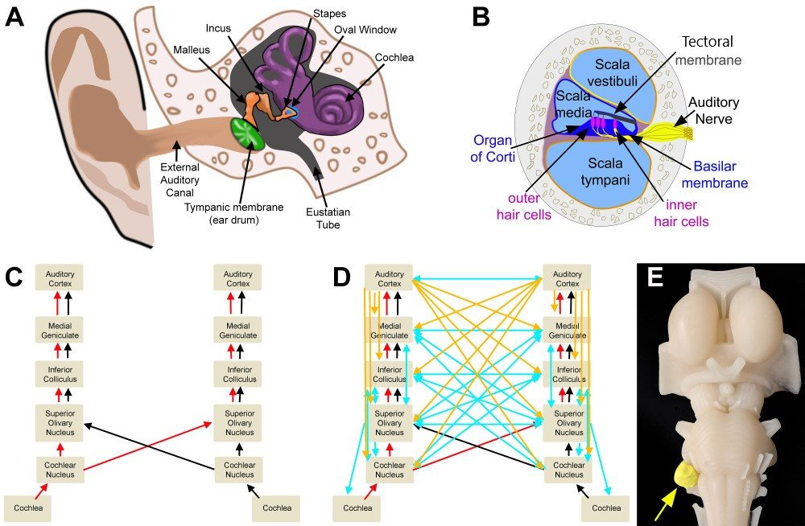

# Preliminaries

## Announcement

- Quiz 4, next Friday, November 20, 2026

## Today's topics

- Warm-up
- Last word on vision
- Audition

# Warm-up

# Last word on vision

## Recording from V1

::: {#fig-hubel-wiesel}
<iframe width="560" height="315" src="https://www.youtube.com/embed/IOHayh06LJ4?si=mtkfFkr_OljvFcnf" title="YouTube video player" frameborder="0" allow="accelerometer; autoplay; clipboard-write; encrypted-media; gyroscope; picture-in-picture; web-share" referrerpolicy="strict-origin-when-cross-origin" allowfullscreen></iframe>

@Lester2009-kw
:::

---

::: {#fig-v1}

<iframe width="560" height="315" src="https://www.youtube.com/embed/8VdFf3egwfg?si=15M81syK75hwT2KC" title="YouTube video player" frameborder="0" allow="accelerometer; autoplay; clipboard-write; encrypted-media; gyroscope; picture-in-picture; web-share" referrerpolicy="strict-origin-when-cross-origin" allowfullscreen></iframe>

@Moeeny2011-kl
:::

## V1 has laminar, columnar organization

{fig-align="center"}

## V1 has laminar, columnar organization

:::: {.columns}
::: {.column width=50%}

- 6 laminae (layers)
    + Input: Layer 4
    + Output: Layers 2-3 (to cortex), 5 (to brainstem), 6 (to LGN)
    
:::
::: {.column width=50%}

- Columns
    + Orientation/angle
    + Spatial frequency
    
:::
::::

## Orientation/angle tuning

{width="35%"}

## From center-surround receptive fields to line detection

## Spatial frequency tuning

Low == gist    ||     high == details

## Ocular dominance slabs/columns

:::: {.columns}
::: {.column width=50%}
- Input from one eye "dominates" input from the other
:::
::: {.column width=50%}

:::
::::

## Ocular dominance signals retinal disparity

<iframe width="560" height="315" src="https://www.youtube.com/embed/KjAQdc29vF8" frameborder="0" allowfullscreen></iframe>

<http://www.scholarpedia.org/w/images/9/99/11-Hubel-Wiesel-model.png>

## Beyond V1

{width="35%" fig-align="center"}

## Beyond V1

- Larger, more complex receptive fields
- *Dorsal stream* (where/how)
    + Toward parietal lobe
- *Ventral stream* (what)

## "Rich" perception from "impoverished" info

{fig-align="center" width="25%"}

## What is vision for?

- What is it? (form perception)
- Where is it? (space perception)
- How do I get from here to there (action control)
- What time (or time of year) is it?

## Computer vision inspired by biological vision

---

---

<iframe width="560" height="315" src="https://www.youtube.com/embed/MPU2HistivI" title="YouTube video player" frameborder="0" allow="accelerometer; autoplay; clipboard-write; encrypted-media; gyroscope; picture-in-picture" allowfullscreen></iframe>

## Main points

- V1 has laminar, columnar structure
  - Layers: Input vs. output
  - Columns: eye
  - Orientation, motion direction, color
- Most V1 cells do not have circular center-surround RFs
- Regions beyond V3 no longer retinotopic, have complex RFs

# Audition

## What is audition (hearing) for?

:::: {.columns}
::: {.column width=50%}
- What is out there?
- Where is it?
- Where is it moving?
:::
::: {.column width=50%}
::: {.fragment}
- Out of sight!
- In the dark!
:::
:::
::::

## Information in sound

:::: {.columns}
::: {.column width=50%}
- Source: Mechanical vibrations in air or water
:::
::: {.column width=50%}

:::
::::

## Audition

- What is it?
    - Pattern of frequencies, amplitudes, durations
- Where is it?
    - Left/right or up/down: Interaural time/phase, intensity differences, pinnae filtering
    - Motion: Frequency shifts via Doppler effect
    
## Audition

:::: {.columns}
::: {.column width=50%}
- Frequencies in sound
:::
::: {.column width=50%}

:::
::::

## Anatomy of audition

:::: {.columns}
::: {.column width=50%}
- Outer ear, especially the pinna
- Middle ear
  - Typmpanic membrane
  - Ossicles
:::
::: {.column width=50%}

:::
::::

## Anatomy of audition

:::: {.columns}
::: {.column width=50%}
- Inner ear
  - Cochlea
:::
::: {.column width=50%}

:::
::::

## Specialized neurons

:::: {.columns}
::: {.column width=50%}
- Cochlear hair cells
- Different sound frequencies activate distinct regions of the cochlea
:::
::: {.column width=50%}

:::
::::

##

![@Joris2019-wi^["Schematic illustration of the transformation from sound waveforms to neural excitation. (Top row) Sound waveforms of (a) a low-frequency tone, (b) a high-frequency tone, and (c) wideband noise. (Middle row) The corresponding waveforms filtered by the cochlea: (d,e) low- and high-frequency tones at their own characteristic cochlear place and (f,g) the same wideband noise at apical and basal cochlear positions, respectively. (Bottom row) The timing of action potentials in the auditory nerve (AN) shown in (top) peri-stimulus time histograms and (bottom) corresponding dot rasters. The dots represent the timing of action potentials evoked by repeated presentations of the stimuli in the panel above. Responses to low frequencies (h,j) show fine structure (i.e., phase locking), while the responses to high frequencies (i,k) only show envelope coding."]](https://www.annualreviews.org/docserver/ahah/fulltext/neuro/42/1/ne420433.f1_thmb.gif)

## {.center}

{#fig-peterson-2025 width="75%"}

## Tonotopic mapping

:::: {.columns}
::: {.column width=50%}
- Tonotopic: map of tones/frequencies
:::
::: {.column width=50%}

:::
::::

## Auditory projection pathway

:::: {.columns}
::: {.column width=50%}
- Cochlea
- VIII cranial (auditory) nerve
- Superior Olivary Complex
:::
::: {.column width=50%}

:::
::::

## Auditory projection pathway

:::: {.columns}
::: {.column width=50%}
- Inferior Colliculus
- Medial Geniculate Nucleus
- Primary Auditory Cortex (A1)
:::
::: {.column width=50%}

:::
::::

## Perceiving what

- Frequencies
- Temporal patterns
- Prior knowledge

## Sound perception is complex

## Hearing where

:::: {.columns}
::: {.column width=50%}
- Binaural
  - Inter-aural time (phase) differences
  - Inter-aural level differences
:::
::: {.column width=50%}
80227-9/asset/67ebce3a-6ba5-48f1-96fa-73741b80d7f5/main.assets/gr1.jpg)
:::
::::

## Hearing where

:::: {.columns}
::: {.column width=50%}
- Monaural
  - Spectral cues (pinnae, head, etc.)
- Head movements
:::
::: {.column width=50%}
80227-9/asset/67ebce3a-6ba5-48f1-96fa-73741b80d7f5/main.assets/gr1.jpg)
:::
::::

## Demo

# Wrap-up

## Main points

## Next time

- Sensory systems

# Resources


