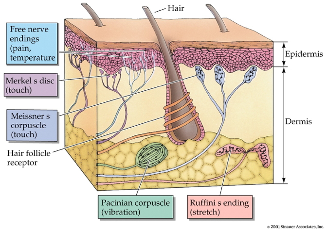
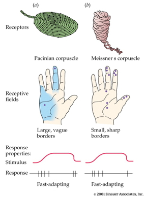
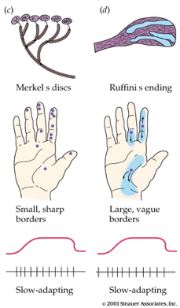
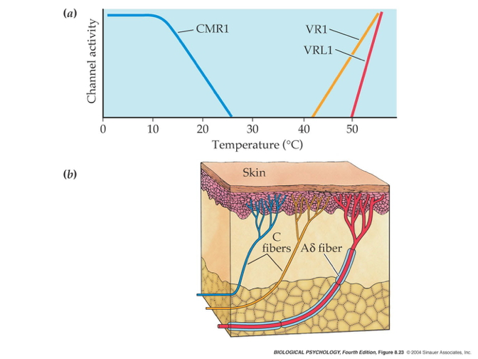
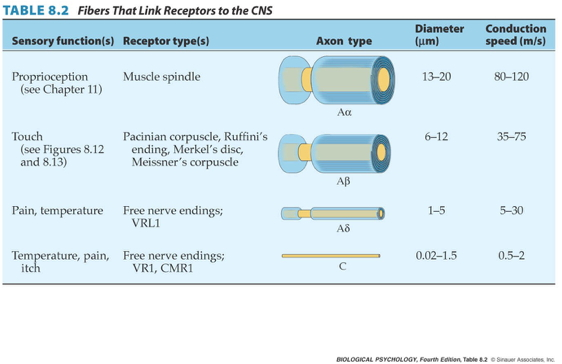
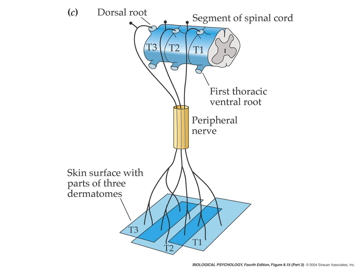
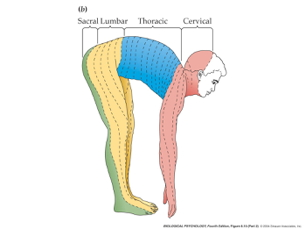

# Prelude

---



-- @Ross-Topic2018-zj

<!-- --- -->

<!--  -->

<!-- -- @ThePoliceVEVO2010-sc -->

## Announcements

- Quiz 4, this Friday, November 20, 2026
- Exam 3, Wednesday, December 3, 2026

## Today's topics

- Wrap-up on sensory systems
  - Link to [2026-11-13 slides](wk-12-2026-11-13-sensory-systems.qmd#chemosensation)
- Somatosensation (Part 1 of 2)

# Somatosensation

## What is it?

- Sensations about the body (soma)

## Types of somatosensation

- Internal (interoceptive)
    - How do I feel?
    + Where/how is my body positioned?
    + Proprioception (perception of the self)
- External (exteroceptive)
    + What’s in the world?
    + Where is it?

## Internal senses

- Kinesthesia
    + Body position
    + Movement 
- Vestibular sense
    + Head position (relative to gravity)
    + Head movement (rotation, translation)
    
## Vesibulo-ocular response (VOR)

:::: {.columns}
::: {.column width=50%}
- Keeps eyes steady when head moves
- Fast: response < 10 ms
- Disturbed in vertigo
:::
::: {.column width=50%}
![Wikipedia^[By User:Mikael Häggström - Image:ThreeNeuronArc.pngOriginal uploader was Tvil at en.wikipedia, CC BY-SA 3.0, https://commons.wikimedia.org/w/index.php?curid=2980751]](https://upload.wikimedia.org/wikipedia/commons/5/58/Simple_vestibulo-ocular_reflex.PNG)
:::
::::

## Vestibulo-ocular response (VOR)

:::: {.columns}
::: {.column width=50%}
- Keeps eyes steady when head moves
- Can't walk & text without it
:::
::: {.column width=50%}


-- @Castilla2007-cq
:::
::::

## External senses

:::: {.columns}
::: {.column width=50%}
- What's out there and where is it located?
- Cutaneous (receptors in the skin) senses
    + Hot, cold
    + Pressure
    + Vibration
- Plus kinesthesia (why?)
:::
::: {.column width=50%}

:::
::::

## Cutaneous receptors

:::: {.columns}
::: {.column width=33%}
- Receptors specialize in different info types, properties
:::
::: {.column width=33%}

:::
::: {.column width=33%}

:::
::::

## Question

- Why are minty foods cool?
- Why are spicy foods hot?

## Receptors detect chemicals + temperature

:::: {.columns}
::: {.column width=50%}
- **Menthol/mint receptor** (CMR1)
    + Also signals "cool" temperatures
:::
::: {.column width=50%}

:::
::::

## Receptors detect chemicals + temperature

:::: {.columns}
::: {.column width=50%}
- **Vanilloid Receptors** (TrpV1/VR1, VRL1)
    + Respond to capsaicin (in peppers), allyl isothiocyanate (in mustard, wasabi)
    + Also signal "hot" temperatures
:::
::: {.column width=50%}

:::
::::

## Axon size/speed trade-off

:::: {.columns}
::: {.column width=50%}
- Not all info travels at the same speed
- Thicker -> faster
- Myelinated -> faster
:::
::: {.column width=50%}

:::
::::

## Axon size/speed trade-off

:::: {.columns}
::: {.column width=50%}
- Fast: Kinesthesia (from muscles and joints) the fastest
- Slow: Pain/itch, temperature
:::
::: {.column width=50%}

:::
::::

## From skin to brain

- Cutaneous receptors ->
- Dorsal root ganglion in spinal cord ->
- Ventral posterior lateral (VPL) thalamus ->
- Primary somatosensory cortex (S1) ->
    + Post-central gyrus of parietal lobe
    
## Dermatomes

- Patches of skin ennervated by a set of nerves

:::: {.columns}
::: {.column width=50%}

:::
::: {.column width=50%}

:::
::::

## Functional segregation

:::: {.columns}
::: {.column width=50%}
- Separate pathways for different information types
- **Dorsal column/medial leminiscal pathway**
    - Touch, proprioception
:::
::: {.column width=50%}

:::
::::

## Functional segregation

:::: {.columns}
::: {.column width=50%}
- **Spinothalamic tract**
    - Pain, temperature
:::
::: {.column width=50%}

:::
::::

# Wrap up

## Main points

- Perceiving Where
    + Somatotopic maps -- locations on skin
    + Kinesthesia -- configuration of limbs
    
## Main points

- Perceiving What
    + Patterns of smoothness, roughness, shape, temperature
- Functional segregation
  - Multiple receptors, parallel axon pathways

## Next time

- Somatosensation II

# Resources


