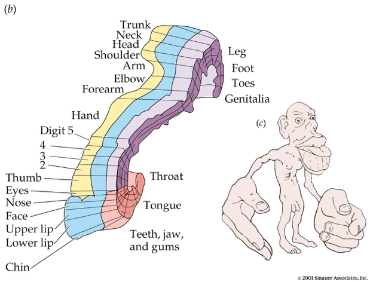
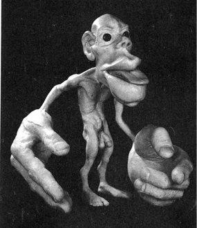
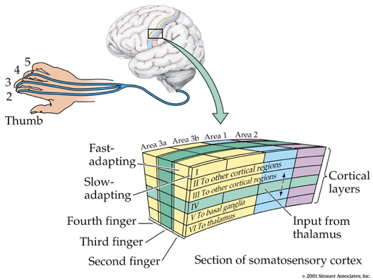
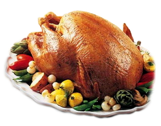
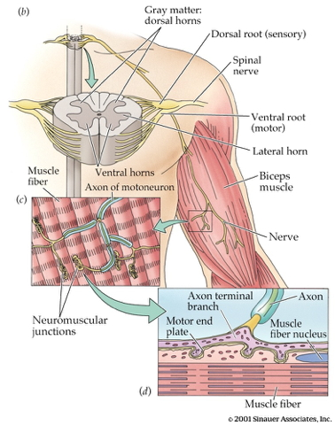
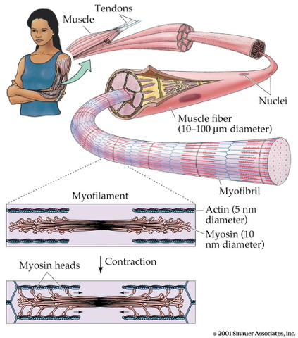
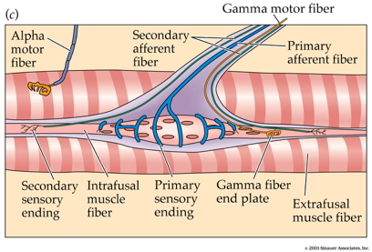
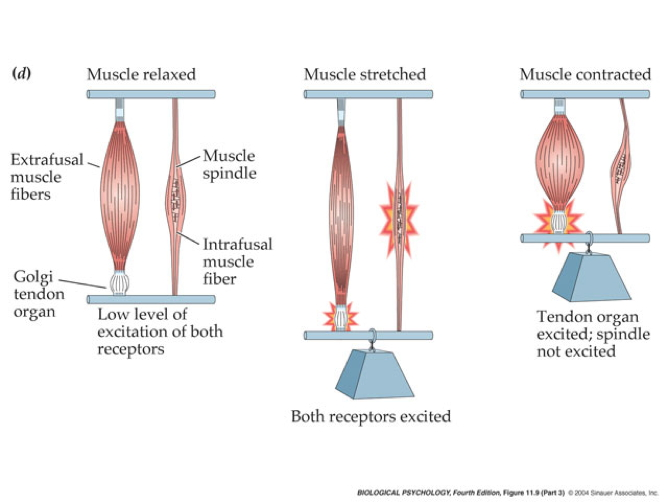
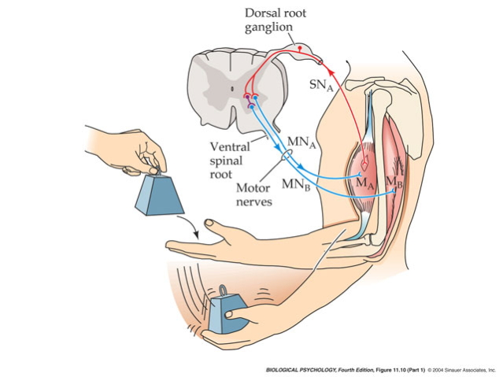

# Prelude

---



-- @Reviews2012-fg

## Announcements

- Quiz 4, this Friday, November 20, 2026
- Exam 3, Wednesday, December 3, 2026

## Today's topics

- Warm up
- Action
- Exam 3 review

# Warm up

---

### All of the statements about the science of perception are true, except:

::: {.incremental}
- A. Scientific psychology started by focusing on perception.
- B. Psychophysics is the discipline most closely associated with the science of perception.
- C. The relationship between physical properties (like brightness) and perceptual judgements (like magnitude) are often non-linear.
- D. People can't report accurately or consistently about their perceptual experiences.
:::

---

### All of the statements about the science of perception are true, except:

- *A. Scientific psychology started by focusing on perception.*
- *B. Psychophysics is the discipline most closely associated with the science of perception.*
- *C. The relationship between physical properties (like brightness) and perceptual judgements (like magnitude) are often non-linear.*
- **D. People can't report accurately or consistently about their perceptual experiences.**

--- 

### There are clearly defined maps on the surface of the cerebral cortex for many sensory channels with the exception of:

::: {.incremental}
- A. Vision
- B. Olfaction/gustation (chemical senses)
- C. Audition
- D. Somatosensation
:::

--- 

### There are clearly defined maps on the surface of the cerebral cortex for many sensory channels with the exception of:

- ~~A. Vision~~
- **B. Olfaction/gustation (chemical senses)**
- ~~C. Audition~~
- ~~D. Somatosensation~~

---

### "Minty"-tasting foods are also perceived as cool because:

::: {.incremental}
- A. The same receptor in the skin responds to menthol and cooler temperatures.
- B. Separate receptors for menthol and cool temperatures activate the same regions of cortex.
- C. Hot and cold receptors mix-up minty and spicy signals.
- D. Most foods that use mint are served cold.
:::

---

### "Minty"-tasting foods are also perceived as cool because:

- A. **The same receptor in the skin responds to menthol and cooler temperatures.**
- ~~B. Separate receptors for menthol and cool temperatures activate the same regions of cortex.~~
- ~~C. Hot and cold receptors mix-up minty and spicy signals.~~
- ~~D. Most foods that use mint are served cold.~~

# Somatosensation II

## Somatotopic maps

:::: {.columns}
::: {.column width=50%}
- In thalamus & cerebral cortex
:::
::: {.column width=50%}

:::
::::

## Maps non-uniform

:::: {.columns}
::: {.column width=50%}
- Some areas of skin activate disproportionately sized areas of the cerebral cortex
  - hands, face, lips & tongue
- More sensors in skin...
- More axons to brain...
- Larger areas in brain
:::
::: {.column width=50%}
{fig-align="right" width="65%"}
:::
::::

---

## Parallel pathways

:::: {.columns}
::: {.column width=50%}
- S1 maintains functional segregation of input types
:::
::: {.column width=50%}

:::
::::

## Main points

- Perceiving Where
    + Somatotopic maps -- locations on skin
    + Kinesthesia -- configuration of limbs
    
## Main points

- Perceiving What
    + Patterns of smoothness, roughness, shape, temperature
- Functional segregation
  - Multiple receptors, parallel axon pathways

# Action I

## Behavior as a system

:::: {.columns}
::: {.column width=50%}
- Inputs (sensation/perception)
- Processing (emotion/cognition)
- Outputs
:::
::: {.column width=50%}
```{mermaid}
flowchart TD
  I(input) --> P[processing]
  P --> O(output)
```
:::
::::

## Multiple outputs

:::: {.columns}
::: {.column width=50%}
- Autonomic
- Endocrine
- Secretions, excretions
- Behavior
  - Body movements
  - Vocalization
:::
::: {.column width=50%}
```{mermaid}
flowchart TD
  P(processing) --> A[ANS]
  P --> H(endocrine)
  P --> S(secretions, excretions)
  P --> B(behavior/action)
  B --> M(movements)
  B --> V(vocalizations)
```
:::
::::

## Movement types 1

::: {.incremental}
- Locomotion
- Reaching, grasping, manipulation
- Facial expressions
- Eye/head movements
- Maintainance of posture, balance
:::
    
## Movement types 2

::: {.incremental}
- Reflexes
  + Simple, highly stereotyped, unlearned, rapid
- vs. planned or voluntary actions
  + Complex, flexible, acquired, slower
  - Discrete (reaching) vs. rhythmic (walking)
  - Ballistic (no feedback) vs. controlled (feedback)
  - Sequential
::: 
    
## Muscle types

:::: {.columns}
::: {.column width=50%}
- Cardiac
- Smooth
    + Arteries, hair follicles, uterus, intestines
    - Involuntary
    + Regulated by ANS
:::
::: {.column width=50%}

:::
::::

## Muscle types

:::: {.columns}
::: {.column width=50%}
- Striated (striped)
    + Skeletal
    + Voluntary control
    - Mostly connected to tendons and bones
    - Regulated by somatic part of PNS
:::
::: {.column width=50%}

:::
::::

## Skeletal muscle groups

- Axial
    + Trunk, neck, hips
- Proximal
    + Shoulder/elbow, pelvis/knee
- Distal
    + Hands/fingers, feet/toes
    
## Skeletal muscles

:::: {.columns}
::: {.column width=40%}
- 650+ muscles
- 40% of total body mass
- 50-75% of total body proteins
- @Frontera2015-rt
- millions of motor neurons
:::
::: {.column width=30%}

:::
::: {.column width=30%}

:::
::::

## Muscle fiber types

:::: {.columns}
::: {.column width=50%}
::: {.incremental}
- Fast twitch/fatiguing
    + Type II (A & B)
    + White meat
- Slow twitch/fatiguing
    + Type I
    + Red/dark meat
:::
:::
::: {.column width=50%}
{fig-align="right"}
:::
::::

---

<!-- Orchestra -->


## From neuron to muscle

:::: {.columns}
::: {.column width=50%}
- Motor neuron
  - Cell body in ventral or lateral horn of spinal cord
  - Axons exit spinal cord via ventral root
:::
::: {.column width=50%}
{fig-align="right"}
:::
::::

## From neuron to muscle

:::: {.columns}
::: {.column width=50%}
- Synapse at neuromuscular junction
    + Release acetylcholine (ACh) onto skeletal muscle fiber
:::
::: {.column width=50%}
{fig-align="right"}
:::
::::

## From neuron to muscle

:::: {.columns}
::: {.column width=50%}
- Motor endplate on muscle fiber
    + Contains nicotinic ACh receptors (nAChR)
:::
::: {.column width=50%}
{fig-align="right"}
:::
::::

## From neuron to muscle

:::: {.columns}
::: {.column width=50%}
- nAChR receptor opens
  - Na+ enters; K+ exits
  - Combined effect excitatory
:::
::: {.column width=50%}
{fig-align="right"}
:::
::::

## From neuron to muscle

:::: {.columns}
::: {.column width=50%}
+ Generates excitatory endplate potential (EPP)
    + Muscle fiber depolarizes
    + Depolarization spreads along fiber
    + Ca++ released from stores inside muscle
:::
::: {.column width=50%}
{fig-align="right"}
:::
::::

---

:::: {.columns}
::: {.column width=50%}
- Muscle fibers segmented into sarcomeres
- Myofibrils (w/in sarcomere)
    + Paired actin & mysosin proteins
    + “Molecular gears”
- Ca++ plus energy source (ATP)
    - Bind, move, unbind (repeat)
:::
::: {.column width=50%}
{fig-align="right"}
:::
::::

---

:::: {.columns}
::: {.column width=50%}
- No "reverse" gear
  - Only contract
  - Must be pulled to stretch/extend
- Muscles often arranged in agonist/antagonist pairs
:::
::: {.column width=50%}
{fig-align="right"}
:::
::::

## Marionette analogy

{fig-align="center"}

## Muscles are sensory organs, too!

## Muscle fiber types

:::: {.columns}
::: {.column width=50%}
- **Intrafusal** fibers
    + Sense length/tension
    + Ennervated (contract) via gamma ($\gamma$) motor neuron activation
    + Contain muscle spindles (sensory organs linked to Ia afferents)
:::
::: {.column width=50%}
{fig-align="right"}
:::
::::

## Muscle fiber types

:::: {.columns}
::: {.column width=50%}
- **Extrafusal** fibers
    + Generate force
    + Ennervated (contract) via alpha ($\alpha$) motor neurons
:::
::: {.column width=50%}
{fig-align="right"}
:::
::::

## Monosynaptic stretch (myotatic) reflex

:::: {.columns}
::: {.column width=50%}
- Muscle stretched (length increases)
- Muscle spindle in intrafusal fiber activates
- Ia afferent sends signal to spinal cord
    + Activates alpha ($\alpha$) motor neuron
:::
::: {.column width=50%}
{fig-align="right"}
:::
::::

## Monosynaptic stretch (myotatic) reflex

:::: {.columns}
::: {.column width=50%}
- Muscle contracts, shortens length
- Gamma ($\gamma$) motor neuron fires to take up intrafusal fiber slack
:::
::: {.column width=50%}
{fig-align="right"}
:::
::::

## Avoiding tremor

:::: {.columns}
::: {.column width=50%}
- Polysynaptic *inhibition* of antagonist muscle
- Prevents/dampens tremor

- Remember: Brain gets fast(est) sensory info from spindles
:::
::: {.column width=50%}
{fig-align="right"}
:::
::::

## Why this matters...

{fig-align="center"}

# Wrap up

## Main points

- 650+ skeletal muscles control voluntary human movement, balance/posture control
- Large diameter, thickly myelinated axons control skeletal muscles
- Motor neurons release ACh onto nicotinic receptors (AChR) in motor endplate

## Main points

- Depolarization of muscle fiber causes Ca++ release
  - Triggers actin & myosin proteins to cause muscle contraction 
- Muscles are sensory organs AND force/movement producers
- Monosynaptic stretch reflex

## Next time

- Quiz 4
- Action II

# Resources

# Resources


