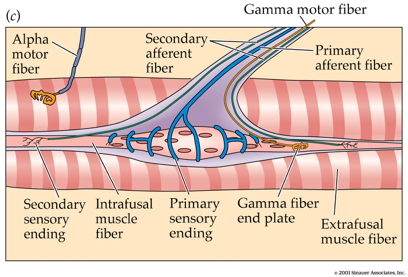
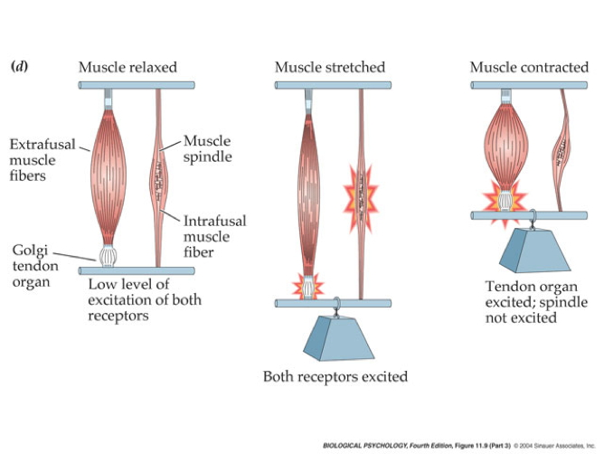
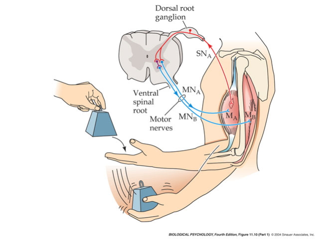
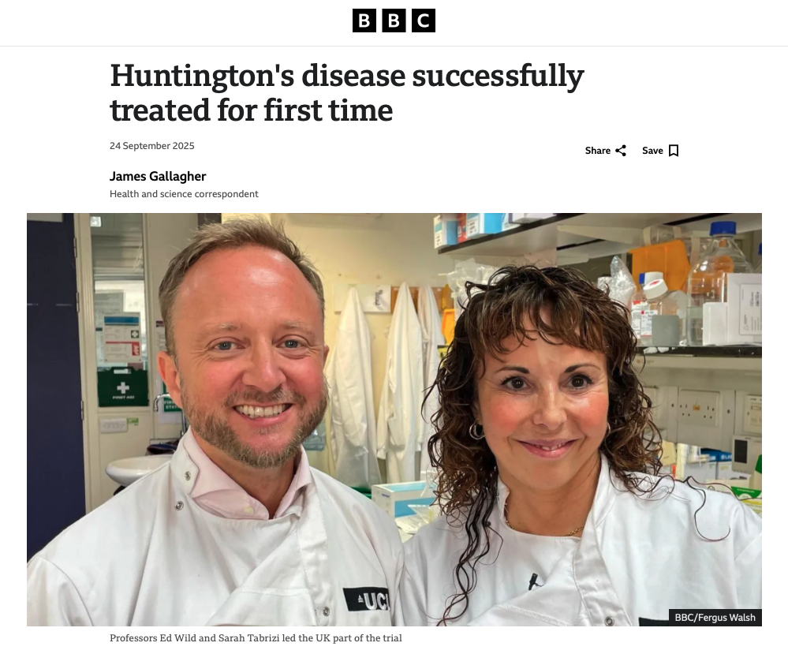

# Preliminaries

---

::: {#fig-woody-guthrie-this-land-is-your-land}

<iframe width="1280" height="450" src="https://www.youtube.com/embed/XaI5IRuS2aE?si=7FCoDPW_Z1-IGCqd" title="YouTube video player" frameborder="0" allow="accelerometer; autoplay; clipboard-write; encrypted-media; gyroscope; picture-in-picture; web-share" referrerpolicy="strict-origin-when-cross-origin" allowfullscreen></iframe>

@alargedog2007-wy
:::

## Announcements

- Exam 3, Wednesday, December 3, 2026

## Today's topics

- Quiz 4
- Action II

# Quiz 4

# Muscles are sensory organs, too!

## Muscle fiber types

:::: {.columns}
::: {.column width=50%}
- **Intrafusal** fibers
    + Sense length/tension
    + Ennervated (contract) via gamma ($\gamma$) motor neuron activation
    + Contain muscle spindles (sensory organs linked to Ia afferents)
:::
::: {.column width=50%}
{fig-align="right"}
:::
::::

## Muscle fiber types

:::: {.columns}
::: {.column width=50%}
- **Extrafusal** fibers
    + Generate force
    + Ennervated (contract) via alpha ($\alpha$) motor neurons
:::
::: {.column width=50%}
{fig-align="right"}
:::
::::

## Monosynaptic stretch (myotatic) reflex

:::: {.columns}
::: {.column width=50%}
- Muscle stretched (length increases)
- Muscle spindle in intrafusal fiber activates
- Ia afferent sends signal to spinal cord
    + Activates alpha ($\alpha$) motor neuron
:::
::: {.column width=50%}
{fig-align="right"}
:::
::::

## Monosynaptic stretch (myotatic) reflex

:::: {.columns}
::: {.column width=50%}
- Muscle contracts, shortens length
- Gamma ($\gamma$) motor neuron fires to take up intrafusal fiber slack
:::
::: {.column width=50%}
{fig-align="right"}
:::
::::

## Avoiding tremor

:::: {.columns}
::: {.column width=50%}
- Polysynaptic *inhibition* of antagonist muscle
- Prevents/dampens tremor

- Remember: Brain gets fast(est) sensory info from spindles
:::
::: {.column width=50%}
{fig-align="right"}
:::
::::

## Why this matters...

{fig-align="center"}


# Disorders of movement

## Parkinson's Disease



## Parkinson's Disease

- Symptoms
    - Slow, absent movement, resting tremor
    - Cognitive deficits, depression
- Biological correlates
    - DA neurons in substantia nigra degenerate, effect basal ganglia
    - Autoimmune disorder? [@Garretti2019-sr]

## Parkinson's Disease

:::: {.columns}
::: {.column width=50%}
- Treatments
    + DA agonists
      + Levodopa (L-Dopa), DA precursor    
    + But, DA agonists linked to impulse control disorders in ~1/7 patients [@Ramirez-Zamora2016-rl]
:::
::: {.column width=50%}

:::
::::


## Parkinson's Disease

:::: {.columns}
::: {.column width=50%}
- Deep brain stimulation
:::
::: {.column width=50%}

:::
::::

## Huntington's Disease


## Huntington's Disease

- Formerly Huntington’s Chorea
    + "Chorea" from Greek for "dance"
    + “Dance-like” pattern of involuntary movements
    - Cognitive decline

---



## Causes

- Genetic + environmental influences
    - Gene fragment (CAG) duplication
    - High levels of *huntingtin* protein accumulate in basal ganglia
    - People with familial risk may want to consider genetic testing
- No effective treatment
    - Promising gene therapy trial halted recently [@Kwon2021-bj]
    
---



## Amyotrophic Lateral Sclerosis (ALS; Lou Gehrig's Disease)

:::: {.columns}
::: {.column width=50%}
- Most common motor neuron disease
- Most cases have no known cause
- No cure
:::
::: {.column width=50%}

:::
::::

---


```{r, fig.cap="Wikipedia: https://commons.wikimedia.org/wiki/File:UMN_vs_LMN.png#/media/File:UMN_vs_LMN.png"}
knitr::include_graphics("https://commons.wikimedia.org/wiki/File:UMN_vs_LMN.png#/media/File:UMN_vs_LMN.png")
```

# Resources

